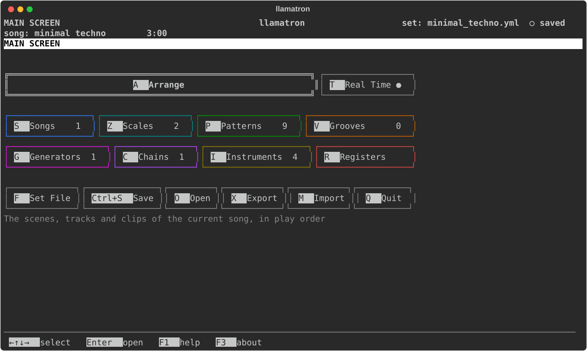

# Llamatron

Llamatron is the sixth iteration of Michael DeHaan's project to enable faster complex compositions 
and random music through science.

Llamatron is at a surface level a "tracker", though it has many advanced features not found in ordinary trackers.
It is heavily inspired by legendary platforms like Ableton Live, the Elektron Monomachine, and the Sequentix Cirklon.

Understanding of what llamatron is is best understood by browsing the examples on the website and watching
the included videos on youtube to hear what the demos produce. It does not cleanly fit into normal music categories. 
For serious use, often it will be used to make a composition that will later be finished in Ableton Live, though Live
is not required to use llamatron in any way.

Llamatron can import midi, export MIDI in multiple variations, and also export Ableton Live sets that are a result
of rending its music-theory oriented object structures.

Llamatron can also play realtime MIDI with live realtime editing
of the song to either MIDI devices (including hardware synthesizers) or FluidSynth.
So yes, you CAN perform live with llamatron, at least theoretically.

Llamatron can also automatically record visualized demos of any song with any synthesizer setup or FluidSynth
with relatively minimal setup configuration, so llamatron songs can be engaging in Youtube, which may be more
engaging than SoundCloud for modern audiences.

## More Info

**The user guide: [mpdehaan.github.io/llamatron](https://mpdehaan.github.io/llamatron/)**

See the web page for all information about using llamatron.

Watch the visualizers play a song on YouTube:

## License

llamatron is licensed under the GNU General Public License, version 3 or any later version. See [LICENSE](LICENSE) for details.

## Development / Contribution / Roadmap / Ideas / Conversation

Against my better judgement Claude is involved in nearly everything in this current version and it's been doing a fantastic job.  Most of these ideas, however, go back quite a long time.

Have ideas for llamatron, I enjoy conversation!

At the same time, this is a personal project and it's going to be opinionated at times. I am not interested in collaborative development, code preferences, tech preferences, or criticism, but if you have ideas or want to share anything I'm always interested in conversation. For feature ideas, maybe I can ask Claude to implement them in a way that others can share. Please do not use GitHub for conversation, bugs, or requests. If you have a cool idea we can see what makes sense, but I also do want to keep things relatively focused.

There are some other ideas in the pipe around generation and arps and so on and this will continue to evolve.

## Author

Michael DeHaan <michael @ michaeldehaan.net> 
home.laserllama.net
laserllama.substack.com

