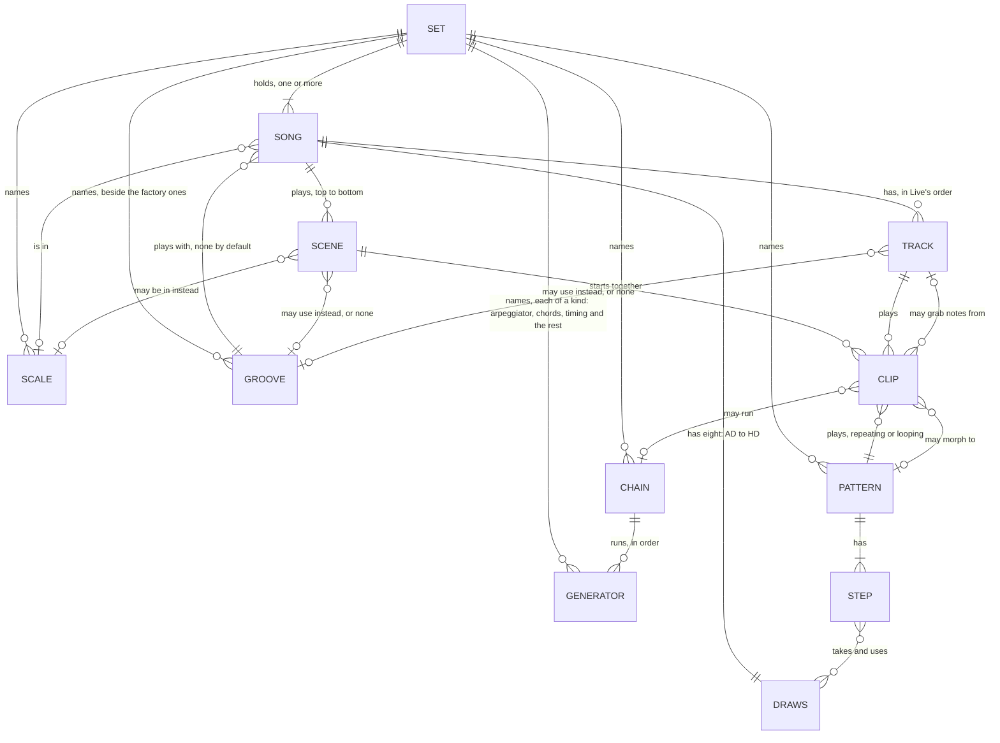
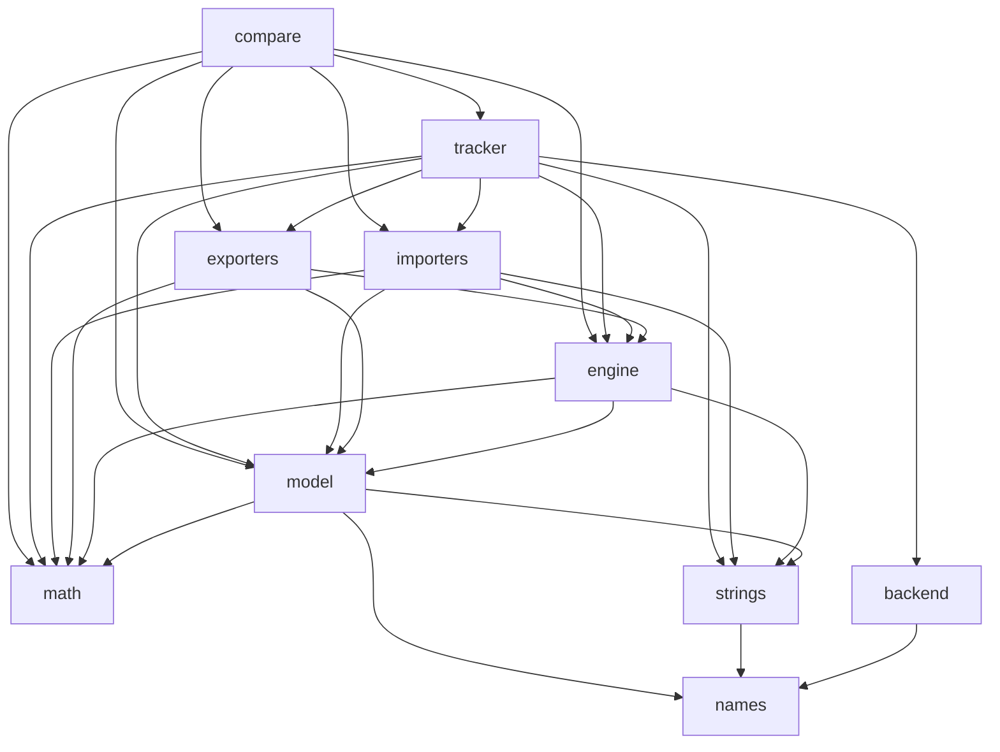

# Architecture

This is a tour of llamatron's code for people who want to understand how it
works without editing it: what the parts are, how a song travels through them,
and the rules the code keeps. The [guide](../docs/GUIDE.md) says how to use the
program, and `CLAUDE.md` holds the rules whoever edits the code follows, with
the detailed notes beside it in `.claude/`.

The source code is on GitHub, at
[github.com/mpdehaan/llamatron](https://github.com/mpdehaan/llamatron), where
every file this page names can be read. llamatron is written in Rust, and all
of it is under `src/`, one Cargo workspace.

## Overview

A set is a text file holding songs, like the songs of one concert. It names
patterns of notes, scales, generators, chains and grooves, which every song in
it shares, and each song names tracks to play patterns on, scenes that put
patterns on tracks, and settings like the tempo and scale. The tracker, the
text UI, edits that file. Exporting reads the file into objects, plays one
song's patterns out into finished clips of notes, arranges the clips in a grid
of scenes by tracks, and writes the grid out as an Ableton Live set, as MIDI
files or as a WAV file. Playing in real time sends the same notes to a
synthesizer or a DAW as the song plays, or to llamatron's own built-in synths
and FluidSynth, which make the sound inside llamatron.

## Conceptual Structure

What a set holds and how its parts refer to one another, as a person composing
thinks of them. This isn't the code's class layout or the file format exactly,
though both follow it closely. A set is one file. Everything above the songs
is shared by every song in the set, and everything inside a song is its own. A
clip is where a scene meets a track: the one pattern that track plays while
that scene plays, with the settings for that playing.

Reading it: a song picks a scale, and a scene can pick another, so a clip's
degrees become notes in its scene's scale or else the song's. A pattern
belongs to no song, so the same riff can play in every song of the set, on any
track, through any chain. A chain is a list of generators, each named once in
the set and usable in any chain. Draws are eight short lists of numbers a
song's steps take from as it plays, shared by every track. The time signature
and the step size are set on the song and can be overridden on a pattern, and
the tempo on a scene. A groove is a row of timing amounts that moves notes off
the grid when a song is played: the song chooses one, and a scene or a track
can choose another or switch grooving off, the track's choice winning over the
scene's.

## Subsystems

llamatron is built like a car: a few large subsystems, each made of
parts, rather than layers that run all the way across. Each subsystem is a
crate, a Rust library of its own under `src/`, and a crate can use only the
crates its manifest names, so the compiler itself keeps a lower part from
reaching into a higher one. The arrows below say which crate uses which.

<!-- generated by internal_tools/make_diagrams.py: crates -->

| Crate | Folder | What it holds | Modules |
| --- | --- | --- | --- |
| math | `src/math/` | llamatron's exact arithmetic and random sources, the bottom layer every other crate stands on: rationals for lengths and times, mixed numbers, and the random numbers the generators draw. | `number`, `python_random`, `rational` |
| names | `src/names/` | Every name llamatron uses as a value, each defined once: the set file's keys and values (`file_format`). | `file_format`, `fluid_calls`, `spec`, `wire` |
| backend | `src/backend/` | llamatron's backend: the built-in synths, FluidSynth, the MIDI sender and the sound card, which llamatron runs on threads of its own, and which the llamatron-backend program runs for any other front end. | `audio`, `daemon`, `drums`, `dsp`, `effects`, `engine`, `envelopes`, `filters`, `fluid`, `instrument`, `modulation`, `oscillators`, `protocol`, `registry`, `sender` |
| strings | `src/strings/` | Every text llamatron shows or raises, in `texts/`, a module for each way a text is used, and `fill`, which fills a text's blanks by name. | `fill`, `plugin_texts`, `texts` |
| model | `src/model/` | llamatron's model: the set as stored, its values, its objects, its schema and its file, the layer the engine renders and the tracker edits. | `file`, `fundamentals`, `objects`, `schema`, `values` |
| engine | `src/engine/` | llamatron's engine: the realizer that plays a song into clips, its generators, and the timing that turns a clip's positions into notes with exact times. | `chord_source`, `clip`, `clip_player`, `drift`, `error`, `generators`, `grab_source`, `groove`, `keyswitch`, `morph`, `order`, `pattern_player`, `positions`, `realizer`, `registers`, `shapes`, `sound`, `statements`, `tables`, `timing`, `tune_source` |
| exporters | `src/exporters/` | llamatron's exporters: a rendered song written as MIDI files, a file per clip, the whole song, a file per track and a General MIDI file, and as an Ableton Live set. | `live`, `midi`, `xml` |
| importers | `src/importers/` | llamatron's importers: a MIDI file made into a song of a set, with the patterns, scales and instruments it needs. | `chord_naming`, `cutting`, `import`, `keys`, `reading`, `steps`, `voices`, `writing` |
| tracker | `src/tracker/` | llamatron's tracker: the text UI's pages, dialogs and keys, the document it edits with undo, and real-time playback. | `app`, `chord_text`, `chord_tones`, `components`, `document`, `drawing`, `everywhere`, `exporting`, `forms`, `generated`, `heard_chords`, `history`, `instrument_sound`, `keys`, `keyswitches`, `launch`, `lengths`, `msgpack`, `named_edits`, `new_set`, `page`, `patterns`, `preferences`, `realtime`, `scene_notes`, `screens`, `settings`, `silent_instruments`, `sound_spec`, `style`, `svg`, `terminal`, `text`, `themes`, `tour`, `track_instrument`, `uses`, `version`, `visualizers`, `voice_leading`, `wav` |
| compare | `src/compare/` | llamatron-compare: what llamatron makes of a set, printed for internal_tools/compare_llamatron.py to hold against the retired Python program's answers, and the walks, screenshots and key map built on llamatron's own pages. |  |
<!-- end of the generated diagram -->

### The Set

The model crate is the model of what a set file holds, and the only part that
knows the file format. Everything else works with its objects. Its values are
the musical words the rest of the program speaks: a note, a chord, a scale, a
time signature, each of which can't be changed once made
(`src/model/src/values/`). Its objects are what the file stores: the set
(`src/model/src/objects/setlist.rs`), each song with its tracks, scenes and
clips (`src/model/src/objects/song.rs`), the patterns
(`src/model/src/objects/pattern.rs`), and the named scales, generators,
chains, grooves and instruments. The set owns the shared sections and the
songs, and a song owns its tracks, scenes and draws, so a rename in either
updates every reference, wherever it is.

Its schema describes once what a set file may hold: each setting's name, range
and default, and each row of a pattern, in one description that both reading a
file and every change ask (`src/model/src/schema/checking.rs`). Its file part
reads and writes the YAML (`src/model/src/file/`), and moves a file saved by
an older version to the layout written now through the migrations
(`src/model/src/file/migrations.rs`), so the rest of llamatron knows only one
layout.

### The Engine

The engine crate makes a song into music. The Realizer
(`src/engine/src/realizer.rs`) walks each scene and plays each clip's pattern
as many times as it repeats, applying everything that changes the notes on the
way: the scale, the track's transpose, probability, ratchets, ties, glide,
play directions, grabs from other tracks, draws and morphs. One clip is played
by `src/engine/src/clip_player.rs` and one pass through a pattern by
`src/engine/src/pattern_player.rs`, so that's the place to read what a tie or
a ratchet does.

The generators change a clip's notes after the Realizer has played them, so an
arpeggiator doesn't care whether its chords came from degrees, grabs or draws.
Each kind is a module of its own in `src/engine/src/generators/`, and a clip's
chain runs its generators in order. The finished clips are held in a grid with
a row for every scene and a column for every track (`src/engine/src/clip.rs`).
Timing turns each clip into timed notes, each sounded once, with its groove,
strum and keyswitches (`src/engine/src/timing.rs`). Both the exporters and
real-time playback take their notes from there, so a song plays the same in a
file and live.

### Files In and Out

The exporters write a played song's grid: a Live set with the clips in Session
View and the scenes laid out in Arrangement View
(`src/exporters/src/live.rs`), and one MIDI file, a file per track, a file per
clip for other DAWs, or a General MIDI file (`src/exporters/src/midi.rs`).
They know nothing of patterns or scenes as the file has them, only the grid,
which is why every kind lays the scenes out the same way. The time signature
travels the whole way without changing a note: the grid carries it, and the
writers put it in each file, so that a DAW draws its bars where the song's
beats are. The WAV export plays the song through the built-in synths and
FluidSynth (`src/tracker/src/wav.rs`).

The importers go the other way: the MIDI import
(`src/importers/src/import.rs`) reads a MIDI file, finds its keys and chords,
cuts it into patterns and writes a song of tracks, patterns and scenes.

### Real Time

Real time plays a song as it happens. The tracker's transport
(`src/tracker/src/realtime/transport.rs`) is its one door: it works out where
each track plays, renders the song into a score
(`src/tracker/src/realtime/score.rs`), and hands it to the player
(`src/tracker/src/realtime/player.rs`), which launches scenes and clips as
each clip's Follow action and each scene's Launch together say, so that a song
plays from the top as the export plays. An edit made while a song plays is
rendered again with the same seed once the keys settle, and taken from the
moment the song's live response says. The pattern preview, which plays Listen,
has a transport of its own (`src/tracker/src/realtime/preview.rs`), so that it
plays beside the song.

The backend sends each event at its moment (`src/backend/`, described in
[Backend](../docs/BACKEND.md)), on threads of its own inside llamatron, so that
drawing a page never makes a note late. On macOS it hands each event to
CoreMIDI, the system's MIDI service, a little ahead and stamped with its
moment, so that it is sent on time however busy the computer is; on other
systems it sends each event as its moment comes. The same backend plays the
built-in synths and FluidSynth, so that they and MIDI share one clock. Every
thread ends when the tracker does, and every sounding note is let go.

### The Song Wizard

The song wizard writes a whole song from a genre, a band and a form. It is
being brought to llamatron's Rust, and its pages in the guide describe it as
it was.

### The Interface

The tracker crate is what a person sees and uses. The app
(`src/tracker/src/app.rs`) holds the pages open, one over another, and the
document they edit. A page (`src/tracker/src/page.rs`) draws itself as lines
of styled text, a header, its body, the status line and the legend of its
keys, and says what each of its keys does. The pages are in folders by what
they edit (`src/tracker/src/screens/`): the set's own pages, Arrange and its
clip, scene and track pages, the pattern editor, and the generators. A page of
settings says only its form, the fields, tabs and buttons it shows, and what
each edit stores; the settings page (`src/tracker/src/screens/field_page.rs`)
draws it and moves its cursor, so every settings page behaves alike.

The tracker holds the set in a document (`src/tracker/src/document.rs`), which
knows the file the set came from, which song is current and whether the set
has unsaved changes. Each page reads the set through it and changes it only
through it. Undo and redo keep the set as each key left it
(`src/tracker/src/history.rs`). Every key binding is written in one table, a
class for each page, dialog and component
(`src/tracker/src/generated/keybindings.rs`), so that a key is changed in one
place.

### Foundations

The math crate holds exact arithmetic for lengths and times
(`src/math/src/rational.rs`) and where random numbers come from. The strings
crate holds every word the program shows (`src/strings/src/texts/`), so a
wording is read and changed in one place.

## Song Data Flow

1. **The file is read.** The Set turns the YAML into objects, each checking
   its own values as it loads, so a bad file is refused with a message that
   says where the problem is, down to the song.
2. **The song is played.** The Engine's Realizer plays each scene's clips into
   finished clips of notes, chords and rests, each with an exact length, and
   each clip's chain of generators changes them.
3. **The clips are gridded.** The clips go into a grid, a row for every scene
   and a column for every track.
4. **The notes are timed.** Timing turns the grid's clips into timed notes,
   with the groove moving each note's start, so every output swings the same
   way.
5. **The notes go out.** The exporters write them into files, or Real Time
   sends them as the song plays.

## Code Rules

These are the things a reader will notice everywhere, and they're deliberate:

- **Every value is checked where it's set.** An object's setter runs the same
  check that loading a file does, because each setting is described once and
  both ask the description, so a page in the tracker, the command line and a
  file all get the same answer about what's allowed, and the message is the
  same wherever it's shown. A pattern's rows work the same way: each row is
  described once, and a file, a key press and the range the pattern editor
  steps through all come from that description. A file's value that is only
  out of range is the one thing put right rather than refused, and only after
  asking: the description knows the nearest value allowed, the tracker lists
  what would change in a dialog before it opens the set, and the command line
  refuses such a file. The file itself is never changed by opening it.
- **Objects talk through methods.** A class reads another's data with a getter
  and changes it with a setter that checks the value. No class reaches into
  another's fields, and the classes that hold musical values, like `Note`,
  `Chord` and `Scale`, can't be changed at all after they're made.
- **Every word the program shows is a constant.** Error messages are in one
  file and the tracker's words in others, so wording can be read and edited in one place and a typo in a file key
  can't happen. The same goes for numbers with a meaning, like the limits of a
  range.
- **Time is exact.** Lengths and positions are fractions, never decimals, so a
  triplet is exactly a third and the files that come out are the same every
  time.
- **Binding is as late as possible.** A degree stays a degree until the clip
  that plays it knows its scale, so changing a scene's scale changes every
  clip in it.
- **Every setting has a default.** A file that leaves a setting out, including
  one from an older version, still loads, so a new setting needs no migration.
- **Names can change.** Everything that refers to something else by name is
  updated when it's renamed, and a test checks every kind of rename.
- **Randomness is random.** Every play and every export is a new take. The
  tests and tools repeat a take by giving the Realizer a seed of their own,
  which no person or command-line option reaches.
- **Undo is a snapshot.** After every edit the tracker keeps the set's data as
  it was, and an undo reads the set from that through the same code that loads
  a file, so undo can never disagree with loading. The history lives in memory
  only and is never written to a file.

## Code Changes

Adding a setting to a song touches the same places every time: the file
format's names, its default, its description, which holds its check, the
player or writer that uses it, the page that edits it, the guide, and a test.
Each of those is a short, local change, which is what the rules above are for.

The checks run the real program. llamatron was held, step by step, to the
program it replaced: every example and test set loaded, saved, edited,
rendered, played and exported, and every page the key tour reaches drawn and
compared, through `internal_tools/compare_llamatron.py`. Its own tests sit
beside the code they test, in each crate.
