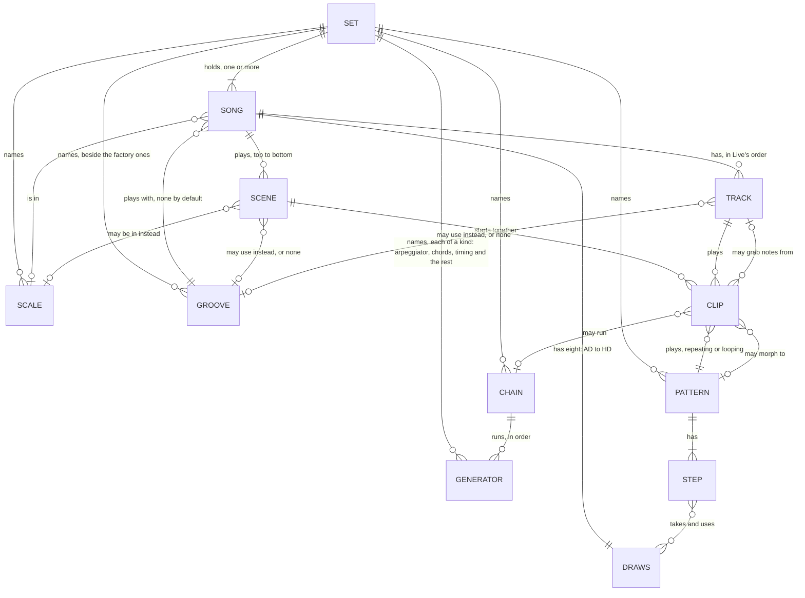
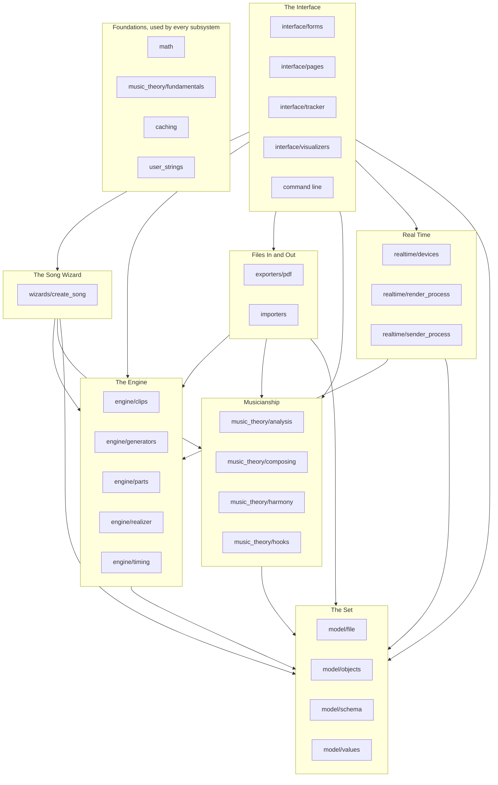

# Architecture

This is a tour of llamatron's code for people who want to understand how it
works without editing it: what the parts are, how a song travels through them,
and the rules the code keeps. The [guide](../GUIDE.md) says how to use the
program, and `CLAUDE.md` holds the rules whoever edits the code follows, with
the detailed notes beside it in `.claude/`.

The source code is on GitHub, at
[github.com/mpdehaan/llamatron](https://github.com/mpdehaan/llamatron), where
every file this page names can be read.

## Overview

A set is a text file holding songs, like the songs of one concert. It names
patterns of notes, scales, generators, chains and grooves, which every song in
it shares, and each song names tracks to play patterns on, scenes that put
patterns on tracks, and settings like the tempo and scale. The tracker, the
text UI, edits that file. Exporting reads the file into objects, plays one
song's patterns out into finished clips of notes, arranges the clips in a grid
of scenes by tracks, and writes the grid out as an Ableton Live set or as MIDI
files. Playing in real time sends the same notes to a synthesizer or a DAW as
the song plays. llamatron makes no sound of its own: the DAW or FluidSynth
does that.

## Conceptual Structure

What a set holds and how its parts refer to one another, as a person composing
thinks of them. This isn't the code's class layout or the file format exactly,
though both follow it closely. A set is one file. Everything above the songs
is shared by every song in the set, and everything inside a song is its own. A
clip is where a scene meets a track: the one pattern that track plays while
that scene plays, with the settings for that playing.

Reading it: a song picks a scale, and a scene can pick another, so a clip's
degrees become notes in its scene's scale or else the song's. A pattern
belongs to no song, so the same riff can play in every song of the set, on any
track, through any chain. A chain is a list of generators, each named once in
the set and usable in any chain. Draws are eight short lists of numbers a
song's steps take from as it plays, shared by every track. The time signature
and the step size are set on the song and can be overridden on a pattern, and
the tempo on a scene. A groove is a row of timing amounts that moves notes off
the grid when a song is played: the song chooses one, and a scene or a track
can choose another or switch grooving off, the track's choice winning over the
scene's.

## Subsystems

llamatron is built like a car: a few large subsystems, each made of parts,
each part made of smaller pieces, rather than layers that run all the way
across. The Set is what a set file holds. The Engine makes a song into music.
Musicianship is what the program understands about music. Files In and Out
writes a played song for a DAW and reads one back from MIDI. Real Time plays a
song as it happens. The Song Wizard writes a whole song from a few choices.
The Interface is what a person sees and uses. Under all of them sit the
foundations: exact numbers, the facts of pitch and interval, remembering what
was worked out, and every word the program shows.

Each box below is a subsystem, holding its parts, and an arrow means that a
part of one uses a part of the other. Every subsystem uses the foundations, so
their arrows are left out. A part is used from outside its subsystem only
through a few front doors, which a test holds, so a subsystem can change
inside without the rest noticing. The picture and the table are generated from
the code by `internal_tools/make_diagrams.py`, each part's description the
first sentence the part says of itself, so they can't go out of date without a
test noticing.

<!-- generated by internal_tools/make_diagrams.py: subsystems -->

| Subsystem | Part | What it holds |
| --- | --- | --- |
| The Set | `model/file` | File: reading and writing the set file, the corrections offered for a value out of range, the migrations that move an older layout to today's, the checks values share, the errors a file and a value raise, safe YAML, file names, the examples' folders and the version every saved file records. |
| The Set | `model/objects` | Objects: what a set file stores: the set, its songs, their tracks, scenes and clips, and the shared patterns, scales, generators, chains and grooves. |
| The Set | `model/schema` | Schema: what a set file may hold: every name the file uses and its fixed lists of words, the range each value must fall in, the value a setting takes when the file leaves it out, and one description of each setting and of each row of a pattern, which holds the one check that reading a file and a setter share. |
| The Set | `model/values` | Values: the musical values every part of llamatron works with: notes, chords, scales, time signatures, held notes, MIDI numbers, the sounds a clip plays as plain data, and what a chord and a progression are in a scale. |
| Musicianship | `music_theory/analysis` | Analysis: what music is, found from its notes alone: its keys, its chords and the part each of its parts plays, for the MIDI import and the genre library's listening tools alike, which hand it notes, anything with a start, an end and a pitch, and never a rendered song. |
| Musicianship | `music_theory/composing` | Composing: how a part is written down and made to play like a musician, which the song wizard asks for every part it writes. |
| Musicianship | `music_theory/harmony` | Harmony: how notes sit against the chords under them. |
| Musicianship | `music_theory/hooks` | Hooks: the short figures a song is known by. |
| The Engine | `engine/clips` | Clips: the finished clips a song is realized into, and the grid that maps them to tracks and scenes. |
| The Engine | `engine/generators` | The generators that change a clip's notes as it exports, each a plugin in a folder of its own, and blending for morphs. |
| The Engine | `engine/parts` | Parts: pieces of music-making that the generator plugins and the clips' and tracks' own settings share, such as a note moved along a scale, so that no plugin's code is reached into from outside it. |
| The Engine | `engine/realizer` | The Realizer: playing a song's composition objects into finished clips, which the exporters and real-time playback then read. |
| The Engine | `engine/timing` | Timing: finished clips turned into timed notes, in ticks: each note sounded once with its groove, strum, nudges and keyswitches (clip_ticks.py, sounding.py, timing.py and the plans beside them), the one place the exporters and real-time playback both take their notes from. |
| Files In and Out | `exporters/pdf` | The PDF export: a song printed as sheet music and as the pages of a learning packet, from its melody and its chords. |
| Files In and Out | `importers` | The importers: a file from outside llamatron made into what a set holds, so far a MIDI file made into a song. |
| Real Time | `realtime/devices` | The devices real-time playback sends to: the MIDI output ports found, watched while FluidSynth's port is awaited, and FluidSynth itself, started, waited for and ended. |
| Real Time | `realtime/render_process` | The render process's part of real-time playback: the score a song is realized into, built ahead and changed as the set changes, and the player that launches scenes and clips and hands each clip's events to the sender. |
| Real Time | `realtime/sender_process` | The sender process's part of real-time playback: the engines that send each event at its moment, the outputs they send through, timestamped by CoreMIDI or sent at once by python-rtmidi, and the process that holds them apart from the tracker. |
| The Song Wizard | `wizards/create_song` | The song wizard: a set made from structured data that says what to play. |
| The Interface | `interface/forms` | The forms: what a page shows, as a tree of plain nodes, apart from how the tracker draws it and from Textual. |
| The Interface | `interface/pages` | The pages as presenters: what each page shows and does, as a form of the forms' nodes (interface/forms/), built from the set as it is now, with nothing of how it looks or of Textual. |
| The Interface | `interface/tracker` | The tracker: the text UI that people compose in, which holds a set of songs and edits it a page at a time. |
| The Interface | `interface/visualizers` | The visualizers: what Arrange's clip area can show in place of the clips while a song plays in real time. |
| The Interface | `command line` | llamatron composes music in MIDI for DAWs, from a text UI. |
| Foundations, used by every subsystem | `math` | Math: exact arithmetic for lengths and times, Rationals and the pairs a realization uses, and where random numbers come from. |
| Foundations, used by every subsystem | `music_theory/fundamentals` | The fundamentals: the musical facts everything else is built on, which need nothing of llamatron's objects. |
| Foundations, used by every subsystem | `caching` | Caching: revisions, how anything that changes says so, and the answers kept until something they came from changes, which every cache of the program is built on. |
| Foundations, used by every subsystem | `user_strings` | User strings: every piece of text llamatron shows people, one module for each way the text is used. |
<!-- end of the generated diagram -->

### The Set

The Set is the model of what a set file holds, and the only subsystem that
knows the file format. Everything else works with its objects. Its values are
the musical words the rest of the program speaks: a `Note`, a `Chord`, a
`Scale`, a time signature, each of which can't be changed once made. Its
objects are what the file stores: `Setlist` for the set
(`src/llamatron/model/objects/setlist.py`), `Song`, `Track`, `Scene`,
`ClipSlot` (one track's part in one scene), `Pattern`, `NamedScale`, `Chain`,
`Groove`, and each generator's settings. The set owns the shared sections and
the songs, and a song owns its tracks, scenes and draws, so a rename in either
updates every reference, wherever it is.

Its schema describes once what a set file may hold: each setting's name,
range and default, and each row of a pattern, in one description that both
reading a file and every setter ask
(`src/llamatron/model/schema/setting.py`). Its file part reads and writes the
YAML, offers to correct a value out of range, and moves a file saved by an
older version to the layout written now through the migrations
(`src/llamatron/model/file/migrations/`), so the rest of llamatron knows only
one layout.

### The Engine

The Engine makes a song into music, in four parts. The Realizer walks each
scene and plays each clip slot's pattern as many times as it repeats,
applying everything that changes the notes on the way: the scale, the track's
transpose, probability, ratchets, ties, glide, play directions, grabs from
other tracks, draws and morphs. `SongRealizer`
(`src/llamatron/engine/realizer/song_realizer.py`) plays a song,
`ClipSlotPlayer` one clip and `PatternPlayer` one pass through a pattern, so
that's the place to read what a tie or a ratchet does. While a song plays,
each note is plain data, a tuple, since a song has thousands; the `Note`,
`Chord` and `Rest` classes say the same thing wherever a clip is built or read
by hand.

The generators change a clip's notes after the Realizer has played them, so
an arpeggiator doesn't care whether its chords came from degrees, grabs or
draws. Each kind is a plugin in a folder of its own under
`src/llamatron/engine/generators/`, holding its settings, its editor's
description and its logic, and every plugin is found by itself, with no list
to add it to (`src/llamatron/model/schema/generator_plugins.py`). A clip's
chain runs its generators in order. The parts beside them are the pieces of
music-making the plugins and the clips' own settings share, so that no plugin
reaches into another.

The finished clips are held in a `ClipGrid`
(`src/llamatron/engine/clips/clip_grid.py`), with a row for every scene and a
column for every track, which knows how long each row lasts and where each
starts when they are laid end to end. Timing turns the grid's clips into
timed notes, in ticks: each note sounded once, with its groove, its strum and
its keyswitches (`src/llamatron/engine/timing/clip_ticks.py`). Both the
exporters and real-time playback take their notes from there, so a song plays
the same in a file and live.

### Musicianship

Musicianship is what llamatron understands about music, apart from how it
stores, plays or shows it: how a tune is written down and made to play like a
musician, how notes sit against the chords under them, and how a song's hook
is made. It reads and writes the Set's objects, so it sits above the Set. The
facts everything else is built on, the pitches, intervals, scale and chord
shapes and voice leading, need nothing of llamatron's objects, so they sit
with the foundations, where the Set itself can use them.

### Files In and Out

The exporters write a played song's grid: a Live set with the clips in
Session View and the scenes laid out in Arrangement View, one MIDI file, a
file per track, a file per clip for other DAWs, a General MIDI file, or a WAV
file played through FluidSynth. They know nothing about patterns or scenes as
the file has them, only the grid, which is why every kind lays the scenes out
the same way. Each kind is one class built on `Exporter`
(`src/llamatron/exporters/exporter.py`), which holds where the files go and
what they're named, so a new kind, for another DAW, is one more class in the
list in `src/llamatron/exporters/exports.py`. Each song of a set exports on
its own, to files beside the set named after the set and then the song, like
`foo_bar.als`. The time signature travels the whole way without changing a
note: the grid carries it, and the writers put it in each file as metadata,
so that a DAW draws its bars where the song's beats are.

The importers go the other way: the MIDI import
(`src/llamatron/importers/midi_import.py`) reads a MIDI file into a song of
tracks, patterns and scenes.

### Real Time

Real time plays a song as it happens, in two processes of its own, apart from
the tracker, so that drawing a page never makes a note late. The render
process (`src/llamatron/realtime/render_process/playback_process.py`) renders
the song into a score (`src/llamatron/realtime/render_process/score.py`),
each clip's events counted from its scene's start, built ahead and changed as
the set changes, and its player
(`src/llamatron/realtime/render_process/player.py`) launches scenes and clips
as each clip's Follow action and each scene's Launch together say, so that a
song plays from the top as the export plays. The Realtime Sender Process
(`src/llamatron/realtime/sender_process/process.py`) sends each event at its
moment. On macOS it hands each event to CoreMIDI, the system's MIDI service, a
tenth of a second ahead and stamped with its moment, so that it is sent on
time however busy the computer is
(`src/llamatron/realtime/sender_process/coremidi.py`); on other systems it
sends each event as its moment comes. The devices are the MIDI ports found
(`src/llamatron/realtime/devices/ports.py`) and FluidSynth, which the tracker
starts when something plays through it
(`src/llamatron/realtime/devices/fluidsynth.py`). Both processes end when the
tracker does, however it ends, and every sounding note is let go.

### The Song Wizard

The song wizard writes a whole song from a genre, a band and a form. Its
choices (`src/llamatron/wizards/create_song/wizard_choices.py`) hold what a
person picked and what follows from it, and its composer
(`src/llamatron/wizards/create_song/composer.py`) turns them into a set's
data: tracks, patterns written by the genre's players, scenes for each
section, and the chains that make them play like a band. Nothing goes into
the set until Apply, which adds the song with everything it uses as one
change, so that one undo takes it away again.

### The Interface

The Interface is what a person sees and uses: the tracker, the visualizers and
the command line. The tracker is built in three parts, so that what a page
shows is apart from how it is drawn:

- **The pages** (`src/llamatron/interface/pages/`) are presenters. Each says
  what its page shows and does, as a form of plain nodes built from the set
  as it is now, with nothing of how it looks. A page's place, such as one
  clip of one song, is a plain value
  (`src/llamatron/interface/pages/places.py`), and the site map opens the page
  for any place
  (`src/llamatron/interface/tracker/site_map.py`).
- **The forms** (`src/llamatron/interface/forms/`) are the kinds of node a
  page or a dialog is made of: fields of each kind, buttons, sections, tab
  boxes, a dialog's paragraphs and answers, a picker's list
  (`src/llamatron/interface/forms/nodes.py`,
  `src/llamatron/interface/forms/dialogs.py`). Each kind's rules are written
  and tested once.
- **The renderers** (`src/llamatron/interface/tracker/renderers/`) are the
  only code that knows how a node looks. They draw with bold, dim, reverse
  video and box characters alone, so the tracker works on any terminal
  background.

The tracker's screens (`src/llamatron/interface/tracker/screens/`) are thin:
each keeps its cursor and its keys and hands the rest to its presenter and the
renderers. It is built on Textual, which is kept to the app, the screens and
the dialogs, so the same pages could be drawn by something else. The things
drawn as grids, the pattern editor's rows and piano roll, Arrange and the
step editors, are a family of their own: each keeps its own cursor and keys,
and says what it shows as grid nodes
(`src/llamatron/interface/forms/pattern_grid.py`,
`src/llamatron/interface/forms/arrange.py`,
`src/llamatron/interface/forms/step_grid.py`), which their renderers draw.
A page shows its lines in one view
(`src/llamatron/interface/tracker/screens/shared/page_view.py`), which keeps
each line it showed and sends the terminal only the lines that changed, since
a page draws itself after every key and ten times a second while a song plays.

The tracker holds one `Setlist` in a `Document`
(`src/llamatron/interface/tracker/document.py`), which knows the file the set
came from, which song is current and whether the set has unsaved changes.
Each page reads the set through its methods and changes it only through the
document, which asks the objects to check each change. The document's methods
are grouped by subject in
`src/llamatron/interface/tracker/document_parts/`: its file and exports, its
undo history, its edits to anything with a name, and its edits to the set,
the current song and the patterns. Every key binding is defined in one
module, `src/llamatron/interface/tracker/keybindings.py`, with a class for
each page, dialog and component, so that a key is changed in one place; each
page ties its bindings to what they do, and a key that steps something one
way or the other is handed its direction rather than its name
(`src/llamatron/interface/tracker/key_table.py`). Playing in real time goes
through the tracker's transport
(`src/llamatron/interface/tracker/transport.py`), the one door to Real Time,
which hands the set's changes and each launch to the render process and tells
the pages what plays, for their lights.

The command line (`src/llamatron/cli.py`) opens the tracker, or exports a set
without it, through the same Engine and exporters.

### Foundations

The foundations are used by every subsystem. Math holds exact arithmetic for
lengths and times (`src/llamatron/math/rational.py`) and where random numbers
come from. The musical fundamentals hold pitches and intervals. Caching holds
revisions, a number every object of a set carries that moves whenever the
object changes (`src/llamatron/caching/revised.py`), and the memory that keeps
an answer until something it came from changes
(`src/llamatron/caching/memory.py`). The user strings hold every word the
program shows.

## Song Data Flow

1. **The file is read.** The Set turns the YAML into objects, each checking
   its own values as it loads, so a bad file is refused with a message that
   says where the problem is, down to the song.
2. **The song is played.** The Engine's Realizer plays each scene's clips into
   finished clips of notes, chords and rests, each with an exact length, and
   each clip's chain of generators changes them.
3. **The clips are gridded.** The clips go into a `ClipGrid`, a row for every
   scene and a column for every track.
4. **The notes are timed.** Timing turns the grid's clips into timed notes,
   with the groove moving each note's start, so every output swings the same
   way.
5. **The notes go out.** The exporters write them into files, or Real Time
   sends them as the song plays.

## Code Rules

These are the things a reader will notice everywhere, and they're deliberate:

- **Every value is checked where it's set.** An object's setter runs the same
  check that loading a file does, because each setting is described once and
  both ask the description, so a page in the tracker, the command line and a
  file all get the same answer about what's allowed, and the message is the
  same wherever it's shown. A pattern's rows work the same way: each row is
  described once, and a file, a key press and the range the pattern editor
  steps through all come from that description. A file's value that is only
  out of range is the one thing put right rather than refused, and only after
  asking: the description knows the nearest value allowed, the tracker lists
  what would change in a dialog before it opens the set, and the command line
  wants `--force`. The file itself is never changed by opening it.
- **Objects talk through methods.** A class reads another's data with a getter
  and changes it with a setter that checks the value. No class reaches into
  another's fields, and the classes that hold musical values, like `Note`,
  `Chord` and `Scale`, can't be changed at all after they're made.
- **Every word the program shows is a constant.** Error messages are in one
  file, the tracker's words in another, and each page's help text in a third,
  so wording can be read and edited in one place and a typo in a file key
  can't happen. The same goes for numbers with a meaning, like the limits of a
  range.
- **Time is exact.** Lengths and positions are fractions, never decimals, so a
  triplet is exactly a third and the files that come out are the same every
  time.
- **Binding is as late as possible.** A degree stays a degree until the clip
  that plays it knows its scale, so changing a scene's scale changes every
  clip in it.
- **Every setting has a default.** A file that leaves a setting out, including
  one from an older version, still loads, so a new setting needs no migration.
- **Names can change.** Everything that refers to something else by name is
  updated when it's renamed, and a test checks every kind of rename.
- **Randomness is random.** Every play and every export is a new take. The
  tests and tools repeat a take by giving the Realizer a seed of their own,
  which no person or command-line option reaches.
- **Nothing is worked out twice.** What the tracker works out from some
  objects is kept in one memory with their revisions and used again until one
  of them has moved, so typing into one pattern leaves what is known about
  everything else alone. While the tests run, every kept answer is worked out
  again after each change and compared, so an answer can't quietly outlive
  what it came from.
- **Undo is a snapshot.** After every edit the tracker keeps the set's data as
  it was, and an undo reads the set from that through the same code that loads
  a file, so undo can never disagree with loading. Each pattern, scale, song
  and so on keeps its own piece of that data until it changes, so a snapshot
  shares every untouched piece with the one before, and an undo reads again
  only the pieces that differ. The history lives in memory only and is never
  written to a file.

## Code Changes

Adding a setting to a song touches the same places every time: the file
format's names, its default, the object that holds it (its description, which
holds its check, its getter and its setter), the player or writer that uses
it, the presenter and the page that edit it, the guide, and a test for each
path. Each of those is a short, local change, which is what the rules above
are for.

The tests run the real program: the text UI tests press real keys on real
pages, the file tests load and save every example, and
`internal_tools/compare_exports.py` proves that a change which shouldn't alter
the music leaves every exported file byte for byte the same.
`internal_tools/compare_screens.sh` does the same for every page and dialog
the tracker draws, when a change shouldn't alter what a person sees.
