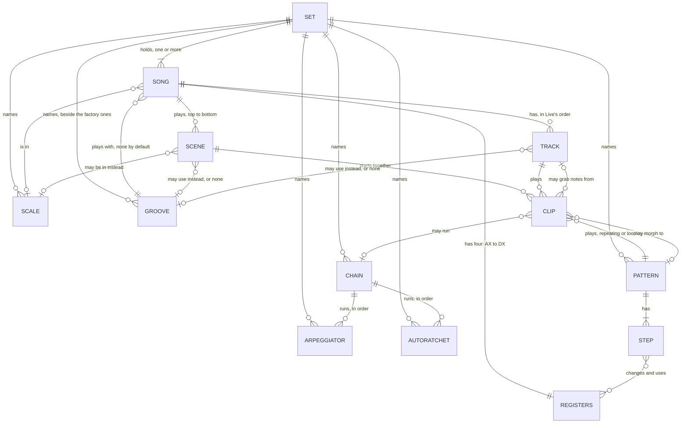
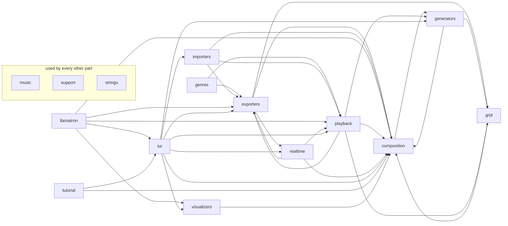

# Architecture

This is a tour of llamatron's code for people who want to understand how it works without
editing it: what the parts are, how a song travels through them, and the rules the code keeps.
The [guide](../GUIDE.md) says how to use the program, and `CLAUDE.md` holds the rules whoever
edits the code follows, with the detailed notes beside it in `.claude/`.

The source code is on GitHub, at [github.com/mpdehaan/llamatron](https://github.com/mpdehaan/llamatron), where every file this page names can be read.

## Overview

A set is a text file holding songs, like the songs of one concert. It names patterns of notes,
scales, generators, chains and grooves, which every song in it shares, and each song names tracks to play
patterns on, scenes that put patterns on tracks, and settings like the tempo and scale. The
tracker, the text UI, edits that file. Exporting reads the file into objects, plays one song's
patterns out into finished clips of notes, arranges the clips in a grid of scenes by tracks, and
writes the grid out as an Ableton Live set or as MIDI files. Nothing plays sound: the DAW does
that.

## Conceptual Structure

What a set holds and how its parts refer to one another, as a person composing thinks of them.
This isn't the code's class layout or the file format exactly, though both follow it closely. A
set is one file. Everything above the songs is shared by every song in the set, and everything
inside a song is its own. A clip is where a scene meets a track: the one pattern that track plays
while that scene plays, with the settings for that playing.

Reading it: a song picks a scale, and a scene can pick another, so a clip's degrees become notes
in its scene's scale or else the song's. A pattern belongs to no song, so the same riff can play in
every song of the set, on any track, through any chain. A chain is a list of generators, each
named once in the set and usable in any chain. Registers are four numbers a song's steps change
and use as it plays, shared by every track. The time signature and the step size are set on the
song and can be overridden on a pattern, and the tempo on a scene. A groove is a row of timing
amounts that moves notes off the grid when a song is exported: the song chooses one, and a scene
or a track can choose another or switch grooving off, the track's choice winning over the scene's.

## Song Data Flow

1. **The file is read.** `composition` turns the YAML into objects, one class for each kind of
   thing the file can hold: `Setlist` for the set, `Song`, `Track`, `Scene`, `ClipSlot` (one track's
   part in one scene), `Pattern`, `NamedScale`, `Chain`, `Groove` and the settings of each generator. Every
   object checks its own values as it loads, so a bad file is refused with a message that says
   where the problem is, down to the song. Every object can also turn itself back into file data,
   which is how saving works. A file from before sets held one song, and is read as a set of one.
2. **The song is played.** `playback` walks each scene and plays each clip slot's pattern as many
   times as it repeats, applying everything that changes the notes on the way: the scale, the
   track's transpose, probability, ratchets, ties, glide, play directions, grabs from other
   tracks, registers, morphs and the clip's chain of generators. The result is a `Clip` of
   notes, chords and rests, each with an exact length. While a song plays, each of those is
   plain data, a tuple, since a song has thousands: the `Note`, `Chord` and `Rest` classes say
   the same thing wherever a clip is built or read by hand.
3. **The clips are gridded.** `grid` holds the finished clips in a `ClipGrid`, with a `ClipRow`
   for every scene and a `ClipColumn` for every track. The `ClipGrid` knows how long each row lasts and
   where each one starts when they're laid end to end, which is the arithmetic every writer uses.
4. **The grid is written.** `exporters` turn the grid into files: a Live set with the clips in
   Session View and the scenes laid out in Arrangement View, or one MIDI file, or a file per
   track, or a file per clip for other DAWs. A groove moves each note's start as it's
   written, so every output kind swings the same way. Each song of a set exports on its own, to files
   beside the set named after the set and then the song, like `foo_bar.als`. The time signature travels this whole way without
   changing a note: playback never reads it, the grid carries it, and the writers put it in each
   file as metadata, so that a DAW draws its bars where the song's beats are.

The tracker sits on top of all of this. The tracker holds one `Setlist` in a `Document`, which knows the file the set came from, which song is current and whether the set has unsaved changes. Each page of the
tracker reads the set and the current song through their own methods and changes them only
through the document, which asks the objects to check each change and then re-estimates how long
everything lasts. The document's methods are grouped by subject in the `tui/document_parts`
package: its file and exports, its undo history, its edits to anything with a name, which
take the section the thing is in, and its edits to the set, to the current song and to
patterns. The pattern editor shows a pattern through one of two views, the rows and the
piano roll, each a component with its own cursor, its own keys and its own drawing
(`src/llamatron/tui/components/pattern_rows.py` and `src/llamatron/tui/components/piano_roll.py`).
Every key binding is defined in one module, `src/llamatron/tui/keybindings.py`, which has a class
for each page, dialog and component, named after it, so that a key is changed in one place. Each
page ties its bindings to what they do, and a key that steps something one way or the other is
handed its direction rather than its name (`src/llamatron/tui/key_table.py`). Saving, exporting and quitting work from every page, through one module the
pages share, and exporting from the tracker runs the same playback and writers as the command
line. Playing in real time goes through the tracker's transport (`src/llamatron/tui/transport.py`),
which renders the song into a score (`src/llamatron/realtime/score.py`), each clip's events
counted from its scene's start, and keeps a player (`src/llamatron/realtime/player.py`) that
launches scenes and clips into the Realtime Sender Process, following each clip's Follow action
and each scene's Launch together, so that the song plays from the top as the export plays, and
the pages ask the transport what plays for their lights.

## Parts

Each box is a Python package, a folder of source files, and an arrow means "uses". The two
packages at the bottom are used by everything, so their arrows are left out to keep the picture
readable. This picture and the table are generated from the code by `internal_tools/make_diagrams.py`,
so they can't go out of date without a test noticing.

<!-- generated by internal_tools/make_diagrams.py: packages -->

| Package | What it holds |
| --- | --- |
| `tui` | The tracker: the text UI that people compose in, which holds a set of songs and edits it a page at a time. |
| `llamatron` | llamatron composes music in MIDI for DAWs, from a text UI. This top level holds the command line and the text every part shows. |
| `composition` | The objects a set file stores: the set, its songs, their tracks, scenes and clips, and the shared patterns, scales, generators, chains and grooves. |
| `playback` | Playing a song's composition objects into finished clips, which the exporters then write. |
| `generators` | The generators that change a clip's notes as it exports: arpeggiators, AutoRatchets and blending for morphs. |
| `grid` | The finished clips a song exports into, and the grid that maps them to tracks and scenes. |
| `exporters` | The exporters of a played song: a Live set, one MIDI file, a file per track, a file per clip, a General MIDI file, or a WAV file played through FluidSynth. |
| `genres` | What makes a style of music, as rules in code, the user's design: genres and subgenres as genomes of traits, each subgenre |
| `importers` | The importers: a file from outside llamatron made into what a set holds, so far a MIDI file made into a song. |
| `realtime` | Real-time playback: the timeline of MIDI events a rendered grid becomes, the score of a song with each clip's events from its scene's start, the player that launches scenes and clips as the follow actions say, the engine that sends the events on time, the ports they go out of, the Realtime Sender Process, which runs the engine apart from the tracker, and FluidSynth, which the tracker starts when something plays through it. |
| `tutorial` | The video tutorial: a plan that rebuilds a set from nothing in the running tracker, key by key, and the runner that presses its keys at a human pace, saying a sentence at each part worth one (internal_tools/make_video_tutorial.py). |
| `visualizers` | The visualizers: what Arrange's clip area can show in place of the clips while a song plays in real time, the user's design of 2026-11-10. |
| `music` | The musical values every part of llamatron works with: notes, chords, scales, time signatures, held notes and MIDI numbers. |
| `support` | Plumbing the rest of llamatron stands on: exact fractions, file names, safe YAML loading, random sources and the version. |
| `strings` | Every piece of text llamatron shows people, one module for each way the text is used. |
<!-- end of the generated diagram -->

A few things the picture doesn't say:

- `composition` is the model of what a set file holds, and it's the only part that knows the
  file format. Everything else works with its objects. The set owns the shared sections and the
  songs, and a song owns its tracks, scenes and registers, so a rename in either updates every
  reference, wherever it is.
- `playback` is where the musical rules live. If you want to know what a tie or a ratchet
  does, this is the place, in `PatternPlayer` for one pass through a pattern and `ClipSlotPlayer`
  for one clip.
- `generators` work on finished clips rather than patterns, so an arpeggiator doesn't care
  whether its chords came from degrees, grabs or registers.
- `exporters` know nothing about patterns or scenes as the file has them: they only see the
  grid, which is why every output kind lays the scenes out the same way. Each kind is one class
  built on `Exporter` (`src/llamatron/exporters/exporter.py`), which holds where the files go and
  what they're named, so a new kind, for another DAW, is one more class in the list in
  `src/llamatron/exporters/exports.py`.
- `tui` is the only part that draws anything, and it draws with bold, dim, reverse video and
  box characters alone, so it works on any terminal background. It's built on Textual, which is
  kept to the app, the screens and the dialogs: the document, the undo history and the status
  line know nothing of it, so the same pages could be drawn by something else.

## Code Rules

These are the things a reader will notice everywhere, and they're deliberate:

- **Every value is checked where it's set.** An object's setter runs the same check that
  loading a file does, because each setting is described once and both ask the description, so a
  page in the tracker, the command line and a file all get the same answer about what's allowed,
  and the message is the same wherever it's shown. A pattern's rows work the same way: each row is described once, and a file, a key press
  and the range the pattern editor steps through all come from that description. A file's value
  that is only out of range is
  the one thing put right rather than refused, and only after asking: the description knows the
  nearest value allowed, the tracker lists what would change in a dialog before it opens the
  set, and the command line wants `--force`. The file itself is never changed by opening it.
- **Objects talk through methods.** A class reads another's data with a getter and changes it
  with a setter that checks the value. No class reaches into another's fields, and the classes
  that hold musical values, like `Note`, `Chord` and `Scale`, can't be changed at all after
  they're made.
- **Every word the program shows is a constant.** Error messages are in one file, the tracker's
  words in another, and each page's help text in a third, so wording can be read and edited in
  one place and a typo in a file key can't happen. The same goes for numbers with a meaning,
  like the limits of a range.
- **Time is exact.** Lengths and positions are fractions, never decimals, so a triplet is
  exactly a third and the files that come out are the same every time.
- **Binding is as late as possible.** A degree stays a degree until the clip that plays it
  knows its scale, so changing a scene's scale changes every clip in it.
- **Every setting has a default.** A file that leaves a setting out, including one from an
  older version, still loads, so there's no migration code.
- **Names can change.** Everything that refers to something else by name is updated when it's
  renamed, and a test checks every kind of rename.
- **Randomness is a choice.** With no seed, every export is a new take. With a seed, the same
  take comes out every time, which is what the tests rely on.
- **Nothing is worked out twice.** Everything a set file stores carries a revision, a number
  that moves whenever the object changes. What the tracker works out from some objects is kept
  in one memory with their revisions (`src/llamatron/support/memory.py`) and used again until one
  of them has moved, so typing into one pattern leaves what is known about everything else
  alone. While the tests run, every kept answer is worked out again after each change and
  compared, so an answer can't quietly outlive what it came from.
- **Undo is a snapshot.** After every edit the tracker keeps the set's data as it was, and an
  undo reads the set from that through the same code that loads a file, so undo can never
  disagree with loading. Each pattern, scale, song and so on keeps its own piece of that data
  until it changes, so a snapshot shares every untouched piece with the one before, and an undo
  reads again only the pieces that differ. The history lives in memory only and is never written
  to a file.

## Code Changes

Adding a setting to a song touches the same places every time: the file format's names, its
default, the object that holds it (its description, which holds its check, its getter and its setter), the player or writer
that uses it, the document and the page that edit it, the guide, and a test for each path. Each
of those is a short, local change, which is what the rules above are for.

The tests run the real program: the text UI tests press real keys on real pages, the file tests
load and save every example, and `internal_tools/compare_exports.py` proves that a change which shouldn't
alter the music leaves every exported file byte for byte the same.
