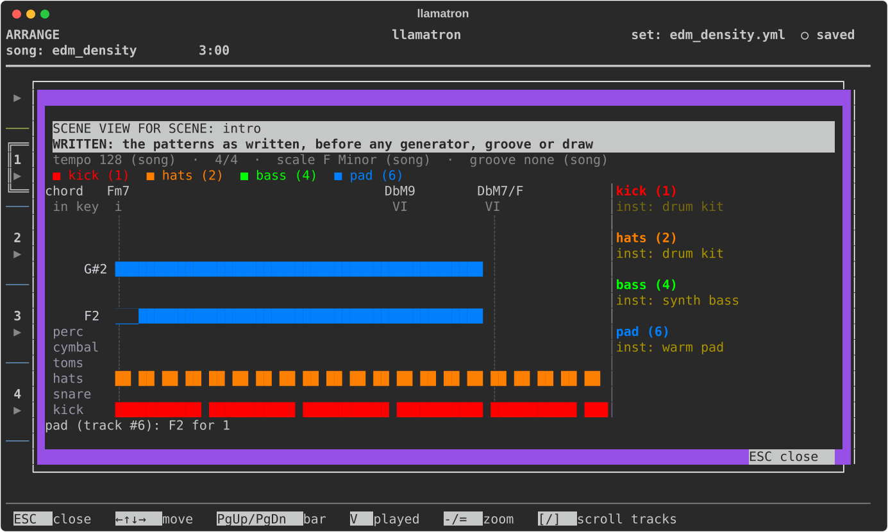

# Arrange

Arrange is where a song is put together: scenes as rows, tracks as columns,
and a clip where a row and a column meet. This page covers the Arrange page
itself. [Tracks](TRACKS.md), [Scenes](SCENES.md) and [Clips](CLIPS.md) cover
the settings of each, and [Playing Live](PLAYING_LIVE.md) covers playing the
song.

## Grid Layout

Press `A` on the main screen to open the current song's arrangement. The track
names run across the top, and the first column holds the scene names, each
with its repeat count and length. Scenes play from top to bottom. A new song
starts with `track-1` and `scene-1`, and new tracks and scenes are numbered
the same way until they are renamed on their own pages.

Light blue lines run between the tracks and under each scene, so that the grid
is easy to follow. A double-lined box inside a cell marks whatever the cursor
is on: a clip, a scene, a track name, or one of the `+` places, including the
`+` after the last track. The arrows move the box around the grid. When there
are more tracks or scenes than fit, the clips scroll while the track names and
the scene column stay in place. An empty cell is blank until the cursor
reaches it, when it shows `+` and `add`.

Under each scene is a bar of its length against the longest scene's, and under
each clip a bar of the clip's length against its scene's. A clip that fills
its scene, or loops, has a full bar, and a clip that ends early has a shorter
one.

## Keys

The keys depend on what is under the cursor:

| Where | Key | What it does |
| --- | --- | --- |
| A track's name | `ENTER` | Open the track editor, as [Tracks](TRACKS.md) describes |
| A track's name | `I` | Insert a blank track before it |
| A track's name | `C` | Copy the track and its clips to its right, asking whether the copy plays the same patterns or copies of them |
| A track's name | `M` | Pick the track up: `←→` carry it, and `ENTER` drops it |
| A track's name | `Bksp` | Delete the track and its clips, after asking; the last track can't be deleted |
| The `+` after the last track, or any track's name | `ENTER` or `A` | Add a track at the end |
| A scene's name | `ENTER` | Open the Scene page, as [Scenes](SCENES.md) describes |
| A scene's row | `I` | Insert a blank scene above it |
| A scene's row | `C` | Copy the scene and all its clips below it, asking whether the copy plays the same patterns or copies of them |
| A scene's name | `M` | Pick the scene up: `↑↓` carry it, and `ENTER` drops it |
| A clip | `M` | Pick the clip up: the arrows carry it to the nearest empty cell, and `ENTER` drops it |
| A scene's name | `Bksp` | Delete the scene and its clips, after asking; the last scene can't be deleted |
| A scene's row | `A` | Add a scene below it |
| The `+` row at the bottom | `ENTER` or `A` | Add a scene at the end |
| An empty cell | `ENTER` | Choose what the new clip plays: "(new pattern)", first, does what `B` does; an existing pattern adds a clip of it, and `ENTER` on the clip again opens it |
| An empty cell | `B` | Make a blank pattern named after the track, add a clip of it and open it in the pattern editor |
| A clip | `ENTER` | Open the clip page, as [Clips](CLIPS.md) describes |
| A clip | `J` | Jump to the clip's pattern in the pattern editor; `ESC` comes back to the clip |
| A clip | `C` | Copy the clip |
| A clip | `Bksp` | Delete the clip, after asking |
| A cell, after copying a clip | `V` | Paste the copied clip here, replacing what's there |
| The corner over the scene names | `Space` | Play the song from the top, or stop everything, with Real Time on |
| A scene's name | `Space` | Play the song from this scene, or stop everything, with Real Time on |
| A clip | `Space` | Play this clip on its own, or stop its track, with Real Time on |
| Anywhere | `D` | Show or hide the details of every cell (see Details View below) |
| A track's name, a scene's name or a clip | `Tab` | Lock into its details to pick, open, add or remove chains and open other settings (see Details View below) |
| A scene's name | `P` | Open Scene View, the scene's notes laid out by track (see Scene View below) |
| Anywhere | `F` | Fracture: give every clip a pattern of its own, after asking (see Fracture below) |

## Fracture

A song often plays one pattern in several clips: every verse shares one bass
line, so that a change to the bass line changes every verse. That is what a
song being written wants. A finished song may want the opposite, such as a
second verse whose bass line differs by a few notes from the first, or the
sections of a song the [Song Wizard](WIZARD.md) made edited one by one.

`F` asks "Do you really want to give all clips unique patterns?", and on YES
every clip of the song gets a pattern of its own. Reading the scenes from the
top and each scene's tracks from the left, the first clip to play a pattern
keeps the pattern, and each later clip that plays the same pattern plays a
copy, numbered as any duplicate is: a pattern called `bass` used by three
clips leaves `bass`, `bass-2` and `bass-3`. The copies stay in the pattern's
group, the song sounds exactly as before, and one `Ctrl+Z` undoes the whole
thing. The purpose is to end the sharing between clips, so that a variation of
one clip is easy to make. A clip that plays several patterns gets its own copy
of each pattern another clip plays, and a pattern named twice in the clip's
own list stays one pattern there.

## Clip Marks

Marks after a clip's pattern name show its settings:

| Mark | Meaning |
| --- | --- |
| `×3` | Repeats 3 times |
| `∞` | Loops |
| `~` | Morphs to another pattern |
| `d` | Has its own play direction |
| `g` | Grabs notes from another track |

## Details View

`D` shows the details view, which reveals how a song is put together, and `D`
again goes back to the usual grid. Under each scene's bar, each clip's bar and
each track's name are the chains it runs, in the order they run, each written
`chain: name`, then a `+` for adding another, then each setting that isn't its
default, on a line of its own, such as `scale:` for a scale other than the
song's, `morph: other`, `direction: pendulum`, `density: 25→100` or `inst:
piano`. A cell with nothing of its own says `stock`. Columns widen to fit.
Every key works as it does in the usual grid.

The details are also where a cell's chains are edited. With the cursor on a
track's name, a scene's name or a clip, `Tab` locks into that cell's details.
This works in the usual grid too, where it opens that one cell's details. The
cell's box turns green and the first line that names something is picked,
shown in brackets. `↑↓` choose a line. `ENTER` on a chain, a scale, an
instrument or a groove opens its page, and `ESC` comes back to the locked
cell. `ENTER` on `+` offers the set's chains and adds the one chosen to this
cell alone. `Bksp` on a `chain:` line takes that chain out of this cell alone;
the chain itself stays in the set and in every other cell that runs it. `Tab`
again or `ESC` leaves the cell, and `D` leaves it and closes every detail.

## Scene View

`P` on a scene's name opens Scene View, a window over Arrange that lays out
every note the scene plays, track by track, on one piano roll: each track in a
colour of its own, the drum tracks in the lanes at the foot, the chord on each
beat named above, and at the right each track's chains and settings, as the
details view shows them. It opens on the patterns as written, before any
generator, groove or draw changes them, with a purple border.

`V` switches to the notes as played, after every chain, groove, strum, shape
and draw, with a blue border, so that the two can be compared, showing one
take of the song's random parts. The arrows move the cursor, and the line
under the roll names the notes under it. `PgUp` and `PgDn` jump a bar, `-` and
`=` make each step narrower or wider, and `[` and `]` scroll the tracks at the
right. `P` or `ESC` closes it.

Each chord heard is named in the scene's scale with its Roman numeral. A chord
that leads to another chord of the key is numbered by the chord it leads to: in
C major, D7 is V7/V, E7 is V7/vi and F#dim7 is vii°7/V. A chord borrowed from
the minor key is numbered by its root and spelled with a flat, such as iv for
Fm and ♭VII for Bb.

