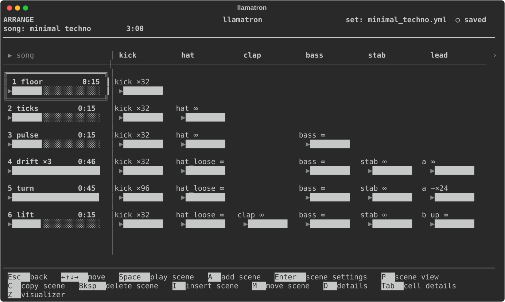
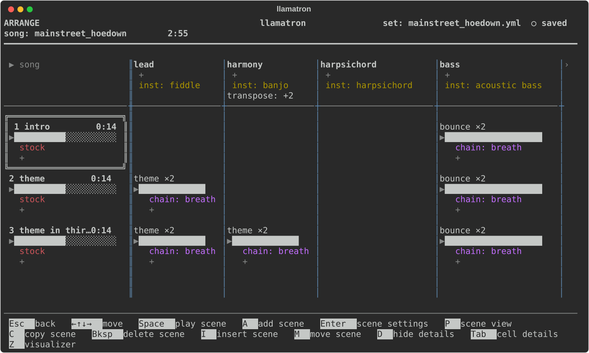
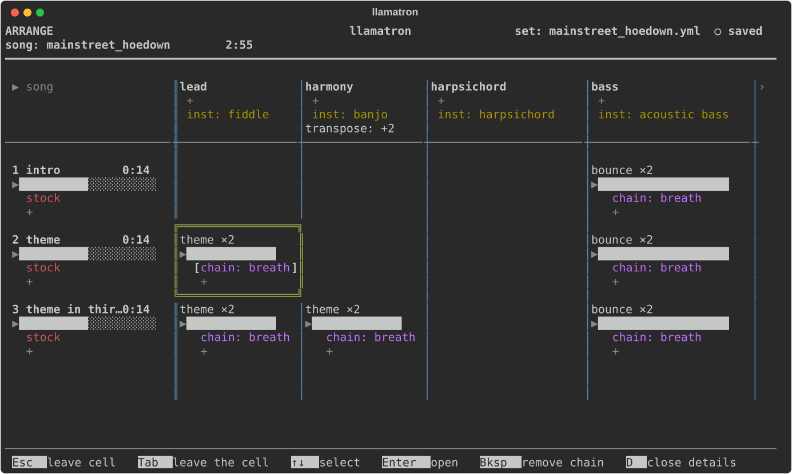
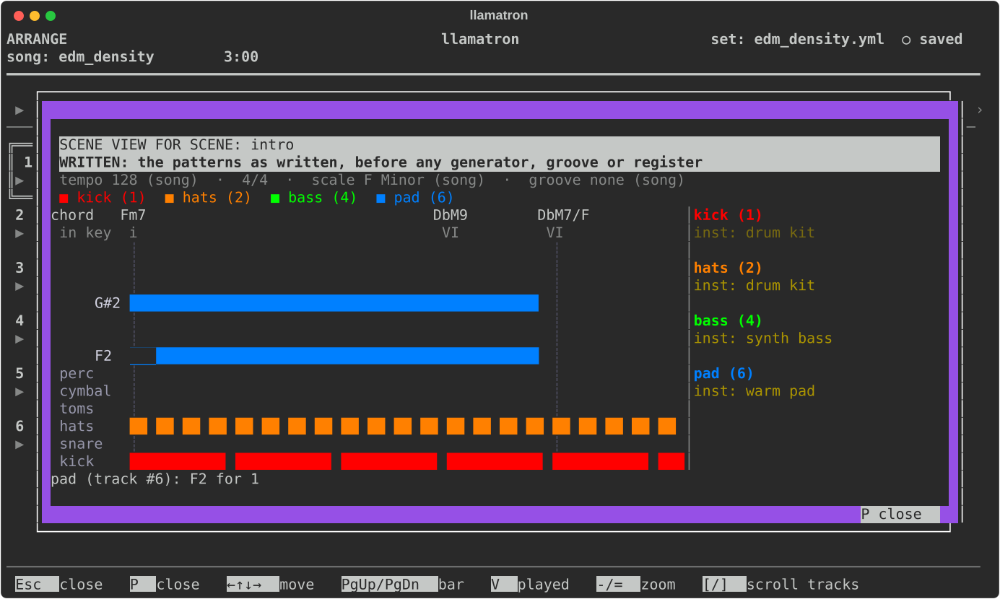

# Arrange

Arrange is where a song is put together: scenes as rows, tracks as columns, and a clip where a row and a column meet. This page covers the Arrange page itself. [Tracks](TRACKS.md), [Scenes](SCENES.md) and [Clips](CLIPS.md) cover the settings of each, and [Playing Live](PLAYING_LIVE.md) covers playing the song.

## Grid Layout

Press `A` on the main screen to open the current song's arrangement. The track names run across the top, and the first column holds the scene names, each with its repeat count and length. Scenes play from top to bottom. A new song starts with `track 1` and `scene 1`, and new tracks and scenes are numbered the same way until they are renamed on their own pages.

A double-lined box marks whatever the cursor is on: a clip, a scene, a track name, or one of the `+` places, including the `+` after the last track. The arrows move the box around the grid. When there are more tracks or scenes than fit, the clips scroll while the track names and the scene column stay in place. An empty cell is blank until the cursor reaches it, when it shows `+` and `add`.

Under each scene is a bar of its length against the longest scene's, and under each clip a bar of the clip's length against its scene's. A clip that fills its scene, or loops, has a full bar, and a clip that ends early has a shorter one.

## Keys

The keys depend on what is under the cursor:

| Where | Key | What it does |
| --- | --- | --- |
| A track's name | `Enter` | Open the track editor, as [Tracks](TRACKS.md) describes |
| A track's name | `I` | Insert a blank track before it |
| A track's name | `C` | Copy the track and its clips to its right |
| A track's name | `M` | Pick the track up: `←→` carry it, and `Enter` drops it |
| A track's name | `Bksp` | Delete the track and its clips, after asking; the last track can't be deleted |
| The `+` after the last track, or any track's name | `Enter` or `A` | Add a track at the end |
| A scene's name | `Enter` | Open the Scene page, as [Scenes](SCENES.md) describes |
| A scene's row | `I` | Insert a blank scene above it |
| A scene's row | `C` | Copy the scene and all its clips below it |
| A scene's name | `M` | Pick the scene up: `↑↓` carry it, and `Enter` drops it |
| A clip | `M` | Pick the clip up: the arrows carry it to the nearest empty cell, and `Enter` drops it |
| A scene's name | `Bksp` | Delete the scene and its clips, after asking; the last scene can't be deleted |
| A scene's row | `A` | Add a scene below it |
| The `+` row at the bottom | `Enter` or `A` | Add a scene at the end |
| An empty cell | `Enter` | Choose a pattern and add a clip; `Enter` on the clip again opens it |
| An empty cell | `B` | Make a blank pattern named after the track, add a clip of it and open it in the pattern editor |
| A clip | `Enter` | Open the clip page, as [Clips](CLIPS.md) describes |
| A clip | `P` | Open the clip's pattern in the pattern editor; `Esc` comes back to the clip |
| A clip | `C` | Copy the clip |
| A clip | `Bksp` | Delete the clip, after asking |
| A cell, after copying a clip | `V` | Paste the copied clip here, replacing what's there |
| The corner over the scene names | `Space` | Play the song from the top, or stop everything, with Real Time on |
| A scene's name | `Space` | Play the song from this scene, or stop everything, with Real Time on |
| A clip | `Space` | Play this clip on its own, or stop its track, with Real Time on |
| Anywhere | `D` | Show or hide the details of every cell (see Details View below) |
| A track's name, a scene's name or a clip | `Tab` | Lock into its details to pick, open, add or remove chains and open other settings (see Details View below) |
| A scene's name | `P` | Open Scene View, the scene's notes laid out by track (see Scene View below) |

## Clip Marks

Marks after a clip's pattern name show its settings:

| Mark | Meaning |
| --- | --- |
| `×3` | Repeats 3 times |
| `∞` | Loops |
| `~` | Morphs to another pattern |
| `d` | Has its own play direction |
| `g` | Grabs notes from another track |

## Details View

`D` shows the details view, which reveals how a song is put together, and `D` again goes back to the usual grid. Under each scene's bar, each clip's bar and each track's name are the chains it runs, in the order they run, each written `chain: name`, then a `+` for adding another, then each setting that isn't its default, on a line of its own, such as `scale:` for a scale other than the song's, `morph: other`, `direction: pendulum`, `density: 25→100` or `inst: piano`. A cell with nothing of its own says `stock`. Columns widen to fit, and blue dividers separate the tracks. Every key works as it does in the usual grid.

The details are also where a cell's chains are edited. With the cursor on a track's name, a scene's name or a clip, `Tab` locks into that cell's details. This works in the usual grid too, where it opens that one cell's details. The cell's box turns green and the first line that names something is picked, shown in brackets. `↑↓` choose a line. `Enter` on a chain, a scale, an instrument or a groove opens its page, and `Esc` comes back to the locked cell. `Enter` on `+` offers the set's chains and adds the one chosen to this cell alone. `Bksp` on a `chain:` line takes that chain out of this cell alone; the chain itself stays in the set and in every other cell that runs it. `Tab` again or `Esc` leaves the cell, and `D` leaves it and closes every detail.

## Scene View

`P` on a scene's name opens Scene View, a window over Arrange that lays out every note the scene plays, track by track, on one piano roll: each track in a colour of its own, the drum tracks in the lanes at the foot, the chord on each beat named above, and at the right each track's chains and settings, as the details view shows them. It opens on the patterns as written, before any generator, groove or register changes them, with a purple border.

`V` switches to the notes as played, after every chain, groove, strum, shape and register, with a blue border, so that the two can be compared; a song without a seed shows one take of its random parts. The arrows move the cursor, and the line under the roll names the notes under it. `PgUp` and `PgDn` jump a bar, `-` and `=` make each step narrower or wider, and `[` and `]` scroll the tracks at the right. `P` or `Esc` closes it.

