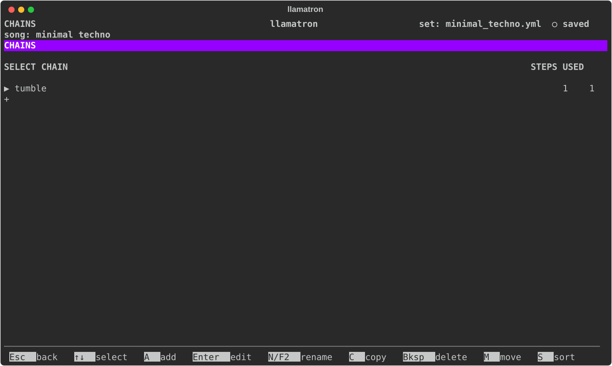
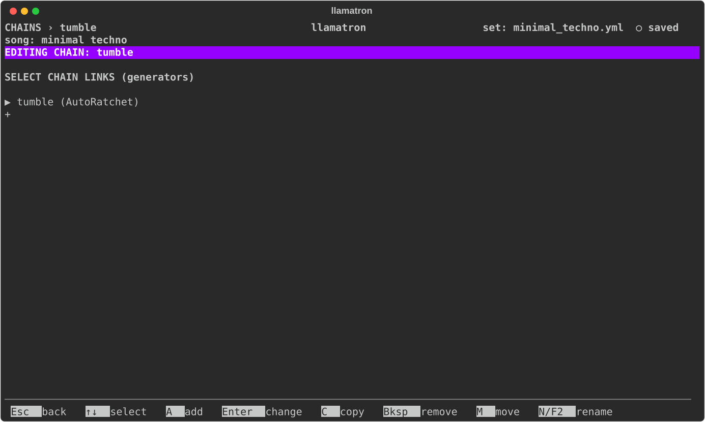

# Chains

A chain is a list of generators that runs on clips. This page covers how chains run, where they are placed, and the Chains page.

## How a Chain Runs

A chain runs its generators one after another, from top to bottom, each working on what the generator before it made. An arpeggiator followed by an AutoRatchet therefore arpeggiates first and then chops every arpeggiated note into repeats, while an AutoRatchet followed by an arpeggiator ratchets the chords first and then arpeggiates the repeats. Chains run whenever a clip plays or exports.

## Chain Placement

A clip names the chains it runs, and so can a scene and a track:

- a **clip's** chains shape that one clip;
- a **scene's** chains shape every clip of the scene;
- a **track's** chains shape every clip the track plays, in every scene.

A clip runs its own chains first, then its scene's, then its track's, and a chain named twice runs twice. The clip page, the Scene page and the track editor each have a Chains field that opens the list.

## Chains Page

Press `C` on the main screen to open the Chains page.

| Key | What it does |
| --- | --- |
| `A` | Add a chain |
| `Enter` | Edit its steps |
| `N` | Rename it, which updates every clip |
| `C` | Copy it |
| `M` | Pick it up: `↑↓` carry it, and `Enter` drops it |
| `S` | Sort the list by name |
| `Bksp` | Delete it, once no clip uses it |

## Chain Editor

| Key | What it does |
| --- | --- |
| `A` | Add a step: any generator, made first on the Generators page |
| `Enter` | Change the step to another generator |
| `C` | Copy the step |
| `M` | Pick it up: `↑↓` carry it, and `Enter` drops it |
| `Bksp` | Remove it |
| `N` | Rename the chain, which updates every clip that uses it |

