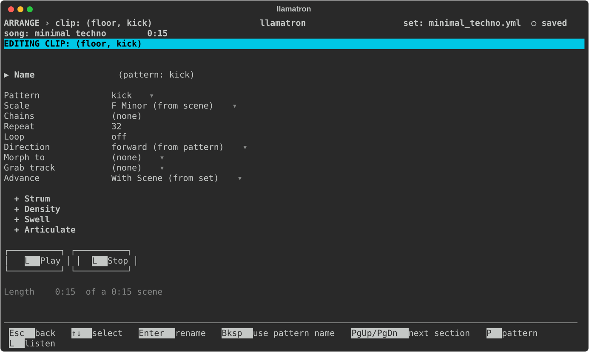
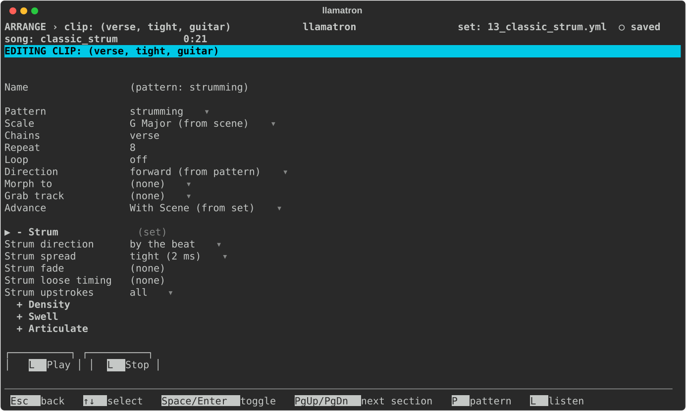
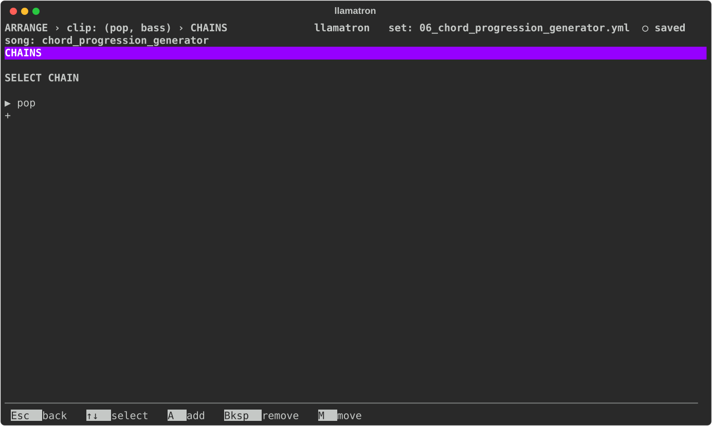

# Clips

A clip is what a track plays in a scene: a pattern, and the settings that change how the pattern plays there. This page covers the clip page.

## Clips on Arrange

A clip sits where a scene's row and a track's column meet on Arrange, so the clip page's crumb pairs the two, such as `ARRANGE › clip: (verse, bass)`. The crumbs always say where `Esc` goes back to. The pattern editor opened with `P` from a clip reads `ARRANGE › pattern: bass line` when opened from Arrange, `ARRANGE › clip: (verse, bass) › pattern: bass line` when opened from the clip page, and `PATTERNS › bass line` only when the Patterns page opened it.

## Clip Settings

| Setting | What it does |
| --- | --- |
| Name | A name of the clip's own, shown on the grid and used for the clip in Live and in the clip tree's file names. Without one, the clip goes by its pattern's name. `Bksp` clears it. |
| Pattern | The pattern the clip plays. `P` opens the pattern in the pattern editor from any row of the page, and `Esc` comes back. |
| Scale | A scale of the clip's own, which wins over the scene's and the song's, so that one track can play in another key or mode. `Enter` picks one, and `Bksp` goes back to the scene's, shown with where it comes from, such as `A Minor (from scene)`. |
| Chains | The chains of generators the clip runs, in order. `Enter` opens the list, where `A` adds a chain, `M` moves one and `Bksp` takes one out; `Bksp` on the field clears them all. A clip runs its own chains first, then its scene's, then its track's. See [Chains](CHAINS.md). |
| Repeat | How many times the clip plays, from 1 to 9999, before staying silent while the scene's other clips finish. |
| Loop | Plays the clip until the scene's longest clip that doesn't loop is done. `Space` or `Enter` toggles it. |
| Direction | Overrides the play direction of the clip's pattern, and of the pattern it morphs to. `Bksp` goes back to the patterns' own, shown as `forward (from pattern)` or the like. |
| Morph to | With Repeat above 1, a second pattern to change into across the repeats. |
| Morph direction | `left`, `right` or `middle`: where the change sweeps in from. |
| Grab track | Another track in the scene, whose notes the pattern's Grab steps play. `Bksp` sets none. |
| Advance | What the clip does in real-time playback when it finishes, as described under Advance below. `Enter` chooses. A clip that sets none shows the set's default, such as `With Scene (from set)`. |
| + Strum | A section, closed until opened, like the track editor's: Strum direction `(track)` takes the track's strum, shown as the direction it takes, such as `down (from track)`, `off` strums nothing whatever the track says, and any other direction strums this clip its own way. See [Strum](generators/STRUM.md). |
| + Density, + Swell, + Articulate | Sections, closed until opened, like the Scene page's, shaping this clip across its own length. A shape set here wins over the scene's, and a generator in the clip's chains wins over both. |
| Play, Stop | Buttons under the settings, which do what `L` (Listen) does: play the clip in real time as its scene would, with its chains, grabs, scale and direction, again and again until `L` is pressed again or Stop is. When the clip's track has no instrument, a list asks which of the set's instruments to listen through, for this listening alone. While the Real Time switch is off, the clip plays through General MIDI in [FluidSynth](FLUIDSYNTH.md) instead, the piano, or the drum kit for drums. See [Playing Live](PLAYING_LIVE.md). |

## Morphing

Morph to and Morph direction appear only when Repeat is above 1, and setting Repeat back to 1 removes the morph. The pattern being morphed to is looped or cut to the clip's length, and follows the clip's Direction when the clip has one; otherwise it follows its own pattern's direction, so a clip set to `eitherway` can finish its morph playing the second pattern backwards. A pattern with no notes morphs too, carrying its CC values and register changes across. The pattern being morphed to never grabs, and uses the registers without adding to them.

## Grabbing Notes

Grab track works like the Cirklon's note grab, and changes only the steps that the pattern's Grab row marks. Each marked step plays the note that the other track most recently started, at or before that step: the note the other track is playing, or the last note it played if it is silent. If the other track hasn't played anything yet, the step keeps its own note, or stays silent if the step has none.

When the other track plays a chord, the step takes the chord's root, the note the chord was built on, whatever its inversion or voice leading. A grab step with nothing on its Chord row plays that one note, and a grab step with a chord on its Chord row plays the chord with the grabbed note at the bottom: when the bass plays D and the step's chord is `m7`, the step plays D, F, A and C. The scale chords, `3` to `13`, add notes of the clip's scale above the grabbed note. A grab hears the other track after that track's chains run, so grabbing from an arpeggiated track takes the arpeggio's notes. Every other step, and everything else about the clip, such as its rhythm and velocity, stays the clip's own, and the grabbing track's transpose still applies.

Because grabbing is set on the clip, one pattern can grab from different tracks in different clips. A clip can grab from a track that grabs from another, but never in a circle: the clip page refuses a grab that would close a circle and says which clips to change, pasting a clip drops such a grab, and a set file with a circle stops exporting with a message naming the tracks.

## Advance

Advance is Live's follow action: what a clip does in real-time playback when it finishes. No export reads it.

- "With Scene" starts the clip directly below when the whole scene is done.
- "Next" starts the clip directly below as soon as this clip's own repeats end, whatever the rest of the scene is doing.
- "Off" starts nothing, so the track falls silent until something launches it.

A scene is done when every clip in it that doesn't loop has finished its repeats. A looping clip loops on until the scene below starts, so a scene whose every clip loops plays until you start something else. When the scene below has Launch together on, a start reaching any of its clips launches the whole scene and stops everything still playing in the scene above. A clip that sets nothing shows the Set File page's Default follow action as its own.

## Clip Strum and Chains

A clip's sections set its own strum and shapes, over those of its track and its scene. In `examples/learning/13_classic_strum.yml`, this clip strums by the beat with a tight spread:

`Enter` on a clip's Chains field opens the list of chains the clip runs, where `A` adds one:

