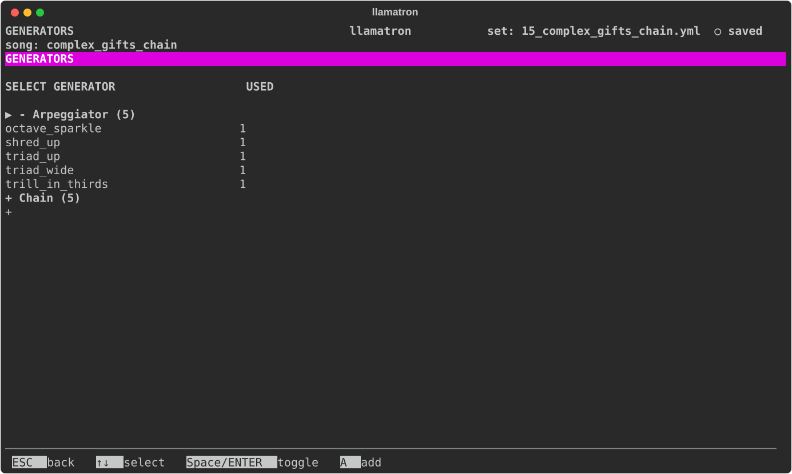

# Generators

A pattern says what a part is; a generator says how it is played. This page explains what generators are,
how they are put to work, and the settings every kind shares. Each kind has a page of its own, listed under
Generator Kinds below, and [Chain](generators/CHAIN.md) covers the chains that run them.

## What a Generator Does

A generator takes the notes a clip makes and changes them: it arpeggiates a chord, moves a figure through
a progression, strums, thins out, swells, slides or hands notes to another track. A generator works on the finished clip, never on the pattern, so nothing you wrote changes. Other clips that play the same pattern
are untouched unless they run the generator too, and the generator follows whatever scale, chords and
tempo the clip is in when it plays: change the scene's scale and the arpeggio follows.

Generators are heard everywhere a song is: in real time as it plays, and in every export.

## Chains

A clip, a scene and a track each list the generators they run, one after another. A chain is a generator
too, one that runs a list of other generators in its place, so that several clips can share the same list;
[Chain](generators/CHAIN.md) says how.

## Generators as Paint

The way to think of a generator is as paint. A clip's list applies it to exactly the clips that should have it,
and editing the generator afterwards changes everything painted with it at once, across every song of the
set. Write one strum, paint it on every guitar part, and change how every guitar strums by editing one
generator.

Some generators have a quick version as a setting of a clip, a scene or a track, like a clip's strum or a
scene's density. The setting is quickest for one place; the generator is worth having for the many places
that should share one shape and change together.

## Chance

Every generator that chooses anything at random, a random arpeggio order or a drift's random degree,
draws afresh each time the song plays or exports, so each is a new take. While a song plays in real time, one take is kept for the whole play, so an edit
changes only what you edited.

## Generator Kinds

The generators fall into eight categories by what they change, as the sidebar and the picker of a new generator's type group them.

### Arrangement

What plays where, among the tracks.

| Generator | What it does | Demo |
| --- | --- | --- |
| [Hocket](generators/HOCKET.md) | Deals one track's notes out among other tracks | `examples/learning/19_hocket_shanty.yml` |

### Articulation

How each note is played: phrased.

| Generator | What it does | Demo |
| --- | --- | --- |
| [Phrasing](generators/PHRASING.md) | Plays a tune in lines, as a singer would: a breath after each, a rise and fall, notes choppy or flowing | `examples/learning/25_phrasing.yml` |

### Band Generators

| Generator | What it does | Demo |
| --- | --- | --- |
| [Musician](generators/MUSICIAN.md) | Plays a clip as a player of the band would: by the kind of section, round the tune, with the instrument's habits | `examples/learning/26_musician.yml` |

### Harmony

Which chords a figure follows.

| Generator | What it does | Demo |
| --- | --- | --- |
| [Chords](generators/CHORDS.md) | Moves a figure through a progression of chords, or to the chords another track plays, and voices each chord nearest the one before | `examples/learning/06_chord_progression_generator.yml`, `examples/learning/24_follow_chords.yml`, `examples/learning/05_voice_leading.yml` |

### Rhythm

Which notes sound, and when within the beat.

| Generator | What it does | Demo |
| --- | --- | --- |

### Timing

Notes placed early or late, played short or joined.

| Generator | What it does | Demo |
| --- | --- | --- |
| [Timing](generators/TIMING.md) | Plays notes on chosen steps early, late, short or sliding into the next | `examples/learning/14_acid_glide.yml` |

### Transitions

A change that takes place over a section or a song.

| Generator | What it does | Demo |
| --- | --- | --- |
| [Drift](generators/DRIFT.md) | Changes the song slowly from version A to version B | `examples/by_genre/electronic/mainstreet_hoedown.yml` |
| [Shapes](generators/SHAPES.md) | Ramps how many notes play, how loud and how long over a section | `examples/by_genre/electronic/edm_density.yml` |

### Voicing

How a chord's notes are laid out and played.

| Generator | What it does | Demo |
| --- | --- | --- |
| [Arpeggiator](generators/ARPEGGIATOR.md) | Plays a chord one note at a time, with offsets | `examples/learning/12_sailor_arpeggiator.yml` |
| [Guitarify](generators/GUITARIFY.md) | Holds chords as a hand does and plays a bar of strokes on them | `examples/learning/23_guitarify.yml` |

[About Demos](DEMOS.md) describes every demo, and its table shows which features each one uses.

## Generators Page

Press `G` on the main screen for the Generators page, which lists every generator of the set under a heading for its type, such as `- Chords (2)`, the types and the generators under each sorted by name. Every type is closed until opened: Space or `ENTER` on a heading opens and closes its type, the set's file keeps which types are open, and `PgUp` and `PgDn` jump between the headings. The kinds are the Chain, Arpeggiator, Chords, Drift, Guitarify, Hocket, Musician, Phrasing, Shapes and Timing. A generator changes a clip's notes when the song plays or exports; to use one, add it to the Generators field of a clip, a scene or a track, on its own or in a chain.

| Key | What it does |
| --- | --- |
| `A` | Add one: choose its kind, and it is named after the kind and opened |
| `ENTER` | Edit its settings |
| `N` or `F2` | Rename it, which updates every chain and list that runs it |
| `C` | Copy it, the copy coming straight after it |
| `M` | Pick it up: `↑↓` carry it, and `ENTER` drops it; the list keeps its order when the set is saved |
| `Bksp` | Delete it after asking; it is taken out of every chain and list that runs it, and the question names up to five |

## Time Settings

Every setting of a generator that is a time, an arpeggiator's Step, a drift's or a progression's Every and a shape's Over, chooses from one list, in this order: its own first choice, such as `(pattern)` or `(whole)`, then 1/64, 1/32, 1/16, 1/16 triplet, dotted 1/16, 1/8, 1/8 triplet, dotted 1/8, 1/4, 1/4 triplet, 1/2, and then 1, 2, 4, 8 and 16 bars, a bar being as long as the song's time signature says. A time a set file holds that isn't on the list, such as an older file's `2`, stays as it is and is offered at the end of the list.

## Restart

Every generator ends its settings with Restart, which says when it starts over:
- "every clip", the default: with every clip, as if made anew for it;
- "on new scene": the first time each scene plays, carrying on through the scene's repeats;
- "whole song": never, running along the song from its top, the scenes laid end to end, so that a scene launched by hand plays as it would at its place in the song.

A generator that carries on keeps what it was doing: a progression runs on across scenes, a shape's ramp can last the whole song, a voice leading voices a scene's first chord near the last chord before, and an arpeggiator goes on with its random choices. A generator painted on several tracks gives each track a copy of its own, so that tracks line up when their patterns do.

## Bypass Generators When

Every generator's page ends with a section called Bypass Generators When, a table of statements about the registers. When one is true as a clip's pattern starts over, the notes of that pass go by the generator untouched, in every chain that names the generator. See [Conditional Execution](REGISTERS.md#conditional-execution).

## Rows of Steps

A [Timing](generators/TIMING.md) generator's Rush, Drag, Shorten and Glide are each a row of 1 to 16 steps, each on (`●`) or off, running from each clip's start at its own Step, the clip's pattern's step size unless set; a note starting on a step that is on is changed. A row shorter than the pattern, 5 or 7 steps over 16, lands somewhere new each time round, so that slides, short notes and pushes move through a line that never changes. `ENTER` on Steps opens the row: Left and Right move along it, `Space` or `ENTER` turns the step under the cursor on or off, the line above the row saying what a step that is on does, and `I` and `D` insert and remove steps.

## Shapes

Density, Swell and Articulate shape a clip's notes over time, each a percentage that ramps from a start to an end. A [Shapes](generators/SHAPES.md) generator holds all three, and a chain names it as `shapes: name`; Density and Articulate are also set in a section of the Scene page and of the clip page, `+ Density` and `+ Articulate`. A generator in a clip's chains wins over the clip's own setting, which wins over its scene's, so that a generator can be painted on many clips and changed in one place. How loud a scene or a clip plays is set by its Velocity and its velocity ramps, which a Shapes generator's Swell scales again: see [Velocity and Velocity Ramps](SCENES.md#velocity-and-velocity-ramps). Every setting left blank plays as 100%, changing nothing.

| Setting | What it does |
| --- | --- |
| Start, End | The percentage at the start and at the end, ramping from one to the other. `Bksp` leaves it blank, which plays as 100%. |
| Over | How long one ramp lasts: "(whole)", the default, the whole scene for a scene's and the whole clip for a clip's or a generator's, or a time from the list every time setting shares, such as "1/4" or "2 bars". |
| Then | What happens after a ramp when the clip goes on: "hold" stays at the end, "repeat" starts the ramp again, and "bounce" ramps back. |
