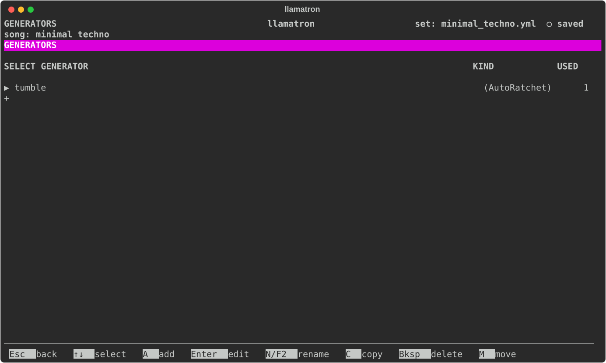

# Generators

A pattern says what a part is; a generator says how it is played. This page explains what generators are,
how they are put to work, and the settings every kind shares. Each kind has a page of its own, listed under
The Kinds below, and [Chains](CHAINS.md) covers the chains that run them.

## What a Generator Does

A generator takes the notes a clip makes and changes them: it arpeggiates a chord, moves a figure through
a progression, strums, thins out, swells, slides or hands notes to another track. A generator works on the finished clip, never on the pattern, so nothing you wrote changes. Other clips that play the same pattern
are untouched unless they run the generator too, and the generator follows whatever scale, chords and
tempo the clip is in when it plays: change the scene's scale and the arpeggio follows.

Generators are heard everywhere a song is: in real time as it plays, and in every export.

## Chains

Generators are kept in chains, lists of generators that run one after another, and a clip, a scene or a
track names the chains it runs; [Chains](CHAINS.md) says how.

## Generators as Paint

The way to think of a generator is as paint. A chain applies it to exactly the clips that should have it,
and editing the generator afterwards changes everything painted with it at once, across every song of the
set. Write one strum, paint it on every guitar part, and change how every guitar strums by editing one
generator.

Some generators have a quick version as a setting of a clip, a scene or a track, like a clip's strum or a
scene's density. The setting is quickest for one place; the generator is worth having for the many places
that should share one shape and change together.

## Chance

Every generator that chooses anything at random, a random arpeggio order or a drift's random degree,
draws from the song's seed. A song with no seed plays a new take each time; a song with a seed plays the
same take every time. While a song plays in real time, one take is kept for the whole play, so an edit
changes only what you edited.

## Generator Kinds

The generators fall into six categories by what they change, as the sidebar groups them.

| Category | Generator | What it does | Demo |
| --- | --- | --- | --- |
| Arrangement | [Hocket](generators/HOCKET.md) | Deals one track's notes out among other tracks | `examples/learning/19_hocket_shanty.yml` |
| Articulation | [Glide](generators/GLIDE.md) | Runs notes on chosen steps into the next note | `examples/learning/14_acid_glide.yml` |
| Articulation | [Shorten](generators/SHORTEN.md) | Plays notes on chosen steps short | `examples/learning/14_acid_glide.yml` |
| Chords | [Arpeggiator](generators/ARPEGGIATOR.md) | Plays a chord one note at a time, with offsets | `examples/learning/12_sailor_arpeggiator.yml` |
| Chords | [Progression](generators/PROGRESSION.md) | Moves a figure through a progression of chords | `examples/learning/06_chord_progression_generator.yml` |
| Chords | [Strum](generators/STRUM.md) | Spreads a chord's notes in time like a pick | `examples/learning/13_classic_strum.yml` |
| Chords | [Voice Leading](generators/VOICE_LEADING.md) | Voices each chord nearest the chord before | `examples/learning/05_voice_leading.yml` |
| Rhythm | [AutoRatchet](generators/AUTORATCHET.md) | Chops notes into quick repeats | `examples/learning/11_ode_to_joy_ratchet.yml` |
| Rhythm | [Euclid](generators/EUCLID.md) | Keeps only the notes on a Euclidean rhythm | `examples/other/euclidean.yml` |
| Timing | [Drag](generators/DRAG.md) | Plays notes on chosen steps late | `examples/learning/14_acid_glide.yml` |
| Timing | [Rush](generators/RUSH.md) | Plays notes on chosen steps early | `examples/learning/14_acid_glide.yml` |
| Transitions | [Articulate](generators/ARTICULATE.md) | Ramps how long notes sound over a section | `examples/learning/15_acid_articulate.yml` |
| Transitions | [Density](generators/DENSITY.md) | Ramps how many notes play over a section | `examples/by_genre/electronic/edm_density.yml` |
| Transitions | [Drift](generators/DRIFT.md) | Changes the song slowly from version A to version B | `examples/by_genre/electronic/mainstreet_hoedown.yml` |
| Transitions | [Swell](generators/SWELL.md) | Ramps how loud notes play over a section | `examples/learning/16_bolero_swell.yml` |

[About Demos](DEMOS.md) describes every demo, and its table shows which features each one uses.

## Generators Page

Press `G` on the main screen for the Generators page, which lists every generator of the set on one list, whatever its kind, with its kind in parentheses beside its name, such as `sparse (Density)`. The kinds are the arpeggiator, AutoRatchet, Drift, Progression, Voice leading, Strum, Euclid, Density, Swell, Articulate, Glide, Shorten, Rush, Drag and Hocket. A generator changes a clip's notes when the song plays or exports; to use one, add it to a chain, then choose the chain on a clip, a scene or a track.

| Key | What it does |
| --- | --- |
| `A` | Add one: choose its kind, and it is named after the kind and opened |
| `Enter` | Edit its settings |
| `N` or `F2` | Rename it, which updates every chain |
| `C` | Copy it, the copy coming straight after it |
| `M` | Pick it up: `↑↓` carry it, and `Enter` drops it; the list keeps its order when the set is saved |
| `Bksp` | Delete it, once no chain uses it |

## Time Settings

Every setting of a generator that is a time, an arpeggiator's Step, a drift's or a progression's Every and a shape's Over, chooses from one list, in this order: its own first choice, such as `(pattern)` or `(whole)`, then 1/64, 1/32, 1/16, 1/16 triplet, dotted 1/16, 1/8, 1/8 triplet, dotted 1/8, 1/4, 1/4 triplet, 1/2, and then 1, 2, 4, 8 and 16 bars, a bar being as long as the song's time signature says. A time a set file holds that isn't on the list, such as an older file's `2`, stays as it is and is offered at the end of the list.

## Restart

Every generator ends its settings with Restart, which says when it starts over:
- "every clip", the default: with every clip, as if made anew for it;
- "on new scene": the first time each scene plays, carrying on through the scene's repeats;
- "whole song": never, running along the song from its top, the scenes laid end to end, so that a scene launched by hand plays as it would at its place in the song.

A generator that carries on keeps what it was doing: a progression runs on across scenes, a Euclidean rhythm keeps drifting against the bar, a shape's ramp can last the whole song, an AutoRatchet goes on through its counts, a voice leading voices a scene's first chord near the last chord before, and an arpeggiator goes on with its random choices. A generator painted on several tracks gives each track a copy of its own, so that tracks line up when their patterns do.

## Rows of Steps

[Glide](generators/GLIDE.md), [Shorten](generators/SHORTEN.md), [Rush](generators/RUSH.md) and [Drag](generators/DRAG.md) are each a row of 1 to 16 steps, each on (`●`) or off, running from each clip's start at its own Step, the clip's pattern's step size unless set; a note starting on a step that is on is changed. A row shorter than the pattern, 5 or 7 steps over 16, lands somewhere new each time round, so that slides, short notes and pushes move through a line that never changes. `Enter` on Steps opens the row: Left and Right move along it, `Space` or `Enter` turns the step under the cursor on or off, the line above the row saying what a step that is on does, and `I` and `D` insert and remove steps.

## Shapes

[Density](generators/DENSITY.md), [Swell](generators/SWELL.md) and [Articulate](generators/ARTICULATE.md) shape a clip's notes over time, each a percentage that ramps from a start to an end. Each is set in three places: a section of the Scene page and of the clip page, `+ Density`, `+ Swell` and `+ Articulate`, and a generator of each kind, which a chain names as `density: name`, `swell: name` or `articulate: name`. A generator in a clip's chains wins over the clip's own setting, which wins over its scene's, so that a generator can be painted on many clips and changed in one place. Every setting left blank plays as 100%, changing nothing.

| Setting | What it does |
| --- | --- |
| Start, End | The percentage at the start and at the end, ramping from one to the other. `Bksp` leaves it blank, which plays as 100%. |
| Over | How long one ramp lasts: "(whole)", the default, the whole scene for a scene's and the whole clip for a clip's or a generator's, or a time from the list every time setting shares, such as "1/4" or "2 bars". |
| Then | What happens after a ramp when the clip goes on: "hold" stays at the end, "repeat" starts the ramp again, and "bounce" ramps back. |
