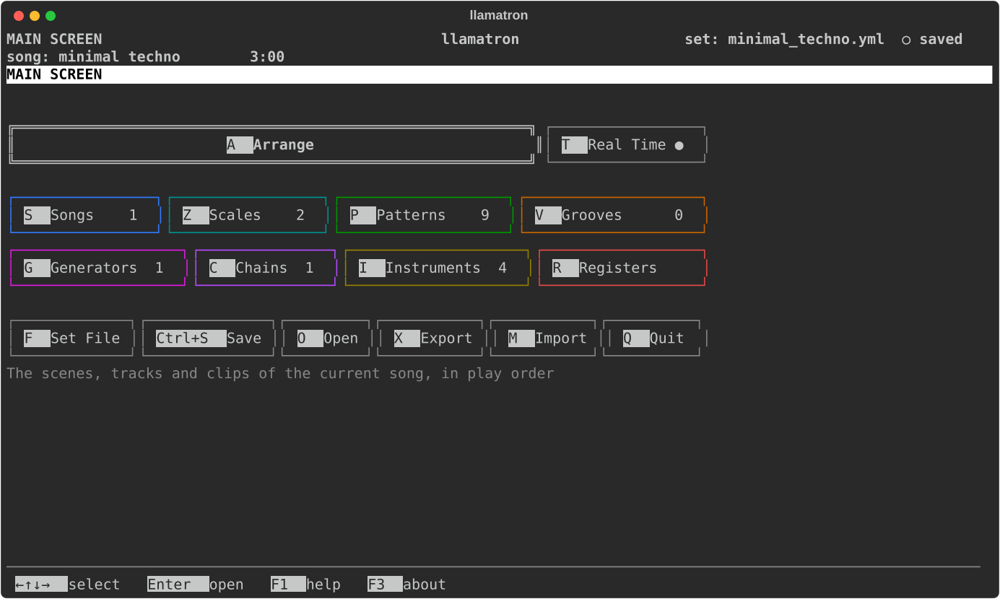
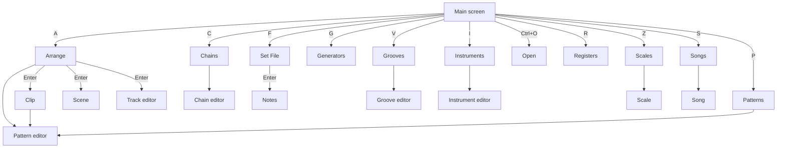
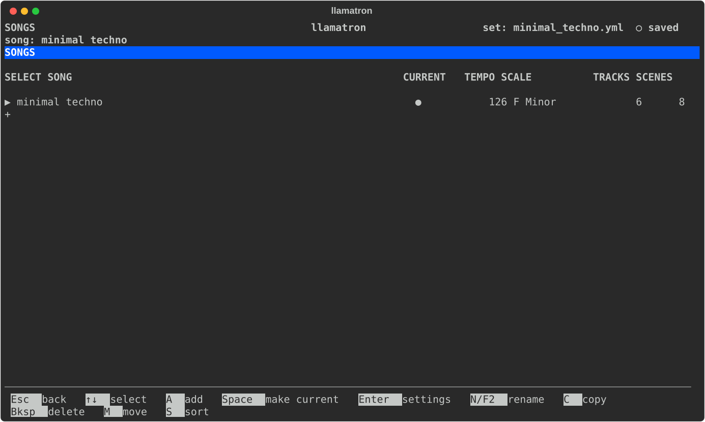
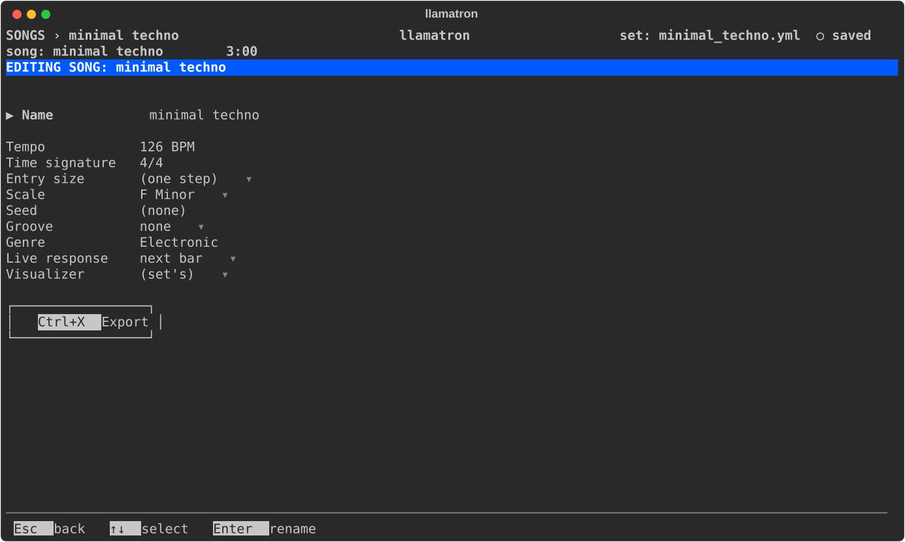

# Getting Started

This page covers starting llamatron, how every screen is laid out, the keys that work everywhere, the main screen, opening and saving, and building a first song step by step. The page assumes llamatron is installed, as [Installing](INSTALLING.md) describes.

## Starting llamatron

```
llamatron                                   # a new set with one song, called untitled, playing a starter pattern
llamatron examples/learning/08_tie.yml         # open a set file
```

Start llamatron from the project folder for now. The Open page starts in `examples/` when the current folder has one, and new sets are saved into `songs/` there. Exports are written beside the set's file, wherever that is.

A file holds a set of songs, like the songs of one concert. The patterns, scales, generators, chains, grooves and instruments belong to the set, and every song shares them; each song has its own tempo, scale, seed, groove, tracks, registers and scenes.

[A video of moving around the tracker](https://www.youtube.com/watch?v=JAswLZ8CGzk) is on YouTube. The video was made with an early build, so some pages look different now, and the program will go on changing.

## Screen Layout

Every screen is laid out the same way, from top to bottom:

- **The header:** where you are at the left, the crumbs, such as `PATTERNS › lead` or `GENERATORS › my arp › OFFSETS`, and `MAIN SCREEN` on the main screen; `llamatron` in the middle; and at the right the open set, such as `set: first.yml`, or `set: (unsaved)` before the set has been saved, with the save mark beside it: `● unsaved` for a set that has no file yet, `● unsaved changes` for a set changed since it was saved or opened, and `○ saved` otherwise. Under the set is the current song, with how long the song, scene, clip or pattern on the page lasts. The version is in the About dialog, `F3`.
- **The page:** a triangle, `▶`, marks the row the cursor is on, and the arrow keys move it, so you never need to know a key to get around: `Enter` opens or edits what is marked. Grids mark the selected cell differently: the pattern editor in reverse video, the piano roll by shading the note under the cursor, Arrange with a double-lined box, and the main screen with a box around the selected cell alone. Keys and buttons, the things that act, are shown in reverse video.
- **The status line:** one dim line saying what the last key did when that isn't obvious, such as where a save or an export went, what an undo undid or why a key did nothing. The next key press clears it.
- **The legend:** the page's own keys, each as a reversed label, changing with what is under the cursor. The keys that work on every page aren't repeated there; `F1` lists them with the page's own.

## Global Keys

| Key | What it does |
| --- | --- |
| `Ctrl+S` | Saves the set. |
| `Ctrl+O` | Opens another set, and comes back to the page you were on. |
| `Ctrl+X` | Exports the current song, as [Exporting](EXPORTING.md) describes. |
| `Ctrl+T` | The emergency stop for real-time playback: stops whatever plays and sends note offs, all notes off and all sound off on every channel the set's instruments use, on every connected device, whether or not anything is known to be playing. The status line says what was silenced. |
| `Ctrl+Z`, `Ctrl+Y` | Undo and redo. Only changes to the set count, never moving around: typing into a cell is one change until the cursor moves, a munge is one change, and the notes count when their Save button is pressed. If an undo renames the thing a page shows, the page stays and shows it under its other name; if an undo takes the thing away, the tracker goes back to the page it was opened from and says so. |
| `F1` | Every key that works on the page, the keys that work everywhere above the page's own; `Tab` turns to a panel saying what the page is for. Keys left off the legend to keep it short, such as `Home`, `End` and `/`, are listed here. |
| `Ctrl+C` | Quits at once, from any page or dialog, without asking about unsaved changes, and closes FluidSynth and the MIDI connections as quitting does. |
| `F2` | Renames what the page shows or what the cursor is on, as `N` does. |
| `F3` | About llamatron: its version, when it was built, where it lives and its license. |

On a Mac, `F1`, `F2` and `F3` are `Fn`+`F1`, `Fn`+`F2` and `Fn`+`F3` unless System Settings sets the function keys as standard keys.

## Keyboard Control

These hold on every page:

- `Esc` goes back one page at a time and never quits; in a dialog it cancels. Every legend starts with it, then the arrows, then the keys that are always there, then the rest.
- `Q` quits, from the main screen only. With unsaved changes it asks first, and `Enter` quits without saving.
- A cursor stops at the edges: holding an arrow down takes you to the end and no further.
- `[` (dec) and `]` (inc) step any value: a number down and up, a cycle of choices back and forward, a gate shorter and longer, and on the piano roll they shrink and stretch the note under the cursor. `-`, `+` and `=` do the same, off the legend, and so do Left and Right on a settings page.
- Anything that is on or off answers to `Space` and `Enter` alike, shown as one key, `Space/Enter`. A row with a short cycle of choices, such as Dot or Register +Note, goes to the next choice on either too.
- Upper and lower case are the same key, and so are `Bksp` and `Delete`.
- Nothing is saved or exported until you ask.

**Lists.** Up and Down select. A list you can add to has a `+` row at the bottom, where `Enter` adds, as `A` does. `/` searches the list as you type: the rows shrink to those containing the text, `Tab` completes, `Enter` keeps your place and `Esc` returns to the whole list. Deleting something still in use is refused, with a list of what uses it; otherwise it asks first. Every list you pick from is sorted by name, while the pages keep the file's order until `S` sorts them for good.

**Settings pages.** Up and Down select a setting, `[` and `]` change it, `Enter` types a value or opens a list to choose from, and `Bksp` clears it where that makes sense. A page with many settings groups some into sections: a heading reads `+ Density` while closed and `- Density` while open, `Space` or `Enter` toggles it, and `PgUp` and `PgDn` jump between headings. Sections start closed and stay as you leave them, by name, for as long as the tracker runs. A closed heading says `(set)` when anything inside holds a value, so a section never hides a setting silently.

**Dialogs.** In a list, `Enter` chooses, `Esc` cancels, typing searches and `Tab` completes. In a text prompt, Left and Right move the cursor, `Bksp` erases before it, `Enter` finishes and `Esc` cancels; the cursor starts at the end. In a question, `Yes` and `No` are buttons that Left and Right move between, `Enter` presses the marked one, `Y` and `N` answer at once, and `Esc` means no.

## Main Screen



The main screen is a grid of cells: the pages, four to a row, and below them a row of actions, Save, Open, Export, Import and Quit. Press a cell's letter, or move the box with the arrows and press `Enter`. A cell whose page is a list counts what the set holds there. One line under the grid says what the selected cell is for, and the box stays where it was when you come back with `Esc`.

| Key | Page | What it is for |
| --- | --- | --- |
| `F` | Set File | The set's title, author, description, notes and defaults, with New and Save As |
| `S` | Songs | The songs in the set, and which one is current |
| `P` | Patterns | The notes, in a grid of steps, shared by every song |
| `C` | Chains | Lists of generators that clips, scenes and tracks run |
| `G` | Generators | Every kind of generator |
| `Z` | Scales | The named scales that songs, scenes and clips use |
| `V` | Grooves | Swing and other timing feels |
| `I` | Instruments | The MIDI devices and channels, or FluidSynth, that tracks play through in real time |
| `R` | Registers | AX to DX, four numbers that pattern steps change and use, in the current song |
| `A` | Arrange | The scenes, tracks and clips of the current song. The cell reads Arrange/Play while Real Time is on, since Arrange then plays the song too |
| `T` | Real Time | A switch, not a page: `●` when the set plays through its instruments in real time, `○` when not |
| `O`, `X`, `M` | Open, Export, Import | On this screen alone, without Ctrl |
| `Q` | Quit | Asks first only when there are unsaved changes |

Registers and Arrange edit the current song, which the Songs page picks. Patterns, Chains, Generators, Scales, Grooves and Instruments belong to the set, so a change there is seen by every song.

## Screen Map

Every screen opens from the main screen, and `Esc` goes back up the map one step at a time. The Open page opens with `Ctrl+O` from every page, so it is drawn from the main screen. The label on an arrow is the key that opens the screen; an arrow with no label is a screen opened from a list, with `Enter` on an item, or in more than one way. The map is generated from the code by `internal_tools/make_diagrams.py`.

<!-- generated by internal_tools/make_diagrams.py: screens -->

<!-- end of the generated diagram -->

## Opening and Saving

- **`Ctrl+S` saves** the set. The first time, it asks for a file name, starting from `songs/untitled.yml`, and adds `.yml` if you leave it off; folders are made as needed. A protected set, such as a demo, is never written over: a dialog offers to save a copy under another name, which isn't protected. The Set File page's Protected setting turns the protection off. Saving writes nothing when the file already holds exactly what it would save, and asks before writing over a file something else has changed since it was opened.
- **`W` saves as** a new name, on the Set File page, asking before replacing another file.
- **`Ctrl+O` opens** a set file. The Open page starts in `examples/`, where folders show with a trailing slash, such as `learning/`: `Enter` opens a file or goes into a folder, and `../` goes up. A file that holds values llamatron can't use, such as a velocity of 200 typed in by hand, opens only after a dialog lists each with the value that takes its place: the nearest number allowed, the longest length allowed, or the default. `Yes` opens the set with those changes, marked unsaved, and the file stays as it is until you save; `No` opens nothing. Anything else wrong with a file, such as a clip that names a missing pattern, is refused with a message saying where.
- **`N` starts** a new set, on the Set File page, with one song called `untitled` whose first track plays a starter pattern.
- **`Ctrl+X` exports** the current song, as [Exporting](EXPORTING.md) describes, and **`M` imports** a MIDI file as a new song, as [Importing](IMPORTING.md) describes.

Opening, starting a new set and quitting ask first when there are unsaved changes.

## First Song

This section builds a short song with a melody and a kick drum. A clip needs its pattern and its track to exist first, so the order matters a little.

### 1. Check Song Settings

Start `llamatron` with no file. llamatron opens a new set with one song, `untitled`, which already plays: its one track, `track 1`, plays `pattern 1`, a bar of sixteenths with the scale's root on each beat, in its one scene, `scene 1`. Press `S` for Songs, which lists the set's songs and marks the current one with `●`:



Press `Enter` on the song to open its settings:



 A new song is 120 BPM in C major; the pictures show a demo's song. Change the tempo with `[` and `]`, or press `Enter` and type a number. Leave the rest alone for now, and press `Esc` twice to go back.

### 2. Melody

Press `P` for Patterns, then `A`, and name the pattern `lead` in place of the `pattern 2` it offers. The pattern editor opens on its piano roll with one bar of empty steps, 16 in 4/4, each a sixteenth note. Each row is a note of the scale, labelled down the left, such as `E3   3` for the E in octave 3, the scale's third degree. The cursor starts on the root, `C3`, at step 1.

1. Press Up twice, to `E3`, and press `Space`. Press Right, then Down once to `D3` and `Space`; Right, Down to `C3` and `Space`; Right, Up to `D3` and `Space`.
2. `Space` places a note one step long, drawn as a bar, and never moves the cursor, so you press Right yourself. A step with no note is a rest.
3. `Bksp` on a note takes it out again.

To make a note longer, press `]` on it to drag its end through one more step, and `[` to take a step back off, or choose how long placed notes are first with `E`. The line under the grid describes the note under the cursor, such as `Step 1: E3 in C Major, gate 1/16`. `Tab` shows the same notes as rows of values, where the Gate row sets lengths finer than whole steps. [Patterns](PATTERNS.md) describes the editor in full. Press `Esc` to go back to the list.

### 3. Drum Pattern

Press `A` again and name this one `kick`. Press `R` and choose `drum on` to make it a drum pattern: the top row is now called Note, and takes note letters rather than degrees, since drums follow no scale. Type `C` on steps 1, 5, 9 and 13. A drum note goes in the set's default drum octave, octave 1 as Live labels it, so `C` is C1, MIDI note 36, the first pad of a Drum Rack. Press `Esc` twice to get back to the main screen.

### 4. Tracks

Press `A` for Arrange. A new song starts with one track, `track 1`, across the top and one scene, `scene 1`, down the side. Press Up onto the track's name, then `Enter`, and rename it `lead` on the Name field. Press `Esc`, then move to the `+` after the last track's name and press `Enter` to add `track 2`, and rename it `drums` the same way.

### 5. Scene Arrangement

Scenes are rows and tracks are columns, and a `+` is an empty cell where a clip can go.

1. Move onto `scene 1`'s `lead` cell and press `Enter`. Choose `lead`; the clip page opens.
2. Set Repeat to 4 with `]`, so the melody plays four times, and press `Esc`.
3. Move onto the `drums` cell, press `Enter` and choose `kick`. Select Loop and press `Space` to turn it on, so the kick plays for as long as the melody does. Press `Esc`.

A scene lasts as long as its longest clip that doesn't loop, so at least one clip in every scene must not loop. The grid marks the clips: `lead ×4` repeats and `kick ∞` loops. To add a second section, press `C` on the scene's row to copy the scene below it, then change its clips. [Arrange](ARRANGE.md) describes the page in full.

### 6. Saving and Exporting

Press `Ctrl+S` and type a name such as `songs/first.yml`. Press `Ctrl+X` and choose Ableton Live set, then open `songs/first_untitled.als` in Live and put an instrument on each track. To name the song something better than `untitled`, press `S` for Songs and `N` to rename it first.

[Concepts](CONCEPTS.md) is the next step: moving a figure through chords, shaping sections, adding randomness and performing.

The demos in `examples/learning/` are numbered in the order to learn them, each teaching one feature a scene at a time; [About Demos](DEMOS.md) lists them in that order.
