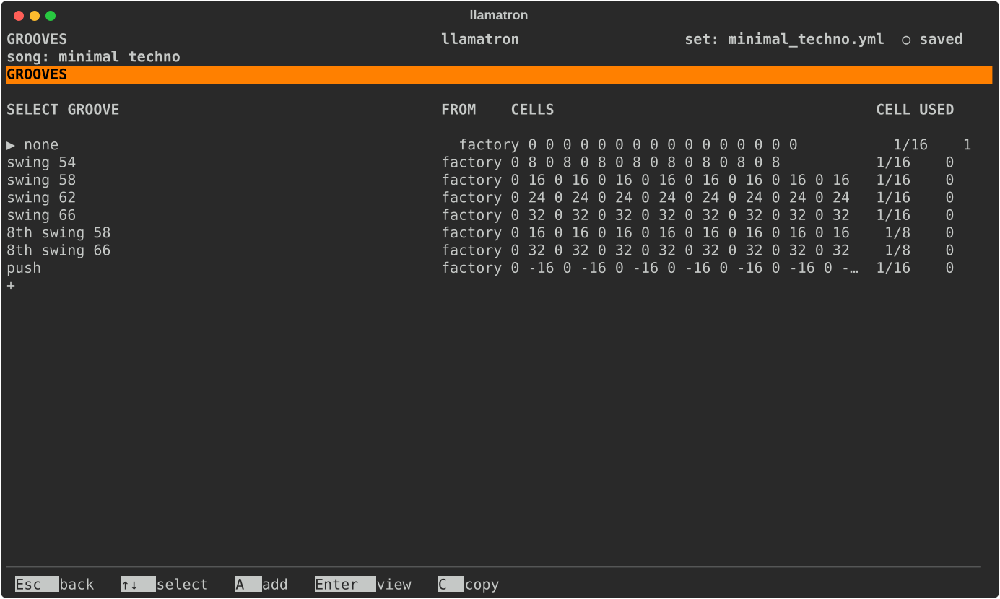
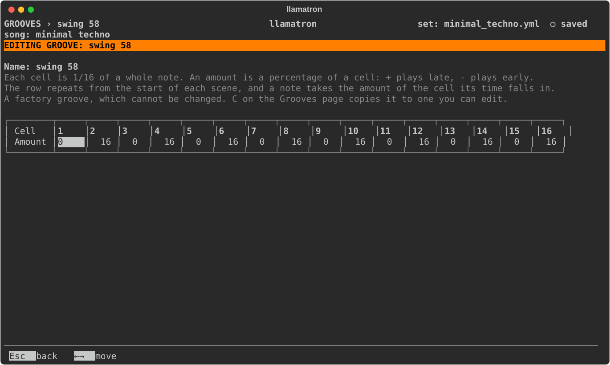

# Grooves

A groove moves notes off the grid, as swing does on a drum machine. This page covers the Grooves page and the groove editor.

## How a Groove Works

A groove is a row of cells, one bar of sixteenths to start with, and each cell says how late (`+`) or early (`-`) a note that falls in it plays, as a percentage of the cell. `16` on every second sixteenth is the classic 58% swing, and `32` is the triplet feel of 66%.

Grooves follow time rather than steps. The row repeats its own length from the start of each scene, and a note takes the amount of the cell its time falls in, whatever the step size or play direction of its pattern. A moved note keeps its gate, so a delayed note also ends later, and a step's CC values move with its note. Grooves are applied in real time and in every kind of export alike, so nothing depends on Live's groove pool. A grab reads the other track's notes where the grid puts them, since a groove changes only timing.

## Factory Grooves

Every set has the factory grooves: `none`, which plays straight and is what a new song uses; `swing 54`, `swing 58`, `swing 62` and `swing 66` on sixteenths; `8th swing 58` and `8th swing 66` on eighths; and `push`, which plays the off-beat sixteenths early. A factory groove can be opened and copied, but not changed, renamed or deleted, and a groove of your own can't take a factory groove's name.

## Grooves Page

Press `V` on the main screen to open the Grooves page. The list shows each groove's cells, the length of a cell, and how many songs, scenes and tracks use the groove.

| Key | What it does |
| --- | --- |
| `A` | Adds a straight groove of your own, named `groove 1` and so on, and opens it. |
| `Enter` | Opens the groove: one of yours to edit, or a factory groove to look at. |
| `C` | Copies the groove, factory or yours, to the end of your own grooves. Copying is how to get a factory groove you can change. |
| `N` | Renames one of your grooves, updating every song, scene and track that chose it. |
| `M` | Picks one of your grooves up: `↑↓` carry it, and `Enter` drops it. |
| `S` | Sorts your grooves by name. |
| `Bksp` | Deletes one of your grooves, once nothing uses it. |

## Choosing a Groove

The song chooses a groove on the Song page, and a scene or a track can choose another on its own page, or `off` to play straight. The track's choice wins over the scene's, and the scene's over the song's, except that `off` anywhere plays straight. A kick track set to `off` therefore stays straight in a swung scene, and a scene set to `off` stays straight even for a swung hi-hat track.

## Groove Editor

The groove editor shows one groove's cells in a row, with the groove's name above them.

| Key | What it does |
| --- | --- |
| Left, Right | Move along the cells. |
| Digits | Type an amount; a minus sign is kept while typing into a negative cell. |
| `[`, `]` or Up, Down | Change the amount by one. |
| `I`, `D` | Insert a straight cell before the cursor, or remove the cursor's cell. |
| `S` | Changes the length of a cell, going round a 32nd, sixteenth, eighth and quarter note. |
| `N` | Renames the groove, updating every song, scene and track that chose it. |

Amounts run from -50 to 50, so that notes can never change order, and a groove has 1 to 32 cells. A groove wider than the screen scrolls sideways as the cursor moves, and the line with the name says which cells are shown, such as `cells 1-11 ›`. A factory groove opens the same way, but only to look at.
