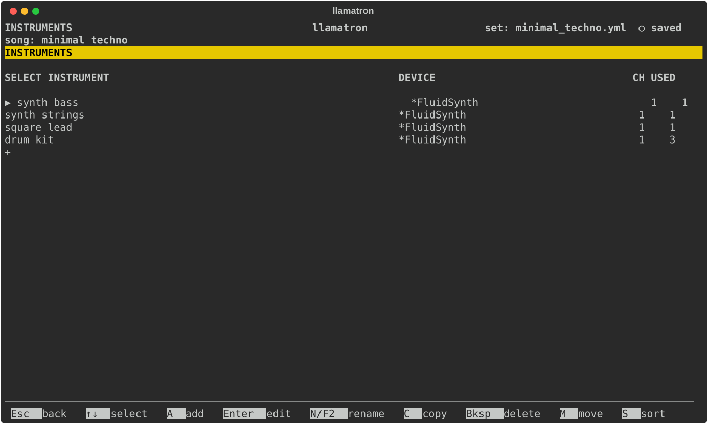
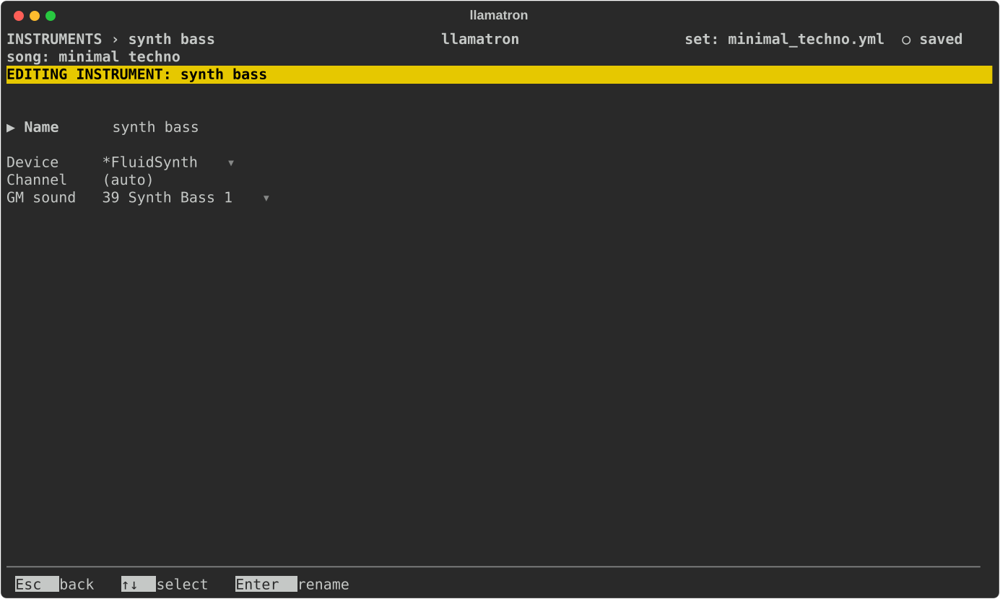

# Instruments

An instrument is where a track's notes go when the song plays in real time: a MIDI device and channel, or FluidSynth. This page covers the Instruments page and the instrument editor.

## What an Instrument Is

An instrument names a device and a channel. The device is one of this computer's MIDI output ports, with a channel on it from 1 to 16, or FluidSynth, the free software synthesizer the tracker starts by itself. Each track chooses an instrument in its track editor, and a track with none is left out of real-time playback. Two instruments may share a device and a channel, so one synthesizer can play every track, or each track can have a voice of its own.

An instrument can also choose a General MIDI sound, which FluidSynth plays and the MIDI (General MIDI) export gives the instrument's tracks. An instrument with a sound but no device is there for that export alone, and its tracks are silent in real time. When no track plays through an instrument with a device, playback doesn't start, and a dialog says why. No other export reads an instrument, since a Live set has instruments of its own.

## FluidSynth Instruments

An instrument whose Device is `*FluidSynth` plays through FluidSynth, as [FluidSynth](FLUIDSYNTH.md) describes. Its Channel shows `(auto)`, because each track through FluidSynth gets a channel of its own, as the MIDI (General MIDI) export assigns them: channel 10 for a drum track, where FluidSynth plays drums, and channels 1 to 16 in turn for the rest. Each clip starts by choosing the track's General MIDI sound.

Every example plays this way as it comes: its Real Time switch is on, and every track plays through a FluidSynth instrument, with a drum kit for the drum tracks, so opening an example and pressing `Space` on Arrange's corner plays it. A new set has no instruments until you add them.

## Missing Devices

When a set opens whose tracks play through an instrument that can't sound on this computer, a dialog says which: FluidSynth when it isn't installed, and each instrument whose MIDI port isn't connected, such as a set saved on another computer with `IAC Driver Bus 1`. The set keeps every device, so the set plays again wherever the device is, and the Instruments page can choose another.

## Instruments Page

Press `I` on the main screen to open the Instruments page. The list shows each instrument's device and channel, and how many tracks play through it. Adding the first instrument turns the main screen's Real Time switch on, and deleting the last turns it off.

| Key | What it does |
| --- | --- |
| `A` | Adds an instrument with no device yet, named `instrument 1` and so on, and opens it. |
| `Enter` | Opens the instrument. |
| `C` | Copies the instrument to the end of the list. |
| `N` | Renames the instrument, updating every track that chose it. |
| `M` | Picks the instrument up: `↑↓` carry it, and `Enter` drops it. |
| `S` | Sorts the instruments by name. |
| `Bksp` | Deletes the instrument, once no track uses it. |

## Instrument Editor

| Setting | What it does |
| --- | --- |
| Name | `Enter` renames the instrument. |
| Device | The MIDI output port, chosen with `Enter` from `(none)`, then `*FluidSynth`, then the ports this computer has now, sorted. A port the set names that has disconnected is still offered, so that the set opens without the port and keeps it. `Bksp` sets none. |
| Channel | 1 to 16, as the device numbers them. `[` and `]` step it, and `Enter` types it. With `*FluidSynth` it shows `(auto)` and can't be changed, since each track gets its own channel. |
| GM sound | One of General MIDI's 128 sounds, or `(none)`. `Enter` opens a picker of General MIDI's sixteen families, two to a page, with `(none)` above them, where `Tab` and `Shift+Tab` turn the pages; `[` and `]` step through the sounds by number, and `Bksp` sets none. A drum track always plays channel 10's drum kit. |
