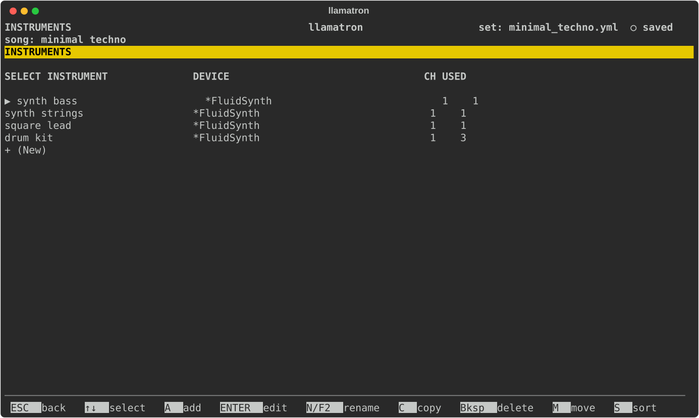

# Instruments

An instrument is where a track's notes go when the song plays in real time: a
MIDI device and channel, FluidSynth, or a sound llamatron makes itself, a
built-in instrument. This page covers the Instruments page and the instrument
editor.

## What an Instrument Is

An instrument names a device and a channel. The device is one of this
computer's MIDI output ports, with a channel on it from 1 to 16, or
FluidSynth, the free software synthesizer the tracker starts by itself. Each
track chooses an instrument in its track editor, and a track with none is left
out of real-time playback. Two instruments may share a device and a channel,
so one synthesizer can play every track, or each track can have a voice of its
own.

An instrument can also choose a General MIDI sound, which FluidSynth plays and
the MIDI (General MIDI) export gives the instrument's tracks. An instrument
with a sound but no device is there for that export alone, and its tracks are
silent in real time. When no track plays through an instrument with a device,
playback doesn't start, and a dialog says why. No other export reads an
instrument, since a Live set has instruments of its own.

## FluidSynth Instruments

An instrument whose Device is `*FluidSynth` plays through FluidSynth, as
[FluidSynth](FLUIDSYNTH.md) describes. Its Channel shows `(auto)`, because
each track through FluidSynth gets a channel of its own, as the MIDI (General
MIDI) export assigns them: channel 10 for a drum track, where FluidSynth plays
drums, and channels 1 to 16 in turn for the rest. Each clip starts by choosing
the track's General MIDI sound.

Every example plays this way as it comes: its Real Time switch is on, and
every track plays through a FluidSynth instrument, with a drum kit for the
drum tracks, so opening an example and pressing `Space` on Arrange's corner
plays it. A new set has no instruments until you add them.

## Built-in Instruments

A built-in instrument plays a sound llamatron makes itself, with no device: its
Kind is Built-in and its Engine chosen. The sound is made in a process of its
own, beside the one that sends MIDI, and MIDI and FluidSynth are held back by
the few milliseconds the sound takes to reach the speakers, so that every
instrument lands together. Built-in sound plays on macOS; elsewhere it is off
unless `ATTEMPT_SYNTHESIS_ANYWAY=1` is set in the environment.

### Parts and Engines

A built-in sound is made of parts, as a synthesizer is: Oscillators make the
raw tone; three envelopes shape it over each note, Env 1 its loudness, Env 2
its filter and Env 3 its pitch; a Filter takes away part of it, darker or
brighter; four LFOs wobble whatever the Mod Matrix routes them to; and two FX
color the result. Each part has a Type, and each type its own few controls, so
an ADSR shows Attack, Curve, Hold, Decay, Snap, Sustain and Release while a
Vactrol shows its Cell, what lights it, its Strike, Memory, Age and Stability.

An Engine is a starting point, a preset of all the parts: choosing one fills
every part as that instrument has them. Any part can then be swapped for
another type, even one from another engine, so an acid bass's oscillator can
play through a vactrol and a low-pass gate.

| Engine | What it starts as |
| --- | --- |
| Basic | Up to three oscillators, each Square, Saw, Sine, Triangle, Pulse or Off, detuned in cents and given a level, through snappy envelopes and a ladder filter each note's own, velocity opening the filter a little, up to 8 notes at once. |
| MechaDrum | A drum machine, Kick, Hard Kick, Synth Kick, Snare, Clap, Rim, Hats, Cowbell, Acoustic Tom or Karplus Drum, shaped by five knobs, Pitch, Decay, Color, Shape and Sweep, 0 to 127. The note tunes the drum from middle C, and a harder hit is brighter. A drum cuts its own last hit unless Overlap is on, and drums of one Choke group cut each other, as a closed hat cuts an open one. Only a percussion instrument offers it. |
| SID | A voice of the classic home computer's sound chip: a Triangle, Saw, Pulse or Noise wave, the pulse's width and its PWM speed, the width bouncing between 10% and 90%, Ring or Sync from a second oscillator an Interval away, and an Arpeggio of semitones stepped 50 times a second, through the chip's own envelope, whose four settings of 0 to 15 pick from its table of times. |
| Pocket | A voice of the handheld console's sound chip: a Pulse of one of four duties, the drawn Wave of 32 steps in one of five shapes, or Noise, long or short, its pitch sweep, and the chip's stepped envelope, a Start level of 15 stepped up or down at a pace. |
| Fishline | The acid bass: one voice of a saw, or the square a transistor shapes from it, its accent gate, a short sweep into the squelchy diode filter and a pedal's Drive, sliding legato. A note at Accent at's velocity or louder is accented: its filter opens further and falls fast over Accent decay, it swells for a moment, and a run of accents climbs higher, by Accent sweep and as far as Resonance lets it. |

A setting shown as a bar is a gauge: `[` and `]` step it, by more as a time
or a frequency grows, and `ENTER` types it.

### Voice

The Oscillators tab's Voice column holds what is the whole instrument's:
Volume, up to 150%; Voices, how many notes sound at once; Legato, where a note
that starts while another is held slides to it without starting its envelopes
again, as an acid line's tied steps do; Glide, how long a note takes to slide;
and Filter, Per note, each note its own filter as on a polysynth, or Shared,
one filter moved by the newest note, as on a paraphonic synth.

### Envelopes

An envelope is how a note rises and falls. ADSR rises over its Attack, its
Curve from a gentle swell through a straight ramp to the snappy charge of an
analog circuit, stays at the top for its Hold, falls over its Decay to its
Sustain while the note is held, and over its Release once it ends; Snap mixes
in a fast first drop, the click of a drum. AR rises and falls whatever the
note's length, a strike; ASR holds at full while the note is held. SID ADSR
and Chip steps are those chips' own envelopes, and Acid gate the acid bass's.

A Vactrol is the light and the light-sensitive cell of the West Coast
synthesizers: a strike lights it, and it falls in a curve that is snappy from a
hard strike and lingers from a soft one, so no two hits sound alike, and hits
close together build on each other. Cell runs from Fast to Lazy; Lit by is a
Strike at each note or the Gate, lit while the note is held; Memory is how much
a strike's light carries into the next; Age dims and slows the cell, and
Stability, at 100% unless lowered, is how alike each hit is.

### Filter

A filter takes away part of the sound, as the knob that makes a synth darker
or brighter does. Ladder is the warm four-pole filter of the classic
monosynths, which whistles on its own at full Resonance, its Slope 6, 12, 18 or
24 dB an octave; Multimode a clean two-pole that passes the lows, a band, the
highs or all but a notch, by its Mode; Sallen-Key a two-pole, low or high,
which screams as its Resonance rises; Diode the squelchy filter of acid bass
lines; OTA a creamier four-pole. Cutoff is where it starts cutting, in hertz;
Env 2 opens it on each note by its Env amount, a share of four octaves (below
zero it closes instead); Key track moves the cutoff with the note; Drive
pushes the sound into the filter for grit.

The Low-pass gate is the West Coast's filter and amp in one, moved together by
Env 1's light, so the sound darkens as it fades, like a struck object; with a
Vactrol envelope it is the classic pluck and bonk. Its Mode is VCA (loudness
only), Lowpass (the cutoff only, ringing with Resonance) or Both. Its Input is
the Oscillator, a Ping, a short strike each note that rings the gate as a
pitched bongo or log drum with no oscillator at all, or Both. Open is its
cutoff fully lit, and Key track moves it with the note, so a ping plays in
tune.

### LFOs, Matrix and FX

The LFOs tab holds four LFOs, each a slow or fast wobble, as a player's hand
shaking the pitch for vibrato or turning a knob back and forth. Each LFO is
off until switched on. Shape is Sine, Triangle, Saw up, Saw down, Square or
Sample & Hold, a new random value each cycle; Rate goes from 0.1 Hz to 100 Hz,
fast enough for chip vibrato and trills; Retrigger starts its cycle again with
each note, and Each scene whenever a scene starts.

The Mod Matrix tab's six slots say what moves what: each a Source (an
envelope, an LFO, the note's Velocity or Key, or a Random value drawn each
note), a Via that scales it, what it Moves (Pitch, Pulse width, Detune,
Cutoff, Resonance or Amp) and its Amount either way, a share of what it moves:
two octaves of pitch, six of cutoff. LFO 1 to Pitch is vibrato, with a Square
shape and a large Amount a chip trill; Velocity to Cutoff makes harder notes
brighter. Env 1 to the amp, Env 2 to the filter and Env 3 to the pitch are
already wired in, so all six slots are free.

The FX tab holds two effects, each empty, Bitcrush (Bits, and the Rate it holds
samples at) or Drive (a Curve, Soft, Warm, Hard, Fold or Wrap, and an Amount),
applied in order, each with a Mix of how much is heard.

Whatever a patch does, the built-in sound protects ears and speakers: a part
that runs away is silenced and starts again clean, the lowest rumble and the
highest hash are taken out, and a limiter keeps the loudest peaks just under
full scale; `Ctrl+T` silences everything.

## Missing Devices

When a set opens whose tracks play through an instrument that can't sound on
this computer, a dialog says which: FluidSynth when it isn't installed, and
each instrument whose MIDI port isn't connected, such as a set saved on
another computer with `IAC Driver Bus 1`. The set keeps every device, so the
set plays again wherever the device is, and the Instruments page can choose
another.

## Instruments Page

Press `I` on the main screen to open the Instruments page. The list shows each
instrument's device and channel, and how many tracks play through it. Adding
the first instrument turns the main screen's Real Time switch on, and deleting
the last turns it off.

| Key | What it does |
| --- | --- |
| `A` | Adds an instrument with no device yet, named `instrument-1` and so on, and opens it. |
| `ENTER` | Opens the instrument. |
| `C` | Copies the instrument to the end of the list. |
| `N` | Renames the instrument, updating every track that chose it. |
| `M` | Picks the instrument up: `↑↓` carry it, and `ENTER` drops it. |
| `S` | Sorts the instruments by name. |
| `Bksp` | Deletes the instrument, once no track uses it. |

## Instrument Editor

The editor shows the instrument's Name and how its steps' velocities play, its
Role, Kind and Engine, then seven tabs: MIDI, Oscillators, Envelopes, LFOs,
Filter, FX and Matrix. The MIDI tab is dim unless the Kind is MIDI, and the
others unless it is Built-in; a new instrument is off. `Tab` goes to the row of
tabs and back, and Left and Right choose a tab.

| Setting | What it does |
| --- | --- |
| Name | `ENTER` renames the instrument. |
| Default velocity | The velocity a step with none typed plays at on the instrument's tracks, 1 to 127, 127 unless set. A track's own Default velocity wins. An instrument that sounds harsh at full velocity is set once here. |
| Accent | What a step with its Accent on adds to its velocity on the instrument's tracks, 0 to 127, `+0` unless set. Each track's own Accent is added to it. See [Tracks](TRACKS.md). |
| Velocity | How loud every clip of the instrument's tracks plays, as a percentage, from 0% to 200%, 100% unless set, stacking with each track's, scene's and clip's. An instrument that is too loud beside the others is set once here. |
| Role | Normal or Percussion, chosen when the instrument is made and never changed: a percussion instrument plays on drum tracks and offers the drum engines. |
| Kind | Off, MIDI or Built-in: MIDI plays through its Device; an instrument off or built in keeps its Device for later and plays nothing through it. |
| Engine | A built-in instrument's preset of parts, from its Role's engines; choosing one fills every part. See Built-in Instruments above. |
| MIDI: Device | The MIDI output port, chosen with `ENTER` from `(none)`, then `*FluidSynth`, then the ports this computer has now, sorted. A port the set names that has disconnected is still offered, so that the set opens without the port and keeps it. `Bksp` sets none. |
| MIDI: Channel | 1 to 16, as the device numbers them. `[` and `]` step it, and `ENTER` types it. With `*FluidSynth` it shows `(auto)` and can't be changed, since each track gets its own channel. |
| MIDI: GM sound | One of General MIDI's 128 sounds, or `(none)`. `ENTER` opens a picker of General MIDI's sixteen families with `(none)` above them, where `Space` or `ENTER` on a family opens its eight sounds, `/` searches every sound, and `L` (listen) plays the sound under the cursor as a scale through FluidSynth, or, where FluidSynth is not installed, through the song's Preview instrument in that device's own sound; `[` and `]` step through the sounds by number, and `Bksp` sets none. A drum track always plays channel 10's drum kit. |
| MIDI: Keyswitch lead | How many milliseconds before its note a keyswitch is sent, 0 to 500, `0 ms` unless set. `[` and `]` step it, and `ENTER` types it. See Keyswitches below. |
| MIDI: Latency | How many milliseconds earlier the instrument's notes are sent, 0 to 500, `0 ms` unless set, for a device that is slow to sound. |
| Oscillators, Envelopes, Filter | Each part's Type and its settings, and the Voice. See Built-in Instruments above. |
| LFOs: LFO 1 to 4 | Whether each LFO is on, its Shape, Rate, Retrigger and Each scene. See Built-in Instruments above. |
| FX: FX 1 and 2 | Each effect and its settings. See Built-in Instruments above. |
| Matrix: Slot 1 to 6 | Each slot's Source, Via, what it Moves and its Amount. See Built-in Instruments above. |
| Preview pattern | A button that opens the instrument's own preview pattern in the pattern editor, for designing a sound before there is any music. Each instrument has its own, kept inside it in the set file and renamed, copied and deleted with it; no list of patterns shows it. It starts as sixteen sixteenth notes running up and down C major from middle C, on a hidden chromatic scale so that any note can be written without choosing a key, or, for a built-in drum, a C on each quarter in the set's drum octave. |
| Listen | A button: `ENTER` on it, or `L` from any field, plays the instrument's preview pattern again and again until `L` again, as does `L` in the preview pattern itself. Edits to the instrument and the pattern are heard as it plays. Leaving the page stops it. An instrument that plays nothing, its Kind Off, is refused. |
| Keyswitch Map | A button: `ENTER` on it, or `K` from any field, opens the instrument's Keyswitch Map. See Keyswitches below. |

## Keyswitches

A keyswitch is a note that a plugin reads as an order to change how it plays,
such as a string library's sustain, staccato and pizzicato, rather than as a
note to sound. An instrument holds a Keyswitch Map of ten slots, numbered 0 to
9, each with a name and the note that switches it. A pattern's steps name
slots, on the Keyswitch row described in [Patterns](PATTERNS.md), so the same
pattern works with whatever notes the instrument's plugin uses.

### Keyswitch Map

| Key | What it does |
| --- | --- |
| Up, Down | Move through the ten slots, and down from the last slot to the OK and CANCEL buttons. |
| Left, Right | Right moves from the slot's name to the slot's note, under the NOTE heading, and Left moves back; the triangle stands before the one the cursor is on. Up and Down keep that place, so one slot after another can be named. |
| `N` or `F2` | Names the slot, from the name or the note. A blank name leaves the slot without one. |
| `ENTER` | On a slot's name, names the slot. On a slot's note, opens the note picker. On a button, presses it. |
| `Bksp` | Empties the slot, its name and its note. |
| `O` | OK: the ten slots go into the instrument together, as one undo step. |
| `ESC` | CANCEL: nothing changes. |

A note is written in the set's octave labels with its MIDI number, such as `C0
(24)`. A slot with no note shows `(none)` under NOTE. A slot may have a name
and no note yet; a step that names such a slot plays nothing for it until the
slot has a note.

### Note Picker

The note picker is drawn over the Keyswitch Map and shows one octave of keys,
with the octave picked apart from the key. Left and Right move along the keys
of the octave, Up and Down change the octave, `ENTER` takes the note and `ESC`
closes the picker with nothing changed. The picker opens on the slot's own
note. For a slot with no note, it opens a half step above the highest note in
the map, or on the lowest C when the map is empty.

### How Keyswitches Play

A step's keyswitch notes start at the same moment as the step's note and are
sent before it, and each lasts as long as the note is written, ties included.
For a plugin that needs the keyswitch earlier, the instrument's Keyswitch lead
sends every keyswitch that many milliseconds before its note. A keyswitch
moves with its note when a groove, a Rush or a Drag moves the note. Nothing
else touches a keyswitch: a track's Transpose, the scale, a strum and every
other generator leave the note exactly as the map holds it, and its velocity
is always 100.

Keyswitches go to an instrument that plays through a MIDI port, and into the
MIDI file, MIDI stems, MIDI clips and Ableton Live set exports. An instrument
that plays through FluidSynth sends none, and the General MIDI file and the
WAV file leave them out, since a General MIDI player would sound each
keyswitch as a low note.
