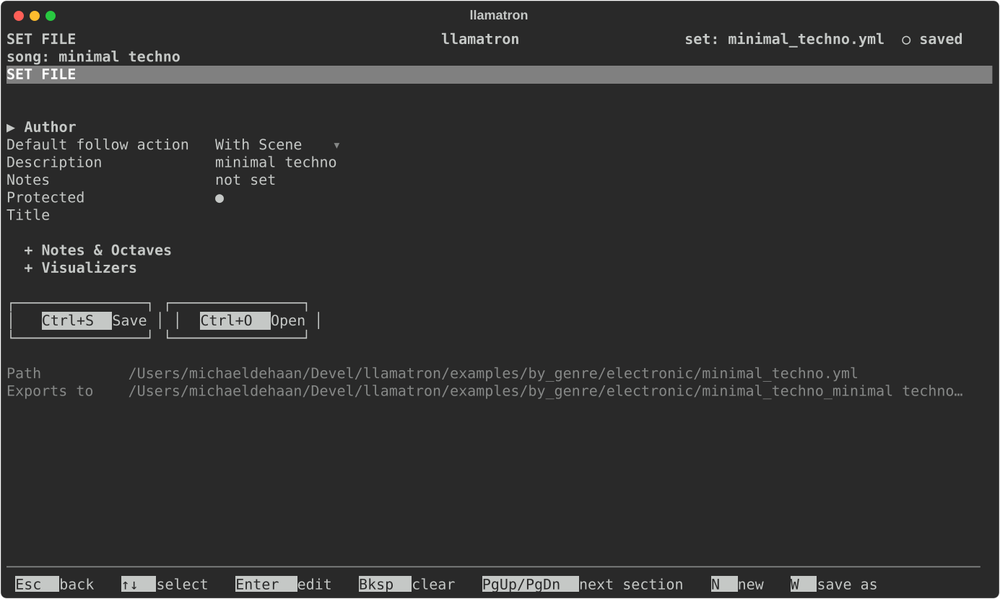
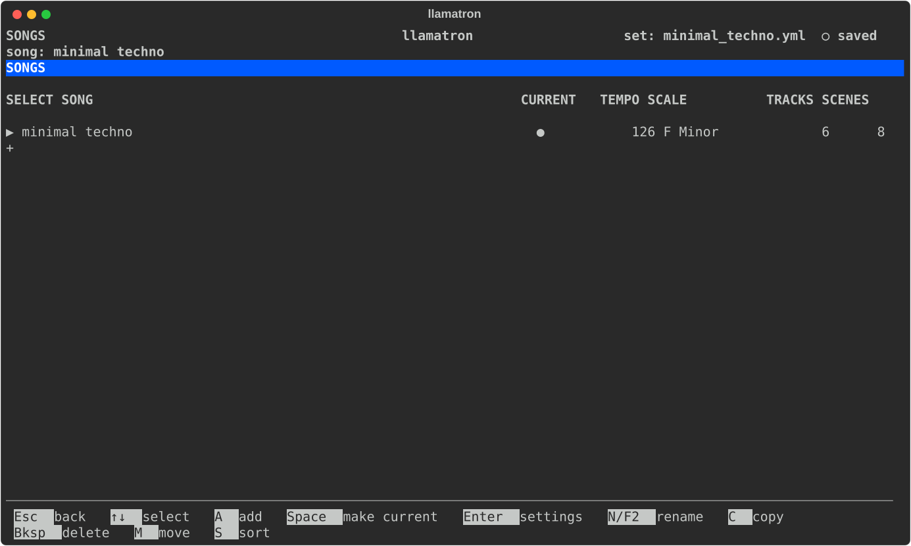
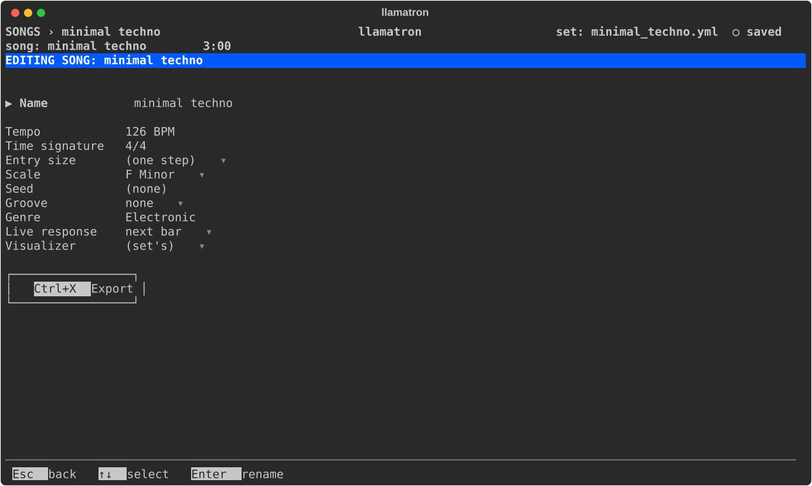

# Object Model

A file is a set of songs, which share its patterns, scales, generators, chains and grooves. This page covers the Set File page, the Songs page and each song's settings.

## Set File Page

Press `F` on the main screen to open the Set File page, which holds the set itself: what the file says about the set, the defaults every song starts from, and the keys that start a new set or save under a new name.

The loose settings come first, in alphabetical order, then two sections, closed until opened with `Space` or `Enter`: Notes & Octaves, the defaults every pattern starts from, and Visualizers.

| Setting | What it does |
| --- | --- |
| Author | Who wrote the set, also only for people reading the file. |
| Default follow action | What a clip's Advance does in real-time playback, unless the clip sets its own: "With Scene", "Next" or "Off". No export reads it. `Enter` chooses. |
| Description, Notes | What the set is, in a line, and anything else to say about it; see Description and Notes below. |
| Protected | Whether the file is protected from being saved over. `Space` or `Enter` turns it on or off. Every set in `examples/` is protected, so trying things in a demo can't spoil the demo: `Ctrl+S` offers to save a copy under another name instead, and the copy is yours and isn't protected. A set you start yourself isn't protected unless you turn this on. |
| Title | The set's name, for anyone reading or sharing the file, such as in git. It doesn't change how anything plays, and `Bksp` clears it. |

**Notes & Octaves**

| Setting | What it does |
| --- | --- |
| Default drum octave | The octave a new drum note gets. |
| Default octave | The octave a new note gets, in the set's octave labels. |
| Octave labels | How octaves are numbered on screen: as Live labels them, where middle C is C3, or in llamatron's own numbering from 0, where middle C is C5. `Enter` chooses. The setting changes only what you see, while the notes and the file stay the same. See Octave Numbering below. |
| Step size | How long each step of a pattern is, unless the pattern sets its own, from 1/64 to a whole note. `Enter` chooses from the list. A pattern's own step size is set in the pattern editor with `E`. |

**Visualizers**

| Setting | What it does |
| --- | --- |
| Visualizer | The visualizer mode Arrange's visualizer key shows first, unless a song names its own. `Enter` chooses. |
| Hide Visualizers | The modes the visualizer key leaves out, listed by name. `Enter` opens a list where `Space` picks or unpicks each mode, `Enter` keeps the choice and `Esc` changes nothing. |

Below the settings, two buttons save and open without remembering a key: `↓` from the last setting reaches them, `←` and `→` choose, and `Enter` on **Save** saves the set, as `Ctrl+S` does, and `Enter` on **Open** opens another set, as `Ctrl+O` does. Below the buttons, the page shows the path of the set's file and where the current song exports. [Opening and Saving](GETTING_STARTED.md#opening-and-saving) describes the keys `N` (New) and `W` (Save As).

### Description and Notes

The Description is one line saying what the set is, such as the tune it plays: `The Wellerman`, or `a C major scale`. `Enter` types it and `Bksp` clears it, as for the title. [About Demos](DEMOS.md) shows each example's description.

The Notes are as long as you like, for anyone reading or sharing the file: what each song or scene is for, or what to try. The notes don't change how anything plays. The Set File page shows their first line, or `not set`, and the notes are saved at the top of the file, where they read as plain text.

### Notes Page

`Enter` on Notes opens the Notes page for editing. Typing adds text at the cursor, `Enter` starts a new line, `Bksp` erases, and the arrows move the cursor; while editing, every letter is text, and only `Tab`, `Esc` and the arrows act as keys. Under the text are two buttons, Save and Cancel. `Tab` moves onto them, Left and Right choose one, `Enter` presses it, and `Tab` again returns to the text.

Save keeps the text in the set, to be saved with the set, as one change for undo. Cancel, or `Esc` anywhere on the page, throws away what was typed since editing began. Either one leaves the page reading, where Up and Down scroll, `E` starts editing again, `Bksp` clears all of the notes after asking, and `Esc` goes back to the Set File page. A protected set's notes open for reading only, and `E` and `Bksp` aren't offered until Protected is turned off.

### Octave Numbering

Octaves are shown as Live labels them unless the Octave labels setting says otherwise. With Live's labels, octaves run from -2 to 8, and degree 1 of C major in octave 3 is middle C (C3, MIDI note 60). llamatron's own labels count from 0, where C0 is MIDI note 0, so middle C is C5 and the top octave is 10. The file always stores llamatron's numbering, whichever labels you see, and a file saved by an earlier version of llamatron, which stored Live's numbering, is converted when it loads.

## Songs Page

Press `S` on the main screen to open the Songs page. The set's songs are listed with their tempo, scale, and number of tracks and scenes, and `●` marks the current song: the song Registers and Arrange edit and `Ctrl+X` exports. Each song has its own tracks, scenes and registers, while all of them share the set's patterns, scales, generators, chains and grooves, so the same pattern can play in every song.

| Key | What it does |
| --- | --- |
| `Space` | Make the selected song current |
| `Enter` | Make it current and open its settings |
| `A` | Add a song, asking for its name |
| `N` | Rename it. The song's name and the set's are independent. |
| `C` | Copy it, with its tracks, scenes and registers, named with the next free number: a copy of `verse` is `verse 2`, and a copy of `verse 2` is `verse 3`. Every copy on every page is named this way. |
| `M` | Pick it up: `↑↓` carry it, and `Enter` drops it |
| `S` | Sort the list by name |
| `Bksp` | Delete it, after asking. The set always keeps at least one song. |

### Song Page

`Enter` on a song opens the Song page.

| Setting | What it does |
| --- | --- |
| Name | The song's name, shown in the header. `Enter` renames it, the same as `N` on the Songs page. |
| Tempo | Beats per minute for the whole song, from 10 to 999. A scene can set its own. |
| Time signature | Beats over a note value, 4/4 to start. `[` and `]` step through the common ones, and `Enter` types any other, such as 7/8. The time signature changes nothing about when notes play: the pattern editor marks its beats with bold numbers and double lines, real-time launches wait for its bars, and the exports carry it so that Live and other DAWs draw the right bars. A pattern can have its own, set in the pattern editor through `R` (Reconfigure). |
| Entry size | How long a note placed on a pattern's piano roll lasts, when the pattern doesn't set its own: one of the step sizes, or `(one step)` of the pattern, which a new song starts with. `[` and `]` step through the sizes, `Enter` picks one from a list, and `Bksp` goes back to one step. |
| Scale | The song's scale, from the Scales page; a scene or a clip can use another. `Bksp` sets no scale, in which case patterns with degrees can't play or export. |
| Seed | With no seed, which a new song starts with, every play and export is a new take: the notes probability drops, random play directions and random arpeggiators all come out differently each time. A seed plays the same take every time, and a different seed gives a different take. `Bksp` clears it. |
| Groove | The swing or other timing feel every clip plays with, unless its scene or track chooses another, from the Grooves page. `none`, which a new song starts with, plays straight. `[` and `]` step through the grooves, and `Enter` picks one from a list. |
| Genre | A word or two saying what kind of music the song is, such as Folk or Electronic, only for people to read. `Enter` types it and `Bksp` clears it. [About Demos](DEMOS.md) groups the examples by genre. |
| Live response | When an edit made while the song plays is heard: "next bar", the default, "clip restart", at each playing clip's next pass, or "ASAP", at once. |
| Preview instrument | The instrument that Listen plays a pattern through. `(the pattern's track)`, which a new song starts with, plays a pattern through the track that uses it. `[` and `]` step through the set's instruments, `Enter` picks one, and `Bksp` clears. |
| Export | `Enter` here exports this song, the same as `Ctrl+X` anywhere, asking which kind of output first. |

## Set Files

Sets are saved as YAML, and each file records the version of llamatron that saved it, which the About dialog also shows. The format is mainly for llamatron to read, but it stays readable so that sets can be compared in version control, and the files in `examples/` show every part of it.

The shared sections come first, `scales`, `patterns`, the generators, `chains` and `grooves`, and then `songs` holds each song by name, with its tempo, scale, seed, groove, registers, tracks and scenes. Patterns are stored the way the editor shows them, with one list per row, so a change in the tracker makes a small change to the file. Every setting has a default, so a file can leave out anything it doesn't need, and a file written by an older version still loads: a file saved before llamatron 1.0.39 held one song and becomes a set of one song named after the file, and a file saved before llamatron 1.0.30, which stored Live's octave numbering, is moved up when it loads and written the new way when saved.
