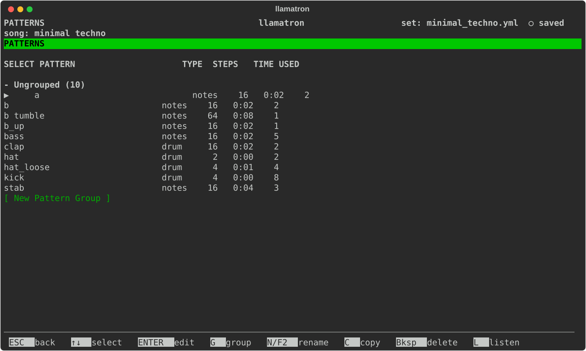
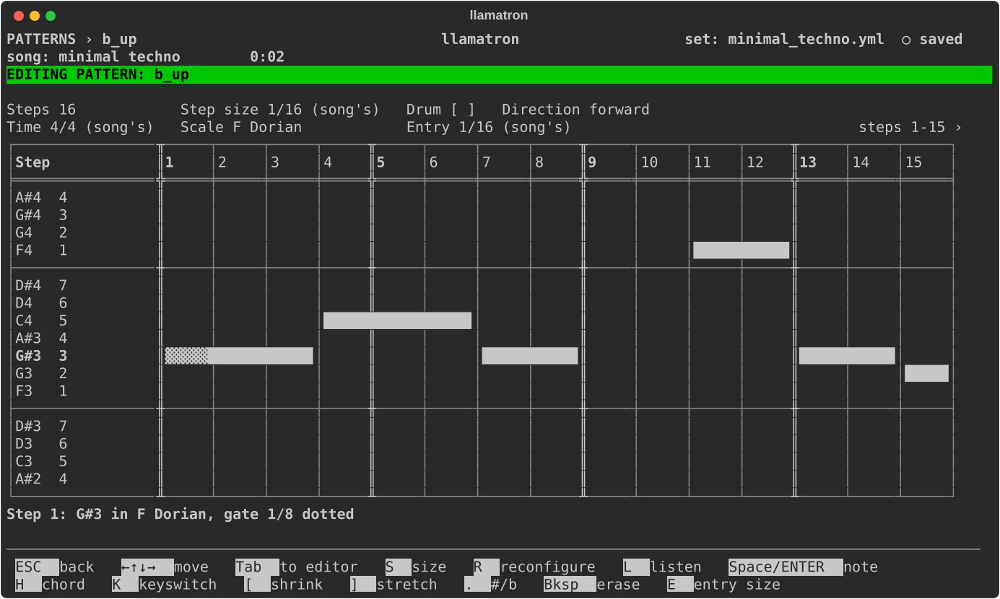
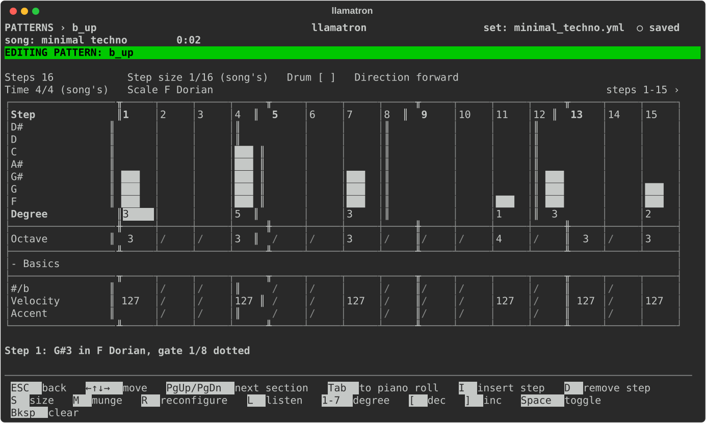
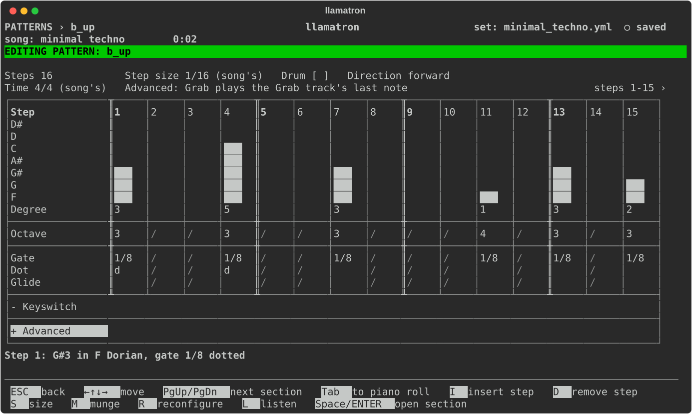
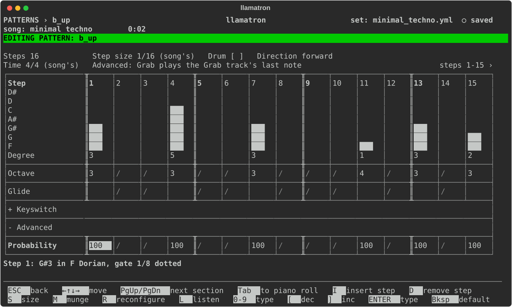
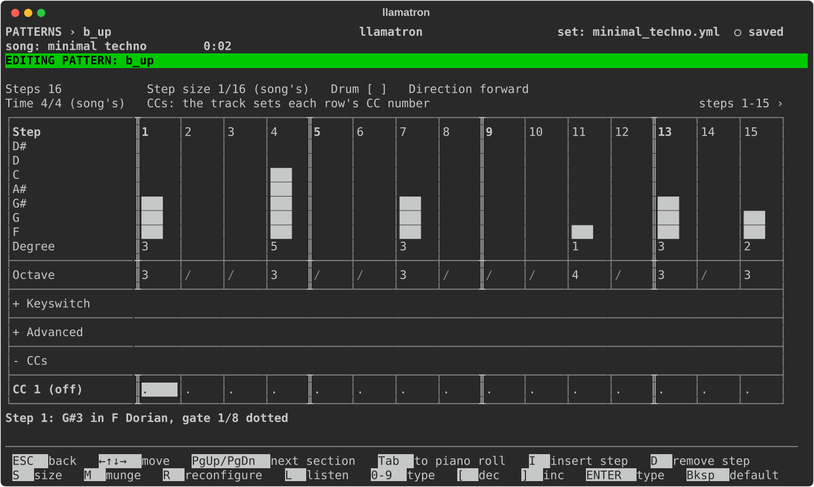
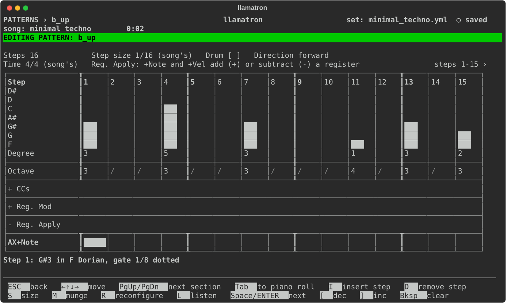
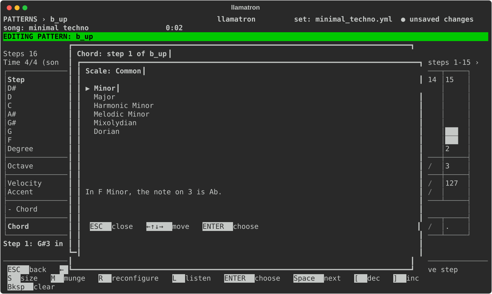

# Patterns

A pattern is a row of steps that clips play, written once and shared. This page covers the Patterns page and the pattern editor, with its piano roll and its rows.

## Patterns Page

Patterns hold the notes, and belong to the set, so every song can play them. Press `P` on the main screen to open the Patterns page. The patterns are listed by group, each group under a heading that `Space` or `ENTER` opens and closes, and the groups and the patterns in each are always sorted by name. Each open group ends with a `[ New Pattern ]` button, and the page ends with a `[ New Pattern Group ]` button. The patterns of a set saved before groups existed are listed last, under Ungrouped. The list shows each pattern's type, notes or drums, its number of steps, how long one play lasts at the current song's tempo, and how many clips use it in every song.

| Key | What it does |
| --- | --- |
| `A` | Adds a pattern to the group under the cursor and opens it. A new pattern starts one bar long in the current song's time signature at the set's step size: 16 steps in 4/4 at 1/16, 12 in 3/4 or 6/8, or 16 when a bar isn't a whole number of steps. |
| `ENTER` | Edits the selected pattern. |
| `N` | Renames the pattern, updating every clip that uses it. |
| `C` | Copies the pattern into its own group. |
| `G` | Moves the pattern to another group, picked from a list that ends with a new group. |
| `Bksp` | Deletes the pattern, once nothing uses it. |
| `PgUp`, `PgDn` | Jump to the heading before and the heading after. |

On a group's heading, the keys work on the whole group:

| Key | What it does |
| --- | --- |
| `Space`, `ENTER` | Opens or closes the group. Which groups are closed is saved with the set. |
| `A` | Adds a pattern to the group. |
| `N` | Renames the group. |
| `C` | Copies the whole group under a new name. Each copied pattern's name starts with the new group's name. |
| `Bksp` | Takes every pattern out of the group, after asking. No pattern is deleted. |

A pattern made anywhere else, such as a blank pattern on Arrange or a MIDI import, goes in the group named after its track.

## Piano Roll

A pattern that isn't a drum pattern opens on its piano roll. Each column is a step, and each row is one note of the scale, highest at the top, labelled with the note and its octave in the File/Global page's octave labels and then the degree, such as `E3   3`. A rule runs across the grid where each octave starts. When the pattern plays under more than one scale, the rows are labelled with the octave and degree alone, such as `oct3  3`, and the header says so.

### Drawing

A note is a bar that fills its cell. A note held over several steps is one unbroken bar running through the dividers, while two notes back to back keep the divider between them, so `█████│█████` is two notes and `███████████` is one held note. A note shorter than a step, from an entry size such as 1/32 on sixteenth steps or a short gate typed on the rows, fills only part of its cell, `███  `, as near as five columns can show, and a gate of a step and a half fills a cell and a half, so the bar ends where the sound does.

A sharp or flat has a row of its own between the two degrees it falls between, labelled dim with the note alone, such as `D#3`. The row appears while a note, or a chord's note, of the pattern is on it, and disappears when the last one goes, so a pattern that stays in its scale shows only the scale, and the cursor can reach a pitch outside the scale only where a note already has one.

A note that grabs its pitch from the clip's Grab track shows a `G` inside its bar in reverse video, `▓▓G▓▓`. The `G` is all the roll shows of such a note: a chord on a grabbing note has no thin lines, and the line describing the step says `the grabbed note`, because what is grabbed depends on the other track and isn't known until the song plays.

The cursor's cell stands between two bold double bars, `║▓▓▓▓▓║`, shaded on a note and a reversed blank on an empty cell. The rows outside the octaves of the one track that plays the pattern are dim and marked off with dots. The roll scrolls up and down through the octaves to keep the cursor on screen, and sideways as the rows do.

The two lines over the grid show the pattern's settings in aligned columns: Steps, Step size, Drum and Direction, and under them Time, Scale and Entry, the entry size, which is how long a note `Space` draws lasts; `(song's)` marks a value the pattern takes from the song. The labels down the left take the same width in both views, so the step columns stay in place when `Tab` switches views.

### The Pencil

The roll is one pencil. `Space`, or `ENTER`, draws a note of the entry size at the cursor, writing the note on its step and a tie on each further step it covers, so the rows show exactly what was painted; only an entry size shorter than a step writes a gate. `Space` on a note at the cursor's pitch erases that note with every step it holds, from any of the note's cells, exactly as `Bksp` does, so `Space` turns a note on and off. A note drawn again is a new note of the entry size, and `Ctrl+Z` brings back an erased note.

A note drawn at another pitch inside a held note cuts the held note where the new one starts, and the rest of the old note carries on after the new one as a note of its own, so drawing never silences anything to the right. A note whose gate reached over the new note's step is cut to end where the new note starts, and a note running past the end of the pattern is cut there. A note drawn on the step where a chord starts moves the chord's root to that pitch and keeps the chord, its tensions, scale, inversion and length; erasing the note removes the chord with it.

### Piano Roll Keys

| Key | What it does |
| --- | --- |
| Arrows | Move along the steps, and up and down a note of the scale, stopping at the edges. |
| `Home`, `End` | Go to the first and last step. |
| `Space`, `ENTER` | Draw a note of the entry size at the cursor, or erase the note under the cursor. |
| `H` | Picks the chord of the note under the cursor, from any of its cells, with `(none)` at the top to make it a single note again. On a step that holds no note, `H` draws a note at the cursor first, as Space would, and picks that note's chord. Where every clip that plays the pattern plays it under one scale, and the console has the room, the picker draws a keyboard under its lists, with the scale's keys outlined and the chord's keys filled. A chord's other notes are drawn as thin dim lines on their own rows, as long as the note, and follow the note rather than being edited on their own. |
| `[` (shrink), `]` (stretch) | Drag the end of the note under the cursor a step earlier or later, from any of its cells. A note shorter than a step becomes a whole step first, and the drag stops at one step and at the next note on the row. On a note whose length is a gate, stretching adds a tie after the gate's reach. |
| `K` | Picks the keyswitches of the note on the cursor's step, whichever row the cursor is on, in the dialog described under Keyswitches below. A step that no note covers takes none, and the status line says so. |
| `X` | The knife: splits the held note under the cursor at the cursor's step, so the rest of the note is a note of its own at the same pitch. |
| `.` | Cycles the note under the cursor through sharp, flat and natural. The note moves to the row that sounds it, a row of its own between two degrees, and the cursor follows. |
| `Bksp` | Takes out the note under the cursor, with the steps it held. |
| `G` | Marks the note under the cursor to grab its pitch from the clip's Grab track, or unmarks it. |
| `E` | Picks the entry size from a list: the song's, or one of the step sizes from 1/64 to a whole note. The entry size is the pattern's own setting, and the Song page's Entry size is what a pattern starts with. |
| `Tab` | Switches to the rows, and back. The pattern editor opens in the view you left it in. |

The legend under the roll keeps to drawing, while `X` and `G` still work there; `F1` lists them. The keys that work on the whole pattern, `S` and `R`, described under Editor Keys below, work on the roll too. Steps are inserted and removed in the rows view.

Velocity, probability and the other values are set on the rows, as are dotted and triplet gates; the roll draws the bar of what sounds. A chord can be picked in either view: `H` on the roll's note and `ENTER` on the Chord row's cell open the same [Chord Selector](#chord-selector). The roll shows a named chord's other notes where they sound in the scale the pattern plays under, so C minor in C major shows its E♭ on a dim `D#3` row between D and E, and shows none of them when the pattern plays under more than one scale; a scale chord's notes are degrees and always show. A chord with an inversion plays its root an octave up, so the note is drawn hollow (`░░░░░`) where it is written, since nothing sounds there, with a thin line where the root does sound. Drum patterns have no roll, and open on their rows.

## Rows View

Each column is a step, and each row is one kind of value. The grid is as wide as the pattern's step count, and a pattern wider than the screen scrolls sideways as the cursor moves, with `steps 1-11 ›` at the right of the header saying which steps are shown. Typing never moves the cursor and never grows the grid, so moving is always done with the arrows, which stop at the edges.

### Degree Gauge

Degree is drawn as a gauge: a bar in each step's column rising to the note's degree, with one row per note of the scale, labelled with the scale's notes down the left, and the degree as a number under the bars, where the cursor sits. The header's second line names the scale the gauge is drawn in, the scale the pattern plays under, or the song's when no clip plays the pattern; when the pattern plays under more than one scale, the rows are numbered instead, and the header says so. Octave sits right under the gauge. Degree and Octave stay at the top whatever rows are showing, while the rows beneath them scroll on a short screen; on a taller terminal nothing scrolls.

### Typing Numbers

Digits build up a number in a cell, so `1` then `2` makes 12. A new number starts once the cursor moves, or when the next digit would go out of range.

### Steps, Rests and Beats

A step with no degree or note is empty, which is a rest. The rows that only a note can hold, such as Octave, Velocity and Chord, show a light `/` on an empty step, and their keys leave the legend while the cursor is there. The rows a rest can hold, Tie, CC 1 to 4, Slide and every register row, stay open; Tie shows `/` on a step with a note, which can't take a tie.

Every step lasts the pattern's step size, shown at the top with the number of steps. The header's second line shows the time signature the pattern is drawn in, the song's unless the pattern sets its own through `R` (Reconfigure). A step that starts a beat has a bold number and a bold double line down its left edge, so a 16-step pattern in 4/4 is marked at 1, 5, 9 and 13, and in 6/8 at 1, 7 and 13. The beat marking changes only what is drawn. A step with a note sounds for its gate, which can run on past later steps but stops at the end of the pattern; a new note gets the song's default octave and a blank gate, which lasts one step.

## Editor Keys

These keys work throughout the rows view:

| Key | What it does |
| --- | --- |
| `ESC` | Goes back. |
| Arrows | Move. |
| `Home`, `End` | Go to the first and last step. |
| `PgUp`, `PgDn` | Jump to the previous or next section heading under Octave, stopping at the first and the last. |
| `Tab` | Switches to the piano roll. |
| `I` | Inserts an empty step before the cursor's step. |
| `D` | Removes the cursor's step, while there is more than one. |
| `S` | Sizes the pattern: a number of steps, from 1 to 4096. Resizing asks first if steps with something in them would be cut. |
| `R` | Reconfigures the pattern, from the list below. |
| `L` | Listen: plays the pattern at once, again and again, until `L` is pressed again, and the status line says the scale. The pattern plays in its own direction, in the scale of the first clip that uses it or else the song's, through the song's Preview instrument, set on the [Song page](OBJECT_MODEL.md). With no Preview instrument the pattern plays General MIDI's piano through [FluidSynth](FLUIDSYNTH.md), and a drum pattern always plays General MIDI's drum kit; where neither a Preview instrument nor FluidSynth is there to sound, `L` is not offered. Listen needs no Real Time switch, never stops a song playing from Arrange, and an edit made while the pattern plays is heard at its next pass. While the pattern plays, in Listen or in a clip of a song playing from Arrange, the piano roll shows a read head, a thin light yellow line on the step that sounds, and the rows show that step's number in light yellow. A direction that chooses its steps as it goes shows neither. `L` on the Patterns page does the same for the selected pattern. |
| `Space` | On the Degree row, takes the note off the cursor's step, or puts the scale's first degree on an empty step. |
| `Bksp` | Clears the cursor's step, on the Degree row. |
| `[`, `]` | Adjust the value at the cursor, down and up, on every row that holds a number; `-`, `+` and `=` do the same. |

## Reconfigure

`R` (Reconfigure) opens a list of changes to the whole pattern, which keeps the legend short:

| Choice | What it does |
| --- | --- |
| `load over` | Load a copy of another pattern over this one, asking first if this one has notes |
| `step size` | The pattern's own step size, typed as a whole number or a fraction like 1/8. Leave it blank to use the song's. |
| `time signature` | The pattern's own time signature, typed like 3/4, for a pattern in another meter than the song. Leave it blank to use the song's. The time signature changes which steps are marked as beats, and the grid of the pattern's clips in Live. |
| `drum on` or `drum off` | Notes and drums use different values, so changing between them clears the notes, and always asks first. |
| `direction` | The play direction |
| `rename` | Rename the pattern |

### Munge

`M` (Munge) opens a list of ways to change the whole pattern at once, under nine headings that open and close. `Space` or `ENTER` on a heading opens it, `PgUp` and `PgDn` jump between headings, and the headings left open stay open the next time. Typing searches every choice, whatever its heading. A choice whose name ends in `(cursor)` works around the step the cursor is on, `(N)` asks for a number, and `(pattern)` asks for another pattern. Every choice is one change to undo. In the examples, a pattern's steps are written A B C D E F G H and the cursor is on C.

| Heading | Choice | What it does |
| --- | --- | --- |
| Clear | clear all except pitch | Blank everything but which notes play: Degree, Octave, #/b and the chord rows stay, and every note goes back to one step long |
| Clear | clear chords | Blank every chord, with its tension, scale and inversion, leaving the note each chord was built on |
| Clear | clear every Nth step (N) | Make a rest of every step that far apart, to thin a busy line: with 4, the 4th, the 8th and so on |
| Clear | crop (cursor) | Remove every step after the cursor's step |
| Copy | copy after to end (cursor) | A B C D E F G H C D E F G H |
| Copy | copy after to start (cursor) | C D E F G H A B C D E F G H |
| Copy | copy before to end (cursor) | A B C D E F G H A B C |
| Copy | copy before to start (cursor) | A B C A B C D E F G H |
| Copy | mirror | Add the steps again, backwards: A B C D becomes A B C D D C B A |
| Other Patterns | interleave (pattern) | Put one step of the other pattern after each step of this one, which is then twice as long: A w B x C y and so on. The other pattern is read round and round, and is not changed |
| Other Patterns | splice after (pattern), splice before (pattern), splice (pattern, cursor) | Add a copy of the other pattern's steps after this one's last step, before its first, or before the cursor's step |
| Other Patterns | split into new patterns (N) | Make new patterns of this one's steps, N each, 16 to start: a pattern of 64 steps called `p1` gives `p1-split-1` to `p1-split-4`. The pattern itself is left as it is, and a dialog names the patterns made |
| Pitch | apply voice leading (no octave shift) | Give every chord after the first the inversion that moves its notes the least from the chord before, as a keyboard player keeps the hand in one place. The first chord stays as written |
| Pitch | apply voice leading (octave shift) | The same, and a chord may also move an octave down or up where that is nearer still |
| Pitch | invert melody (cursor) | Mirror every note around the cursor's note: a note 2 scale steps above it ends 2 below, so a line that rose now falls |
| Pitch | randomize pitches | Shuffle which pitch each note plays; the rhythm stays |
| Pitch | reverse pitches | The pitches play in backwards order on the same rhythm |
| Registers | clear register conditions | Blank every step's Stop When, Restart When and Mute When |
| Registers | clear register modifications | Blank the rows that set a register and that add to one; the rows that use a register stay |
| Registers | smooth AX=, smooth BX=, smooth CX=, smooth DX= | On the row that sets the register, fill the blank steps between two values from a straight line between them |
| Reorder | pivot (cursor) | Swap what's before the cursor with what's after it |
| Reorder | randomize all | Shuffle the steps into a random order. The shuffle is an ordinary edit, not seeded, so every randomize is different |
| Reorder | randomize after (cursor), randomize before (cursor) | Shuffle the cursor's step and the steps after it, or before it, among themselves |
| Reorder | reverse all | Reverse the whole pattern |
| Reorder | reverse after (cursor), reverse before (cursor) | Reverse every step after the cursor, or before it |
| Rhythm | divide long notes | A note that lasts several steps, by ties or a long gate, becomes a note on every step it covered |
| Rhythm | join repeated notes | Steps next to each other at the same pitch become one long note: the first keeps the note and the rest become ties |
| Rhythm | randomize rhythm | Move the notes earlier and later among the rests; the notes keep their order and their lengths |
| Roll | roll left (cursor), roll right (cursor) | Turn one side of the cursor by one step: roll left turns the cursor's step and the steps before it, A B C becoming B C A, and roll right turns the cursor's step and the steps after it, C D E F G H becoming H C D E F G |
| Roll | roll left (N), roll right (N) | Turn the whole pattern N steps: a step pushed off one end comes in at the other. Rolling A B C D E F G H left 3 gives D E F G H A B C |
| Velocity and CCs | humanize velocity (N) | Move each typed velocity up or down at random by no more than N |
| Velocity and CCs | smooth CCs | Fill the blanks between two values on each of CC 1 to CC 4: 20, blank, blank, blank, 100 becomes 20, 40, 60, 80, 100. The Slide row makes a finer sweep as the pattern plays; smooth CCs writes the values where they can be seen and changed |
| Velocity and CCs | smooth velocity | The same on Velocity, on the steps that hold a note |

A choice that would make the pattern longer than a pattern may be is refused, and a drum pattern is never combined with a pattern of notes. After a reverse, a pivot or a roll the cursor stays on its step; after steps are added in front, the cursor stays on its note.

Choosing the same reverse or pivot again undoes it. On a drum pattern's Note row, `D` types the note D, so move to another row to remove a step.

## Rows and Sections

Degree and Octave stay at the top, and under them the rows come in sections that open and close like an accordion. Each section is headed by a row of the grid with a rule above and below it and no step dividers across it, labelled `+` and the section's name while closed, such as `+ Advanced`, and `-` and the name while open. The cursor moves onto a heading like any row, keeping its step, and the heading's name shows in reverse video; `Space` or `ENTER` opens or closes the section, and `PgDn` and `PgUp` jump from heading to heading.

Basics and Timing start open, and the editor remembers which sections are open, for every pattern, for as long as it runs. When the open rows don't fit the screen, they scroll to keep the cursor's row in view. The sections, in the order a step works them out, are:

- **Basics:** #/b, Velocity, Accent;
- **Chord:** Chord, Tension, Scale, Inversion;
- **Timing:** Tie, Gate, Dot, Glide;
- **Keyswitch:** a row for each slot of the instrument's Keyswitch Map;
- **Advanced:** Probability, Ratchet, Ratchet Offset, Grab;
- **CCs:** CC 1 to CC 4, Slide;
- **Set Registers:** the rows that change the registers;
- **Use Registers:** the rows that use the registers;
- **Stop When, Restart When, Mute When:** a statement about the registers on each step, which stops the clip, starts the pattern over or mutes the step.

### Basic and Timing Rows

| Row | Values | Keys |
| --- | --- | --- |
| Degree | The gauge, 1 up to the size of the scale, where 1 is the root | Digits, `[` `]`, `Bksp` empties the step |
| Note (drum patterns) | A to G, with no gauge | Letters, `Bksp` empties the step |
| Octave | -2 to 8 with Live's labels, 0 to 10 with llamatron's (see Octave labels on the File/Global page) | Digits, `[` `]`, `Bksp` sets the default |
| Tie | `●` on an empty step after a note holds the note through that step. See below. | `Space` or `ENTER` toggles, `Bksp` turns it off. Only on empty steps. |
| Gate | How long the note sounds, in whole notes, like 1/16 or 5/16. Blank is one step. | `[` `]` step through 1/64, 1/32, 1/16, 1/8, 1/4, 1/2, 1, 2 and 4, `ENTER` types a whole number or a fraction, and `Bksp` makes it one step. |
| Dot | `d` makes the gate dotted, half as long again, and `t` makes it a triplet, two thirds as long, so 1/16 with `d` is 3/32 | `Space` or `ENTER` goes to the next one, `[` (dec) and `]` (inc) step back and forward, `Bksp` clears |
| #/b | Sharp or flat: moves the note a half step up or down | `Space` or `ENTER` goes to the next one, `[` (dec) and `]` (inc) step back and forward, `Bksp` clears |
| Chord | Builds a chord on the note | `ENTER` to choose from the list, `Space` goes to the next one, `[` (dec) and `]` (inc) step back and forward, `Bksp` clears |
| Inversion | Which of the chord's notes is at the bottom: blank for root position, `1` moves the chord's lowest note up an octave, `2` the lowest two and `3` the lowest three, which only a chord of four notes or more has, so a triad plays `3` as `2`. A step with no chord shows `/`, and the piano roll draws the chord's other notes where the inversion plays them. | `Space` or `ENTER` goes to the next one, `[` (dec) and `]` (inc) step back and forward, `Bksp` clears |
| Velocity | 1 to 127. A blank step plays at the Default velocity of the track that plays the pattern, 127 unless the track or its instrument says otherwise. | Digits, `[` `]`, `ENTER` to type, `Bksp` sets the default |
| Accent | `●` makes the step louder by the Accent of the track that plays the pattern, added to the step's velocity, typed or default, and stopping at 127. A blank is off. See [Tracks](TRACKS.md). | `Space` or `ENTER` toggles, `Bksp` turns it off |
| Glide | `●` makes the note run slightly into the next one, which a synth with glide turned on slides across. A blank is off. | `Space` or `ENTER` toggles, `Bksp` turns it off |
| Keyswitch section, a row for each slot | Whether the step's note is played with that slot of the instrument's Keyswitch Map. See Keyswitches below. | `Space` or `ENTER` toggles, `Bksp` clears |

When the scale is known, the Degree gauge is as tall as the scale, five rows for a pentatonic scale and seven for a major one, and a degree can't go past it: `]` at the top and `[` at the bottom stay where they are, and the status line says `top of C_major: change the octave on the Octave row`, since the gauge and the Octave row together make the note. A file can hold a degree past the scale's top, such as 9 in a seven-note scale; the editor shows and plays it as degree 2 an octave higher, and writes it back within the scale when nudged. When the scale isn't known, the gauge has seven numbered rows, any degree up to the largest scale the pattern plays in can be typed, and a degree above the rows fills the gauge and marks its number with `▲`.

### Ties

Tie draws a note out across the steps after it. Put a note on one step, then press `Space` on the empty steps that follow, and the note keeps sounding through every tied step: a sixteenth note followed by three ties is a quarter note, and the piano roll shows it as one bar.

Ties win over the gate: a note with ties after it sounds to the end of its ties whatever its gate says, so the ties you see are the length that plays, and the line under the grid says when a gate is being overridden. A note with no ties after it keeps its gate, so lengths can be drawn with ties or typed as gates. The Tie row works only on empty steps, because a tied step plays nothing of its own, and typing a degree on a tied step removes the tie, so the note ends there and later ties hold the new note. Emptying a note with `Bksp` also clears the ties that followed it, so no bar is left hanging onto an earlier note. In detail:

- A tie after an empty step holds nothing and is silent, as is a tie after a note that probability dropped.
- Ties go in the order the steps play, so with a play direction a tie holds whichever note played just before it.
- A tie on the first step of a pattern holds the last note of the pass before it, across repeats and loops of the same clip, which a gate can't do, since gates stop at the end of the pattern. At the very start of a clip nothing comes before the tie, so the tie is silent, including at the start of a new scene.
- A tie holds a whole chord, or the last slice of a ratchet, and glide on the note acts at the end of the held note.
- A tied step can still send CC values and change registers, like any empty step. During a morph, a tie on the first step follows the clip's own pattern.

### Glide and Probability

Glide does nothing before a rest or before the same pitch. Probability, on the Advanced rows, is rolled each time the song plays or exports, once for each repeat and each ratchet slice. A note that probability drops is silent however long its gate, and the note after it plays as normal. A song with a seed plays the same every time until the seed changes, and a song without one rolls afresh each time.

### Chords

The Chord section holds everything about a step's chord: the Chord row, the Tension row, the Scale row and the Inversion row. `ENTER` on the Chord, Tension or Scale row opens the [Chord Selector](#chord-selector), and on each of the three rows `[`, `]` and `Space` step through the choices, stopping at the first and the last; the Scale row steps through every scale type in the Chord Selector's order. While the cursor rests on a step that holds a chord, the status line names the chord and its notes.

A step whose Scale is set takes its degree and its scale chord from that scale type on the clip's root, which is how a chord is borrowed: in C major, degree 6 with the Scale "Minor" and the chord `3` plays A flat major. A tension is added above the chord's root, so `dom7` on degree 5 with `b9` and `13` plays G B D F A♭ E. A single note takes no tensions.

There are two kinds of chord.

**Named chords** are built in exact half steps up from the note, ignoring the scale, so they can play notes outside it. In C major, `M` on degree 3 is E major, which includes G#. The notes shown are on C:

| Chord | What it builds | On C |
| --- | --- | --- |
| `M` | Major | C E G |
| `m` | Minor | C E♭ G |
| `dim` | Diminished | C E♭ G♭ |
| `aug` | Augmented | C E G♯ |
| `sus2` | Suspended second | C D G |
| `sus4` | Suspended fourth | C F G |
| `pow` | Power chord | C G |
| `M6` | Major sixth | C E G A |
| `m6` | Minor sixth | C E♭ G A |
| `dom7` | Dominant seventh | C E G B♭ |
| `M7` | Major seventh | C E G B |
| `m7` | Minor seventh | C E♭ G B♭ |
| `mM7` | Minor-major seventh | C E♭ G B |
| `dim7` | Diminished seventh | C E♭ G♭ A |
| `m7b5` | Half-diminished | C E♭ G♭ B♭ |
| `aug7` | Augmented seventh | C E G♯ B♭ |
| `augM7` | Augmented major seventh | C E G♯ B |
| `7sus4` | Seventh, suspended fourth | C F G B♭ |
| `dom9` | Dominant ninth | C E G B♭ D |
| `M9` | Major ninth | C E G B D |
| `m9` | Minor ninth | C E♭ G B♭ D |
| `add9` | Added ninth | C E G D |
| `madd9` | Minor added ninth | C E♭ G D |
| `dom11` | Dominant eleventh | C E G B♭ D F |
| `M11` | Major eleventh | C E G B D F |
| `m11` | Minor eleventh | C E♭ G B♭ D F |
| `dom13` | Dominant thirteenth | C E G B♭ D F A |
| `M13` | Major thirteenth | C E G B D F A |
| `m13` | Minor thirteenth | C E♭ G B♭ D F A |

**Scale chords** are the plain numbers. Scale chords stack every other note of the scale, so they use only notes in it. The scale decides whether each one is major, minor or diminished, and they change when the scale does. The notes shown are on degree 1 of C major:

| Chord | What it builds | On degree 1 of C major |
| --- | --- | --- |
| `5` | Root and fifth | C G |
| `3` | Triad | C E G |
| `7` | Seventh | C E G B |
| `9` | Ninth | C E G B D |
| `11` | Eleventh | C E G B D F |
| `13` | Thirteenth | C E G B D F A |

In C major, `3` on degree 2 is D minor, and `5` on degree 7 is B and F, a diminished fifth. A `13` uses every note of a seven-note scale. In pentatonic, blues and other scales without seven notes, every other note isn't a third, so scale chords sound less like their names. A plain number always means a scale chord, which is why the named dominant chords are `dom7` to `dom13`.

Drum patterns have no Chord row.

### Keyswitches

A step can name keyswitches, the notes that change how a plugin plays, from the ten slots of its instrument's Keyswitch Map, which [Instruments](INSTRUMENTS.md) describes. In the rows, the Keyswitch section has a row for each slot the instrument's Keyswitch Map gives a name or a note, labeled with the slot's name, and each step's cell is a toggle: `Space` or `ENTER` turns the slot on for the step's note, and `Bksp` turns the slot off. A step may have several slots on. The rows are the instrument's when the instrument is known for certain, as described below; otherwise the section has a row, labeled by number, for each slot a step already uses, and the line over the rows says why.

On the piano roll, `K` opens a dialog of the ten slots, numbered 0 to 9:

| Key | What it does |
| --- | --- |
| Up, Down | Move through the slots. |
| `Space` | Turns the slot under the cursor on or off. |
| `0` to `9` | Turn that slot on or off, wherever the cursor is. |
| `ENTER` | OK: the step takes the slots that are on. |
| `ESC` | CANCEL: nothing changes. |

The dialog shows each slot's name and note when the instrument is known for certain: when the pattern editor was opened from a clip, whose track plays the instrument, or when every track that plays the pattern uses the one instrument. Otherwise the dialog shows the slots by number alone and says why, since a pattern stores slot numbers and is shared by every clip that plays it. A slot with no note in the map can still be turned on, and plays nothing until the instrument gives the slot a note.

On the piano roll, a step whose note has keyswitches shows a magenta light, `◆`, in the top row of the roll, in the step's column, drawn over a note's bar when a note is there. The line under the grid names the keyswitches of the cursor's step in both views.

## Advanced

Open the `Advanced` section to see these: `PgDn` to its heading and `Space`.

| Row | Values | What it does |
| --- | --- | --- |
| Probability | Chance of playing, 0 to 100, default 100 | Digits, `[` `]`, `ENTER` to type, `Bksp` sets the default |
| Ratchet | 1 to 16 | Splits the step into that many equal notes in the same time |
| Ratchet Offset | -24 to 24 | Moves each ratchet note that much further along the scale than the last one. In a drum pattern it moves by half steps instead. |
| Grab | `●` or blank | Plays the note that the clip's Grab track most recently played instead of this step's own, or the root of a chord, however the chord is inverted or voiced. A chord on the step's Chord row is built on the grabbed note. The Grab row works on an empty step too: marking one gives it the root in the default octave as a note of its own, so the step has a velocity and a gate like any other, and a marked step can't hold a chord. |

Gate and Dot are in Timing, with Tie, because ties draw a note's length where you can see it, and most patterns need nothing else. Unset values show a dot. The number rows take digits, `[` (dec) and `]` (inc), or `ENTER` to type, and `Bksp` sets them back. Grab is toggled with `Space`.

Grab works like the Cirklon's note grab, taking notes from the track that each clip names in Grab track. See [Clips](CLIPS.md) for how it works.

## CCs

Open the `CCs` section to see these. The CC rows send MIDI CC values, like the Cirklon's aux rows, and each track decides which CC number each row sends, so the same pattern can move different controls on different tracks.

| Row | Values | What it does |
| --- | --- | --- |
| CC 1 to CC 4 | 0 to 127 | Sends that value at the start of the step. A dot sends nothing, so the last value holds. The row's label says which CC number the lane sends on the tracks that play the pattern, like `CC 1 (74)`, or `(off)` when it sends nothing there, or `(?)` when the tracks send different numbers; a pattern no track plays yet shows the plain `CC 1`. |
| Slide | `●` or blank | Ramps each of this step's CC values to that row's next value, instead of jumping, like slide on an Elektron Monomachine |

CC rows and Slide can be set on a rest, so a sweep can carry on through silence. The number rows take digits, `[` (dec) and `]` (inc), or `ENTER` to type, and `Bksp` clears them. A ratchet doesn't repeat the values, and probability doesn't drop them.

In a Live set, each CC becomes a clip envelope, and Live draws a slide as a straight line. In MIDI files, a slide is sent as a new value every 1/64 note.

## Set Registers and Use Registers

The song has four registers, AX, BX, CX and DX: numbers the whole song shares, which pattern steps change and use as the song plays. Their settings are on the [Registers](REGISTERS.md) page. They're for changes that build up from bar to bar, like a note that climbs each time a riff comes round, or a fade.

The `Set Registers` section holds the rows that change the registers, and `Use Registers` the rows that use them.

| Row | Values | What it does |
| --- | --- | --- |
| AX+Note to DX+Note | `+`, `-` or blank | `+` moves the note up the scale by the register's value and `-` moves it down; blank leaves it. `Space` or `ENTER` cycles the three, `[` (dec) and `]` (inc) step back and forward, and `Bksp` clears. Not in drum patterns. Can be set on an empty step, where nothing moves. |
| AX+Vel to DX+Vel | `+`, `-` or blank | `+` adds the register's value to the velocity and `-` takes it off, keeping the velocity between 1 and 127; blank leaves it. The same keys. Can be set on an empty step, where nothing changes. |
| AX= to DX= | blank, or a value | Sets the register to this value when the step plays, before anything adds to it, held between the register's Minimum and Maximum; blank leaves it. `]` (inc) on a blank step gives the register's Minimum in the current song, `[` (dec) on the Minimum gives blank again, and `Bksp` clears. |
| AX+= to DX+= | minus to plus the register's Allowed Inc Max | Adds this much to the register when the step plays, or takes it away. `[` (dec) and `]` (inc) stop at the register's Allowed Inc Max on the [Registers](REGISTERS.md) page, 20 unless changed, the narrowest of the songs that play the pattern. |

How they work:

- A step sets the registers, then adds to them, then uses them, so a step's own `=` and `+=` already change its note.
- Every step sets and adds, even an empty one or one that probability or a Mute When statement silences, so a change can go on a step with no note. Putting it on the last step of a pattern means the first time through plays as written.
- A step that uses several registers adds all their values together, each added or subtracted as its row says. A register's value can be negative too, so `-` on a register holding -3 moves the note up three.
- A ratcheted step adds once, and every slice uses the same value.
- The registers are shared by every track, so one track can change a register that others use. Within a scene, steps are taken in time order, and steps at the same moment in track order. Only one track adding to a register usually makes the most sense.
- Values carry on from scene to scene, unless a scene resets them (see [Scenes](SCENES.md)).
- A morph's target pattern uses the registers but doesn't add to them.
- A note pushed out of the MIDI range moves to the nearest octave that fits.

## Stop When, Restart When and Mute When

A drummer who plays the fill only in every fourth bar, a riff that stumbles and starts again, a phrase that breaks off halfway through its third time: each is a player deciding, at one moment in the bar, by a count kept in the head. These three sections give every step of a pattern that decision, with a register as the count.

Each section holds one statement about the registers on each step, written down the step's column in five rows, `c1` to `c5`. The five rows are the five parts of a statement of [Conditional Execution](REGISTERS.md#conditional-execution), stood on end:

| Row | Holds | Example: `AX % 4 = 3` |
| --- | --- | --- |
| c1 | The register, or blank for no statement | `AX` |
| c2 | The operator: `<`, `<=`, `=`, `>=`, `>`, `odd`, `even`, `!=`, `+`, `-`, `%`, `*` or `/` | `%` |
| c3 | A number or a register | `4` |
| c4 | After a sum, how the result is compared | `=` |
| c5 | After a sum, the number or the register the result is compared with | `3` |

`AX >= 3` takes the first three rows and `AX odd` the first two; the rows a statement has no use for show a light `/`. `ENTER` chooses a part from a list, `Space` goes to the next choice or number, `[` (dec) and `]` (inc) step, and `Bksp` takes the step's whole statement away. A step with no note can hold a statement too.

| Section | When the step's statement is true |
| --- | --- |
| Stop When | The clip is done, as if it had played every repeat: the step and everything after it are not played, and the clip's follow action takes over. The clip plays again the next time its scene or another clip launches it. |
| Restart When | The pattern starts over from its first step, and the pass counts as one of the clip's repeats. A looping clip runs on, in passes of uneven length. The first step cannot hold one. |
| Mute When | The step does not sound. The step still sets and adds to the registers. |

How they work:

- A step's statements are read as the step is reached, before the step's own `=` and `+=`. A Stop When on the first step therefore ends the clip exactly on the edge of a pass.
- When several are true on one step, Stop When acts first, then Restart When, then Mute When.
- A step that stops the clip or starts the pattern over never makes its own register changes.
- A looping clip whose pattern holds a Stop When ends when the statement comes true, and its scene can then end. An export gives up on a statement that never comes true after 9999 passes.

In an example scenario, a pattern of 16 steps adds 1 to AX on step 8 and holds Stop When `AX >= 3` on step 9, and the scene sets AX to 0. The clip plays the pattern twice, plays the first 8 steps a third time, and is done: exactly two and a half times. `examples/learning/27_advanced_conditionals.yml` plays this, with a scene for each of the other two sections.

The demo `examples/learning/27_advanced_conditionals.yml` plays all three:

The register change rows take digits, `[` (dec) and `]` (inc), or `ENTER` to type a negative number, and `Bksp` clears them, and every register row can be set on an empty step: no register setting is ever locked out for want of a note, and erasing a note leaves the step's register rows as they are. The rows that use registers are toggled with `Space` or `ENTER`.

## Play Directions

`direction`, under `R`, sets the order the steps play in. Names follow the Cirklon.

| Direction | Order |
| --- | --- |
| forward | First step to last |
| reverse a | Step 1, then backward from the last |
| reverse b | Last step to first |
| alternate | Forward, then reverse |
| pendulum | Forward and back without repeating the ends |
| random | Any step |
| brownian | On 50% of the time, back 25%, stay 25% |
| eitherway | On or back, 50% each |

Whatever the direction, one pass through a pattern lasts as long as playing it forward does, with the last step cut to fit. A direction can't change how long a clip or scene is.

Positions carry on across repeats. The random directions draw their own random numbers, separate from the ones probability uses, so changing a direction never changes which notes probability drops. A clip can override the direction.

## Chord Selector

The Chord Selector chooses a step's chord in one place. `ENTER` on the Chord, Tension or Scale row of the rows view opens it, and so does `H` on a note of the piano roll. It holds four lists side by side: the chord's quality, with `(single note)` at the top; its inversion, with `(none)` for root position at the top; its tensions, the notes added on top, such as a flat ninth; and the scale the step borrows its notes from, with `(the clip's own)` at the top.

| Key | What it does |
| --- | --- |
| Arrows | Up and Down move within a list, Left and Right from list to list, stopping at the edges. |
| `Tab` | Goes to the next list, and round to the first. |
| `Space` | On a tension, turns it on or off. |
| `Space`, `ENTER` | On a category of scales, opens its flyout; on `(the clip's own)`, borrows no scale. |
| `ENTER` | On a quality, an inversion or a tension, takes the chord. |
| `ESC` | Cancels, changing nothing. |

The scale list, the last of the four, holds categories: Common, Modes, Harmonic & Melodic, Pentatonic & Blues, Symmetric, Jazz, Mid. East & Europe, East Asia and India. A category opens a flyout of its scale types, a box drawn over the Chord Selector, a little down and to the right. In the flyout, Up and Down move, `ENTER` picks a scale type and closes the flyout, and `ESC` or Left closes the flyout with nothing changed. After a pick the cursor goes on to the qualities, so that the next `ENTER` takes the chord, and the category shows the scale type picked, as in `[ Common ▸ Major ]`. Common holds the six scales most often borrowed from, which are also found in their own categories.

The lines under the lists say what the chord comes to as the choice moves: its name in the scale it is drawn from, its name in the clip's own scale when it borrows another, and its exact notes. The pattern underneath shows the chord at the same time: the piano roll draws the chord's other notes as thin green lines, and the rows show the values in their cells. Cancelling puts the step back as it was.
