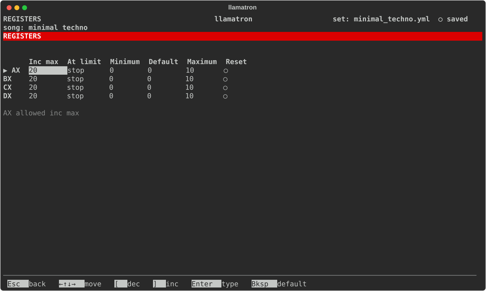

# Registers

Registers are four numbers that the whole song shares. Pattern steps set them, add to them, use them to move notes and velocities, and compare them to decide whether a note plays. This page covers the Registers page; the pattern rows that work with registers are described under [Reg. Mod, Reg. Apply and Reg. Cond](PATTERNS.md#reg-mod-reg-apply-and-reg-cond) on the Patterns page.

## Register Settings

Press `R` on the main screen to open the Registers page, a grid with a row for each register and a column for each setting. The four registers, AX, BX, CX and DX, belong to the current song, and each has these settings, shown across the grid as Inc max, At limit, Minimum, Default, Maximum and Reset:

| Setting | Default | What it does |
| --- | --- | --- |
| Default | 0 | The value the register holds when the song starts, and when a scene resets it. |
| Minimum | 0 | The lowest value the register can hold. |
| Maximum | 10 | The highest value the register can hold. |
| At limit | stop | What happens when a step adds past either end. "stop" stays at the end reached; "reset" goes back to Default; "overflow" lands on the other end; "overflow right" lands on Minimum when passing Maximum but stops at Minimum; "overflow left" does the reverse; and "pick random" lands anywhere from Minimum to Maximum, drawn from the song's seed. |
| Reset each scene | off | Whether the register goes back to Default as each scene first starts, though not on the scene's repeats. The Scene page's Reset field does the same for one scene. |
| Allowed inc max | 20 | The most a single step may add to the register or take from it; the `+=` rows stop there. Lowering it brings every add in every pattern the song plays within the new limit, and `Ctrl+Z` undoes that. |

Every number runs from -127 to 127, and Minimum can't be above Default, nor Default above Maximum; a change that would break that order is refused with the reason. The arrow keys move over the grid, stopping at every edge, and the line under it names the setting under the cursor in full. `[` and `]` change a number, `Enter` types one, and `Bksp` sets it back to its default. At limit steps through its choices with `[` and `]`, or `Enter` picks from a list, and `Space` or `Enter` turns Reset each scene on and off.

## Overflow

A register that overflows lands exactly on the other end, whatever amount was left over. With a range of 0 to 3, adding 1 to 3 gives 0, and so does adding 2; with At limit at "stop", the register stays at 3. A file saved before At limit existed, with its old Wraps setting on, opens with At limit at "overflow".

`examples/learning/22_registers.yml` shows every register at work.
