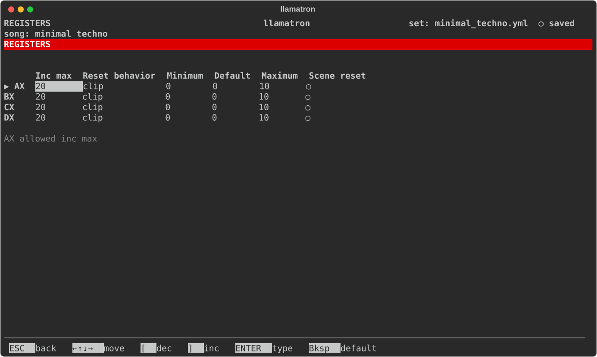

# Registers

Registers are four numbers that the whole song shares. Pattern steps set them, add to them, use them to move notes and velocities, and test them to decide what plays. This page covers the Registers page; the pattern rows that work with registers are described under [Set Registers and Use Registers](PATTERNS.md#set-registers-and-use-registers) and [Stop When, Restart When and Mute When](PATTERNS.md#stop-when-restart-when-and-mute-when) on the Patterns page.

## Register Settings

Press `R` on the main screen to open the Registers page, a grid with a row for each register and a column for each setting. The four registers, AX, BX, CX and DX, belong to the current song, and each has these settings, shown across the grid as Inc max, Reset behavior, Minimum, Default, Maximum and Scene reset:

| Setting | Default | What it does |
| --- | --- | --- |
| Default | 0 | The value the register holds when the song starts, and when a scene resets it. |
| Minimum | 0 | The lowest value the register can hold. |
| Maximum | 10 | The highest value the register can hold. |
| Reset behavior | clip | What happens when anything adds to the register, or takes from it, past either end. The choices are described under [Reset Behavior](#reset-behavior). |
| Reset each scene | off | Whether the register goes back to Default as each scene first starts, though not on the scene's repeats. The Scene page's Reset field does the same for one scene. |
| Allowed inc max | 20 | The most a single step may add to the register or take from it; the `+=` rows stop there. Lowering it brings every add in every pattern the song plays within the new limit, and `Ctrl+Z` undoes that. |

Every number runs from -127 to 127, and Minimum can't be above Default, nor Default above Maximum; a change that would break that order is refused with the reason. The arrow keys move over the grid, stopping at every edge, and the line under it names the setting under the cursor in full. `[` and `]` change a number, `ENTER` types one, and `Bksp` sets it back to its default. Reset behavior steps through its choices with `[` and `]`, or `ENTER` picks from a list, and `Space` or `ENTER` turns Reset each scene on and off.

## Reset Behavior

A register is a counter, and Reset behavior says what the counter does at the end of its range. A count that rolls round makes a cycle, a count that turns round makes a rise and a fall, and a count that holds makes a build that arrives and stays. The setting governs everything that adds to a register or takes from it: a step's `+=`, a scene's and a clip's Increment Registers, and what a generator or a drift adds. Setting a register to a value is never governed by it.

In each example, the register runs from 0 to 4 and a step adds to it every time a pattern comes round.

| Reset behavior | Past Maximum | Below Minimum | Adding 1, the register reads | Adding 3, the register reads |
| --- | --- | --- | --- | --- |
| clip | Holds at Maximum. | Holds at Minimum. | 0 1 2 3 4 4 4 | 0 3 4 4 4 |
| reset/clip | Goes to Minimum. | Holds at Minimum. | 0 1 2 3 4 0 1 | 0 3 0 3 0 |
| clip/reset | Holds at Maximum. | Goes to Maximum. | 0 1 2 3 4 4 4 | 0 3 4 4 4 |
| reset to default | Goes to Default. | Goes to Default. | 0 1 2 3 4 0 1, with Default at 0 | 0 3 0 3 0, with Default at 0 |
| reverse | Turns round. | Turns round. | 0 1 2 3 4 3 2 1 0 1 | 0 3 2 1 4 1 2 |
| overflow | Rolls round to Minimum, keeping what is left over. | Rolls round to Maximum, keeping what is left over. | 0 1 2 3 4 0 1 | 0 3 1 4 2 0 3 |
| pick random | Lands anywhere from Minimum to Maximum, drawn from the song's seed. | The same. | 0 1 2 3 4, then anywhere | 0 3, then anywhere |

The two names with a slash say what happens past Maximum first and below Minimum second. "reset/clip" suits a count that goes up, and "clip/reset" a count that goes down: with a step that takes 1 away, "clip/reset" reads 4 3 2 1 0 4 3.

A register set to "reverse" bounces off each end. Once past Maximum, every add takes away instead, and every subtraction adds, until the register passes Minimum and counts forward again. What is left over carries on back the other way: at 3, adding 3 goes up 1 to 4 and comes back down 2, to 2. Anything that sets the register, a step's `=`, a scene's or a clip's Set Registers or a reset, puts the register back to counting forward.

"overflow" keeps what is left over, so a step that adds 3 to a register of 5 values visits all 5 in a shuffled order before the cycle repeats.

`examples/learning/22_registers.yml` shows every register at work, and the scene called up and down in `examples/learning/27_advanced_conditionals.yml` plays "reverse" beside "overflow".

## Set Registers and Increment Registers

A band counts. A drummer plays a fill every fourth bar, and a guitarist changes the strum the second time through a verse. A register does the counting, and a scene or a clip can move a register without a pattern step doing so. The Scene page and the clip page each have two sections, closed until opened:

| Section | Fields | On a scene | On a clip |
| --- | --- | --- | --- |
| Set Registers | `AX =` to `DX =` | Sets the register to the value as the scene first starts, though not on the scene's repeats. | Sets the register to the value as the clip starts, the first time its pattern plays in each play of its scene. |
| Increment Registers | `AX +=` to `DX +=` | Adds the amount as the scene first starts and again on each of the scene's repeats. | Adds the amount every time the clip's pattern starts over. |

A field left at `(none)` leaves its register alone, and `Bksp` sets a field back to `(none)`. An amount added past a register's Minimum or Maximum does what the register's Reset behavior says. As a scene starts, the changes happen in one order: the registers' resets, the scene's sets, the scene's adds, each clip's sets, each clip's adds, and then the steps of the patterns.

## Conditional Execution

Conditional Execution lets the registers decide what plays. A table of up to 4 statements about the registers is read each time a clip's pattern starts over, and when any one statement is true, the table acts for that pass of the pattern. There are two tables:

| Table | Where | When a statement is true |
| --- | --- | --- |
| Bypass Generators When | A generator's page, a chain's statements (`W` in the chain editor), the Scene page, the clip page and the track editor | The notes of that pass go by the generators untouched. A generator's table leaves out that generator, wherever a chain names the generator; a chain's table leaves out the whole chain; a clip's table leaves out every chain the clip runs; a scene's and a track's tables do the same for each of their clips. |
| Skip Playback When | The clip page and the track editor | The clip sits that pass out in silence. Time goes on, the pass still counts toward the clip's Repeat, and the pattern's register steps still act, so the count never stops. |

So a guitar can stop strumming after its pattern has played 4 times, a fill can play in every fourth bar, and a note can be heard in every other bar.

Each line of a table is one statement, read from left to right:

| Statement | True when |
| --- | --- |
| `ignored` | Never. A line set to `ignored` does nothing. |
| `AX < 4` | AX is less than 4. The comparisons are `<`, `<=`, `=`, `>=`, `>` and `!=`. |
| `AX odd`, `AX even` | AX is odd, or even. |
| `AX % 3 = 0` | The remainder of AX divided by 3 is 0, which is every third count. The sums are `+`, `-`, `%`, `*` and `/`, and the result is compared with the number at the end. |
| `AX + BX > CX` | A register may stand wherever a number does. |

The sums are in whole numbers: a division rounds down, and a remainder is counted from 0 upward. A typed 0 is refused after `/` and `%`, and when a register that divides holds 0 the statement counts as true.

Left and Right move between the parts of a line and `ENTER` changes the part under the cursor: the register, the operator, and then a number or a register. `Bksp` sets the line back to `ignored`.

A step of a pattern can hold a statement of its own, which is read as the step is reached and stops the clip, starts the pattern over or mutes the step: see [Stop When, Restart When and Mute When](PATTERNS.md#stop-when-restart-when-and-mute-when).

`examples/learning/27_advanced_conditionals.yml` shows both tables and the three kinds of statement on a step: single notes that come and go by counting, one pattern of chords played four ways by one chain, a fill in every fourth bar, a riff that starts over, and a phrase played two and a half times.

