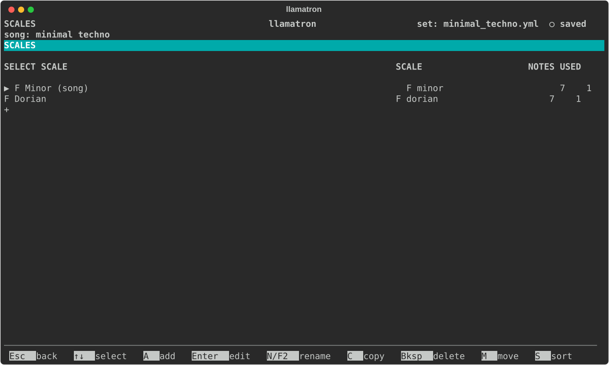
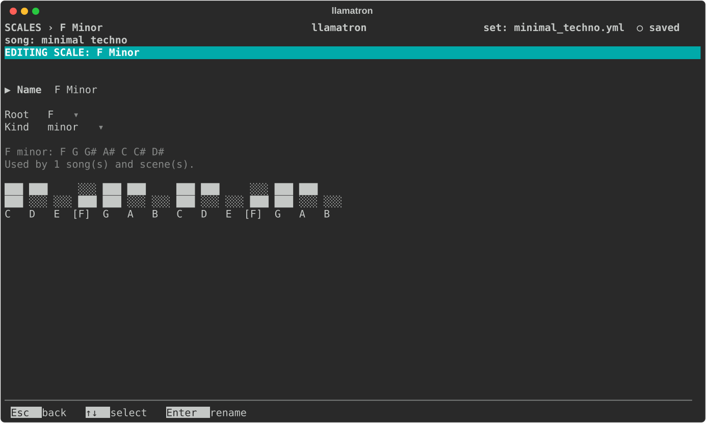

# Scales

Patterns hold scale degrees, and scales say which notes the degrees play. This page covers the Scales page and editing a scale.



## Named Scales

A scale is a root note and a kind, such as C major, under a name of your choosing. Scales belong to the set, so every song can use them, and a new set has one scale, called `C Major`.

The name can be anything, and that freedom is the point: call a scale `main` and use it everywhere, and changing what `main` is later moves the whole song into the new key. The song chooses a scale, each scene can choose another, and each clip can choose its own. A clip plays in its own scale when it has one, otherwise in its scene's, and otherwise in the song's.

## Scales Page

Press `Z` on the main screen to open the Scales page. The list shows each scale's notes, how many notes it has, and how many things use it.

| Key | What it does |
| --- | --- |
| `A` | Add a C major scale, named after what it is, and open its page |
| `Enter` | Open the scale's page, below |
| `N` | Rename it, which updates every song, scene and clip that uses it |
| `C` | Copy it |
| `M` | Pick it up: `↑↓` carry it, and `Enter` drops it |
| `S` | Sort the list by name |
| `Bksp` | Delete it, once nothing uses it. To delete the song's scale, clear it on the Song page first. |

## Scale Page



The Scale page holds one scale's name, root and kind, with the notes they make underneath and how many songs and scenes use the scale.

| Setting | What it does |
| --- | --- |
| Name | `Enter` renames the scale, and the song and every scene using it follow. |
| Root | The note the scale starts on. `[` and `]` step through the roots, and `Enter` picks one on a keyboard. |
| Kind | Major, minor, a mode or a world scale. `[` and `]` step through the kinds, and `Enter` picks from two pages. |

A scale still named after its root and kind, such as `C Major`, is renamed as its root and kind change, so that the name keeps saying what the scale plays. A name of your own, such as `main`, stays as it is, and so does a name of that default form when the new name is already taken.

## Scale Keyboard

Under the settings, a two-octave keyboard shows the scale. The black keys sit on a row above the white keys, each between the two white keys it belongs to; the scale's keys are filled (`███`) and the rest hatched (`░░░`), and the root is bracketed in the row of names beneath, such as `[F]`, or under its black key, such as `[Bb]`. The keyboard redraws as Root and Kind change, so a glance shows where the scale's half steps fall:

```
      ░░░ ░░░     ░░░ ░░░ ███     ░░░ ░░░     ░░░ ░░░ ███
    ███ ███ ███ ███ ███ ███ ░░░ ███ ███ ███ ███ ███ ███ ░░░
     C   D   E  [F]  G   A   B   C   D   E  [F]  G   A   B
```

## Root Picker

The root is picked on a keyboard, with each flat under the sharp that shares its key:

```
 C   C#   D   D#   E   F   F#   G   G#   A   A#   B
     Db       Eb           Gb       Ab       Bb
```

Left and Right move along the keys, and Up and Down switch between a sharp and its flat. A scale rooted on a flat spells its notes with flats, and any other root spells them with sharps.

## Kind Picker

The kind is picked from two pages, and the line underneath shows the notes of the kind under the cursor, such as `D dorian: D E F G A B C`. Up and Down move within a column, and Left and Right move to the next column. The top line names both pages, highlighting the current one, and shows `Tab ▸` when a page follows or `◂ Shift+Tab` when one comes before. `Tab` and `Shift+Tab` change page, as do Left and Right past the edge of a page, and neither goes round from the last page to the first.

**Common**

| Group | Kinds |
| --- | --- |
| Modes | major, ionian, dorian, phrygian, lydian, mixolydian, minor, aeolian, natural minor, locrian |
| Minor & major | harmonic minor, melodic minor, harmonic major |
| Symmetric | chromatic, whole tone, whole half dim, half whole dim, augmented |
| Pentatonic & blues | major pentatonic, minor pentatonic, blues, major blues, egyptian |

**Jazz & world**

| Group | Kinds |
| --- | --- |
| Melodic minor | melodic minor, dorian flat2, lydian augmented, lydian dom, mixolydian flat6, locrian natural2, altered |
| Jazz | bebop dom, bebop major, prometheus |
| Middle East & Europe | phrygian dom, double harmonic, hungarian minor, hungarian major, ukrainian dorian, persian, neapolitan minor, neapolitan major, enigmatic |
| East Asia | hirajoshi, in sen, iwato, kumoi, yo, ryukyu |
| India | todi, marwa, purvi |

Ionian is the same scale as major, and aeolian and natural minor are the same as minor. Melodic minor appears on both pages, the second time leading its modes, whose names spell out flat and natural: dorian flat2 is dorian ♭2. Ryukyu is the Okinawan scale, and the ragas are given in their twelve-note versions. The picker shortens "diminished" to "dim" and "dominant" to "dom" to fit, while set files keep the full names, such as `whole_half_diminished`.
