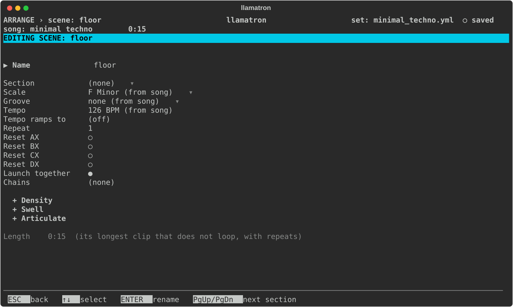
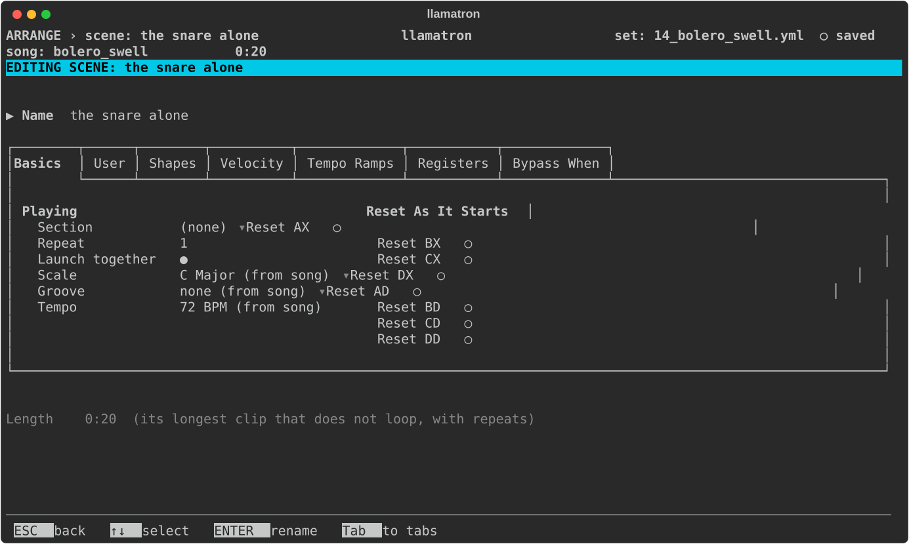
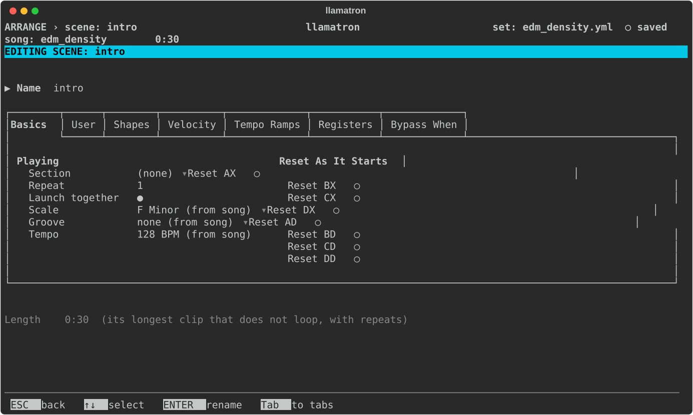

# Scenes

A scene is a row of Arrange: the clips that play together, with settings for the whole section. This page covers the Scene page.

## Scene Length

A scene starts all of its clips together and has no length of its own: a scene lasts as long as its longest clip that doesn't loop, times the scene's repeats.

## Scene Settings

On Arrange, `ENTER` on a scene's name opens the Scene page.

Under the Name, a box of tabs holds the rest, as on the clip page (see [Clips](CLIPS.md#clip-settings) for the keys): Settings, with Playing (Section, Repeat, Launch together, Scale, Groove, Tempo) and Reset As It Starts (the draws' resets); Generators, the Generators field; Shapes; Velocity, the Velocity field and the two ramps; Tempo Ramps; Bypass When. A scene has no built-in generators.

| Setting | What it does |
| --- | --- |
| Name | The scene's name. |
| Section | The kind of section the scene is, such as verse, chorus or solo, chosen from a list, or `(none)`. It changes nothing about how the scene plays. |
| Scale | A scale for the scene's clips in place of the song's. `Bksp` goes back to the song's. |
| Groove | A groove for the scene's clips in place of the song's, or `off` to play them straight whatever the song or a track chooses. A track's own groove still wins over the scene's, but not over the scene's `off`. `Bksp` goes back to the song's. |
| Tempo | A tempo in place of the song's. `Bksp` goes back to the song's. |
| Velocity | How loud every clip of the scene plays, as a percentage of each note's written velocity, from 0 to 200. Blank is 100%, the notes as written. See [Velocity and Velocity Ramps](#velocity-and-velocity-ramps). |
| Repeat | Plays the whole scene this many times, from 1 to 999. |
| Generators | The generators every clip of the scene runs, after each clip's own, edited as a clip's are. See [Generators](GENERATORS.md). |
| Launch together | For real-time playback only, and on by default: when a clip above sends a start to any clip of this scene, every clip of the scene starts together. When off, each clip starts only when the clip directly above it sends a start, and Arrange marks the scene with `┆` after its name. `Space` or `ENTER` toggles it. See [Playing Live](PLAYING_LIVE.md). |
| Tempo Ramp In, Tempo Ramp Out | On the Tempo Ramps tab, columns that move the tempo gradually at the scene's start and at its end. See [Tempo Ramps](#tempo-ramps). |
| Velocity Ramp In, Velocity Ramp Out | On the Velocity tab, columns that fade the scene in from its start and out to its end. See [Velocity and Velocity Ramps](#velocity-and-velocity-ramps). |
| Bypass When | A tab of statements about the registers. When one is true as a clip's pattern starts over, that pass goes by the clip's generators untouched. See [Conditional Execution](REGISTERS.md#conditional-execution). |
| Density, Articulate | On the Shapes tab, columns each with a Start, End, Over and Then that shape every clip of the scene across the whole scene, unless a clip sets its own shape or a generator in its chains does. See [Shapes](generators/SHAPES.md). |

The page shows how long the scene lasts, and any problem, such as every clip looping. Turning on a loop that leaves a scene with no clip that ends opens a Scene loop errors dialog naming the scenes to fix, and exporting while any scene is in that state does the same.

## Tempo Ramps

A band that eases into a song, a DJ set that creeps a few beats a minute faster over ten minutes, a last chorus that slows to a stop: each is a tempo that moves gradually instead of jumping. A scene has two ramps for that. Tempo Ramp In starts at the scene's first bar, and Tempo Ramp Out is counted back from the scene's last bar. Without a ramp, a scene plays at one tempo from start to end.

| Setting | What it does |
| --- | --- |
| Tempo in start, Tempo out start | The tempo the ramp starts from. Blank, the ramp starts from the scene's tempo, which is the Tempo field or else the song's tempo. |
| Tempo in end, Tempo out end | The tempo the ramp reaches. Blank, the ramp reaches the scene's tempo. |
| Tempo in over, Tempo out over | How many bars the ramp takes, from 1 to 9999. Blank, there is no ramp. |

A ramp needs its bars and a start or an end, and `Bksp` on a field makes the field blank again. The tempo changes at every step, the set's step size, a sixteenth note unless changed, so a ramp is a slope and never a stair of bars: a note in the middle of a bar is already a little faster than the note before. A ramp of 1 BPM over 64 bars is as smooth as a ramp of 40 BPM over 2. A scene that repeats counts its bars across all of its repeats together, so one ramp runs once through the whole scene. Where the bars of the two ramps overlap, Tempo Ramp In wins. Between the ramps the scene plays at its own tempo, and neither ramp changes anything after the scene: the next scene starts at its own tempo, so a tempo that should stay where a ramp took it is set as the next scene's Tempo.

In an example scenario, a song plays at 120 and a scene of 8 bars sets Tempo in start to 100 and Tempo in over to 2, and Tempo out end to 90 and Tempo out over to 1. The scene starts at 100, reaches 120 as bar 3 starts, plays bars 3 to 7 at 120, and slows through bar 8 to end at 90.

`examples/by_genre/electronic/minimal_techno.yml` climbs from 126 to 132 across its last five scenes, each scene's Tempo Ramp In taking all of the scene's bars to reach the tempo the next scene starts at, and its last scene's Tempo Ramp Out slows the final 2 bars to a stop.

The song's length, each scene's length and each clip's length on Arrange are measured through the ramps, as are the MIDI files, the WAV file and real-time playback. A Live set follows a ramp in Arrangement View only: see [Exporting](EXPORTING.md#export-contents).

## Velocity and Velocity Ramps

A band plays a verse quietly and a chorus loudly, a song fades in from nothing, and a last chorus fades away. A scene's Velocity is the first of these: every note of the scene plays at that percentage of the velocity the note was written with, so accents and soft notes keep their proportions. 100 is the notes as written, 50 is half as hard, 0 is as soft as a note can be, and a value above 100 plays harder, each note stopping at the top MIDI velocity.

The two ramps are the fades. Velocity Ramp In starts at the scene's first bar and Velocity Ramp Out is counted back from the scene's last bar. Each starts from the scene's Velocity and returns to it, unless the ramp says otherwise.

| Setting | What it does |
| --- | --- |
| Velocity in start, Velocity out start | The percentage the ramp starts from. Blank, the ramp starts from the Velocity field's value, shown as `80% (from Velocity)` or the like. |
| Velocity in end, Velocity out end | The percentage the ramp reaches. Blank, the ramp reaches the Velocity field's value. |
| Velocity in over, Velocity out over | How many bars the ramp takes, from 1 to 9999. Blank, there is no ramp. |

A ramp needs its bars and a start or an end. Between the two ramps the scene plays at its Velocity. Where the two overlap, the ramp in wins. A scene that repeats counts a ramp's bars across all of its repeats together, as a tempo ramp does.

In an example scenario, a scene of 8 bars has Velocity at 80, Velocity in start at 0 and Velocity in over at 2, and Velocity out end at 40 and Velocity out over at 1. The scene fades in from silence to 80% across its first 2 bars, plays bars 3 to 7 at 80%, and falls to 40% through bar 8.

A clip has the same seven fields on its clip page. Each field a clip sets wins over the scene's, and a field the clip leaves blank takes the scene's, shown as `80% (from scene)`. When a clip gives a ramp its own bars, the bars are counted over that clip's own play: from where the clip starts, and back from where the clip ends, which for a looping clip is the end of the scene.

A [Shapes](generators/SHAPES.md) generator's Swell, in a clip's chains, scales the same notes again, on top of the scene's and the clip's velocity, so that one Shapes generator can add accents or a shape of its own to many clips.

In `examples/learning/14_bolero_swell.yml`, each scene's Velocity Ramp In starts where the scene before ended, for one long crescendo:

How loud a velocity sounds is up to the instrument: some synth presets ignore velocity, and then none of this is heard.

## Section Shapes

The Scene page's sections shape every clip of the scene over its length. In `examples/by_genre/electronic/edm_density.yml`, the intro's Density ramps from 25 to 100 across the scene, filling in to a build:

