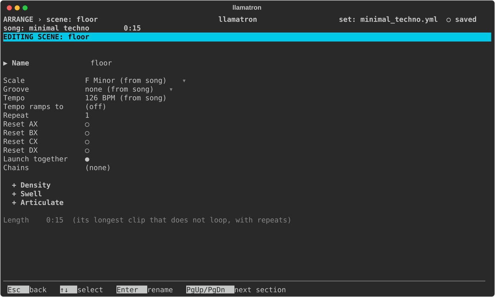
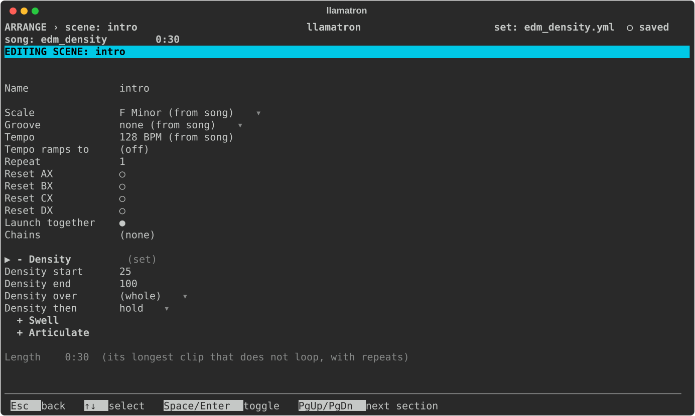
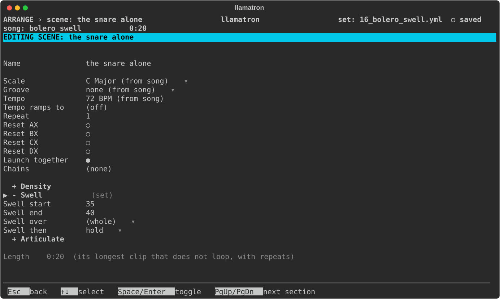

# Scenes

A scene is a row of Arrange: the clips that play together, with settings for the whole section. This page covers the Scene page.

## Scene Length

A scene starts all of its clips together and has no length of its own: a scene lasts as long as its longest clip that doesn't loop, times the scene's repeats.

## Scene Settings

On Arrange, `Enter` on a scene's name opens the Scene page.

| Setting | What it does |
| --- | --- |
| Name | The scene's name. |
| Scale | A scale for the scene's clips in place of the song's. `Bksp` goes back to the song's. |
| Groove | A groove for the scene's clips in place of the song's, or `off` to play them straight whatever the song or a track chooses. A track's own groove still wins over the scene's, but not over the scene's `off`. `Bksp` goes back to the song's. |
| Tempo | A tempo in place of the song's. `Bksp` goes back to the song's. |
| Tempo ramps to | Moves the tempo from Tempo to this value across the scene's repeats. `Bksp` turns the ramp off. |
| Repeat | Plays the whole scene this many times, from 1 to 999. |
| Chains | The chains every clip of the scene runs, after each clip's own, edited as a clip's are. See [Chains](CHAINS.md). |
| Launch together | For real-time playback only, and on by default: when a clip above sends a start to any clip of this scene, every clip of the scene starts together. When off, each clip starts only when the clip directly above it sends a start, and Arrange marks the scene with `┆` after its name. `Space` or `Enter` toggles it. See [Playing Live](PLAYING_LIVE.md). |
| Reset AX to Reset DX | Sets that register back to its default as the scene starts. `Space` or `Enter` toggles it. A scene that repeats resets only as it first starts, so a register can keep changing across the repeats. |
| + Density, + Swell, + Articulate | Sections, closed until opened, each with a Start, End, Over and Then that shape every clip of the scene across the whole scene, unless a clip sets its own shape or a generator in its chains does. See [Density](generators/DENSITY.md), [Swell](generators/SWELL.md) and [Articulate](generators/ARTICULATE.md). |

The page shows how long the scene lasts, and any problem, such as every clip looping. Turning on a loop that leaves a scene with no clip that ends opens a Scene loop errors dialog naming the scenes to fix, and exporting while any scene is in that state does the same.

## Section Shapes

The Scene page's sections shape every clip of the scene over its length. In `examples/by_genre/electronic/edm_density.yml`, the intro's Density ramps from 25 to 100 across the scene, filling in to a build:

In `examples/learning/16_bolero_swell.yml`, each scene's Swell picks up where the one before ended, for one long crescendo:

