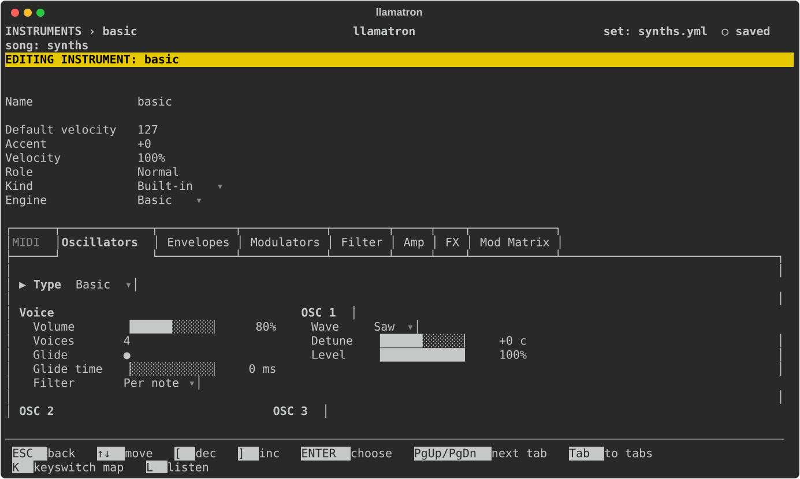
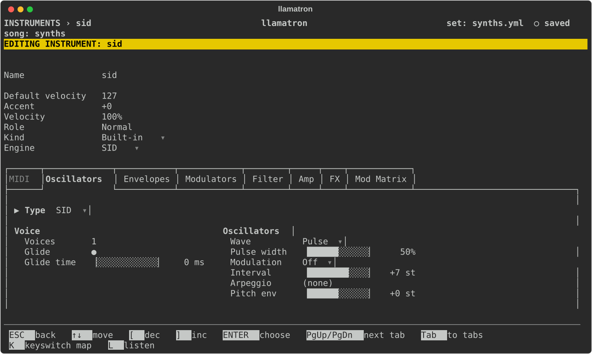
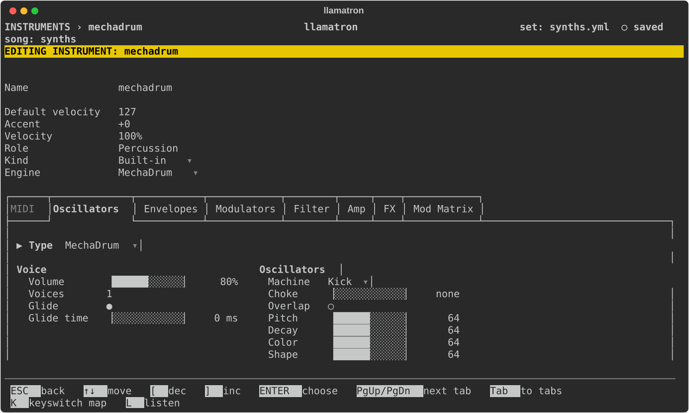

# Synths

llamatron has synthesizers of its own, so that a set can play with no DAW, no
hardware and no SoundFont. A built-in instrument is a semi-modular synth,
inspired equally by traditional monosynths, grooveboxes and eurorack modules,
in a fusion of the three that is mostly never seen before. Like a monosynth,
it is a voice you can play straight away, its parts already wired the way a
player expects. Like a groovebox, it comes with engines that each start as a
finished sound, chip voices and an acid bass and a drum machine among them,
ready for a pattern. Like a rack of modules, every part of it can be pulled
out and replaced by another: an acid bass's oscillator can play through a
vactrol and a low-pass gate, and a chip voice through a ladder filter.

## Choosing a Synth

On the Instruments page, open an instrument and set its Kind to Built-in. The
Engine field under it then chooses the synth, and the tabs below hold its
parts.

An engine is a starting point, a preset of every part: choosing one fills the
Oscillators, Envelopes, Filter, LFOs, FX and Mod Matrix tabs as that synth has
them. Each part has a Type, and any part can then be swapped for another type,
even one another engine starts with, so that the engines are places to start
rather than walls. A part's settings are only the ones its type has, so an
ADSR shows its Attack, Decay, Sustain and Release, and a vactrol its Cell,
Memory, Age and Stability.

## Engines

The engines come in two lists. A standard engine plays notes, for a lead, a
bass, a pad or a chord. A drum engine plays hits, for a percussion instrument,
each note tuning the drum. Engines marked planned are agreed and not built
yet; their pages say so.

### Standard

- [Basic](synths/engines/BASIC.md): up to three band-limited oscillators of
  classic waveforms.
- [SID](synths/engines/SID.md): an 8-bit sound chip's voice, with ring
  modulation, sync and fast arpeggios.
- [Pocket](synths/engines/POCKET.md): a 4-bit chip's pulse, drawn wave and
  shift-register noise.
- [Fishline](synths/engines/FISHLINE.md): an acid bass, its accents and
  slides.
- Planned: [Asheville](synths/engines/ASHEVILLE.md),
  [Monorail](synths/engines/MONORAIL.md), [Choir](synths/engines/CHOIR.md),
  [MozaicClassic](synths/engines/MOZAICCLASSIC.md),
  [MozaicHypersaw](synths/engines/MOZAICHYPERSAW.md),
  [Syrup](synths/engines/SYRUP.md), [DustCart](synths/engines/DUSTCART.md),
  [BitArcade](synths/engines/BITARCADE.md),
  [Bytecrunch](synths/engines/BYTECRUNCH.md),
  [Piano](synths/engines/PIANO.md), [Tonewheel](synths/engines/TONEWHEEL.md),
  [Combo Organ](synths/engines/COMBO_ORGAN.md),
  [Stringy](synths/engines/STRINGY.md), [FM](synths/engines/FM.md), [Bit
  Saw](synths/engines/BIT_SAW.md), [PhoneHome](synths/engines/PHONEHOME.md),
  [Dialup](synths/engines/DIALUP.md), [Pluck](synths/engines/PLUCK.md),
  [Strings](synths/engines/STRINGS.md), [Pipe](synths/engines/PIPE.md),
  [Wavetable](synths/engines/WAVETABLE.md),
  [ComplexOsc](synths/engines/COMPLEXOSC.md) and
  [Harm](synths/engines/HARM.md).

### Drum

- [MechaDrum](synths/engines/MECHADRUM.md): a drum machine of ten drums, from
  kicks to a physical model of a drum head.
- Planned: [Oh8](synths/engines/OH8.md), [Oh9](synths/engines/OH9.md),
  [SynTom](synths/engines/SYNTOM.md), [FM Kick](synths/engines/FM_KICK.md),
  [FM Snare](synths/engines/FM_SNARE.md), [FM Tom](synths/engines/FM_TOM.md),
  [FM Metal](synths/engines/FM_METAL.md), [FM
  Bell](synths/engines/FM_BELL.md), [Glitch
  Drum](synths/engines/GLITCH_DRUM.md), [Chirpy](synths/engines/CHIRPY.md),
  [Pocket Drum](synths/engines/POCKET_DRUM.md) and
  [Struck](synths/engines/STRUCK.md).

## Oscillators of Each Engine

The Oscillators tab holds the raw sound, and is where the engines differ most.
Its Voice column, at the left, is the same for every engine.

### Basic

### SID

### Pocket

### Fishline

### MechaDrum

## Voice

The Oscillators tab's Voice column holds what is the whole instrument's:
Volume; Voices, how many notes sound at once; Legato, where a note that starts
while another is held slides to it without starting its envelopes again, as an
acid line's tied steps do; Glide, how long a note takes to slide; and Filter,
Per note, each note its own filter as on a polysynth, or Shared, one filter
moved by the newest note, as on a paraphonic synth.

## How a Voice Is Wired

Each note is a voice, run one sample at a time. Its oscillator makes the tone,
its pitch moved by the glide, by Env 3 through the oscillator's Pitch env and
by the Mod Matrix. The filter takes part of the tone away, its cutoff moved by
Env 2 through the filter's Env amount, by key tracking and by the Mod Matrix.
The amp sets the loudness, from Env 1 and the note's velocity, moved by the
Mod Matrix. These routes are wired in, as a semi-modular synth's normalled
connections are, so that every slot of the Mod Matrix stays free for movement
of your own. The instrument's voices are then added together and pass through
its effects in order.

A shared filter is the exception to "each note its own": the voices are added
first, and the one filter, moved by the newest note, takes their sum. A
low-pass gate is always each note's own, since it is that note's amp as well
as its filter.

Each part has a page of its own:

| Part | Page |
| --- | --- |
| Env 1, Env 2 and Env 3 | [Envelopes](synths/ENVELOPES.md) |
| The filter or the low-pass gate | [Filters](synths/FILTERS.md) |
| Four LFOs | [LFOs](synths/LFOS.md) |
| Six routes of what moves what | [Mod Matrix](synths/MOD_MATRIX.md) |
| Two effects in order | [Effects](synths/EFFECTS.md) |

A setting shown as a bar is a gauge: `[` and `]` step it, by more as a time or
a frequency grows, and `ENTER` types it.

## How the Sound Is Made

The synths run in llamatron's backend, apart from the pages the tracker draws,
on threads of their own, so that a page being drawn never makes a note late;
[Backend](BACKEND.md) describes it in full. The sound reaches the sound card
through cpal, a Rust library for audio output: CoreAudio on macOS, ALSA on
Linux and WASAPI on Windows. llamatron is built and played mostly on macOS, so
a problem with sound on Linux or Windows is most likely in the sound card's
driver or cpal's support for it; the backend writes what it found at start-up,
and any problem, to rotating log files in `~/.llamatron/`.

The audio callback, which the sound card calls for each chunk, only plays:
everything an instrument needs is made when the instrument is compiled, on
another thread, and the callback allocates nothing and waits on no lock. Notes
and changes reach it through lock-free queues. MIDI and FluidSynth are held
back by the moment the sound takes to reach the speakers, so that every
instrument lands together.

Whatever a patch does, the built-in sound protects ears and speakers: a part
that runs away is silenced and starts again clean, the lowest rumble and the
highest hash are taken out, and a limiter keeps the loudest peaks just under
full scale; `Ctrl+T` silences everything.
