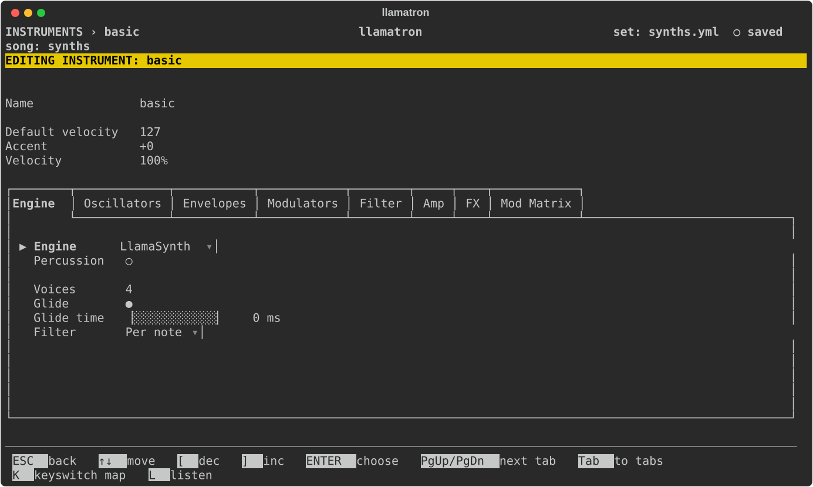

# Synths

llamatron has synthesizers of its own, so that a set can play with no DAW, no
hardware and no SoundFont. A built-in instrument is a semi-modular synth,
inspired equally by traditional monosynths, grooveboxes and eurorack modules,
in a fusion of the three that is mostly never seen before. Like a monosynth,
it is a voice you can play straight away, its parts already wired the way a
player expects. Like a groovebox, it comes with engines that each start as a
finished sound, chip voices and an acid bass and a drum machine among them,
ready for a pattern. Like a rack of modules, every part of it can be pulled
out and replaced by another: an acid bass's oscillator can play through a
vactrol and a low-pass gate, and a chip voice through a ladder filter.

## Choosing a Synth

On the Instruments page, open an instrument and set its Kind to Built-in. The
Engine field under it then chooses the synth, and the tabs below hold its
parts.

An engine is a starting point, a preset of every part: choosing one fills the
Oscillators, Envelopes, Filter, LFOs, FX and Mod Matrix tabs as that synth has
them. Each part has a Type, and any part can then be swapped for another type,
even one another engine starts with, so that the engines are places to start
rather than walls. A part's settings are only the ones its type has, so an
ADSR shows its Attack, Decay, Sustain and Release, and a vactrol its Cell,
Memory, Age and Stability.

## Engines

The engines come in two lists. A standard engine plays notes, for a lead, a
bass, a pad or a chord. A drum engine plays hits, for a percussion instrument,
each note tuning the drum. Engines marked planned are agreed and not built
yet; their pages say so.

### Standard

- Basic: [Basic](synths/engines/BASIC.md).
- Analog Mono: [Fishline](synths/engines/FISHLINE.md),
  [Asheville](synths/engines/ASHEVILLE.md) (planned),
  [Monorail](synths/engines/MONORAIL.md) (planned).
- Analog Poly: [Choir](synths/engines/CHOIR.md) (planned),
  [MozaicClassic](synths/engines/MOZAICCLASSIC.md) (planned),
  [MozaicHypersaw](synths/engines/MOZAICHYPERSAW.md) (planned),
  [Syrup](synths/engines/SYRUP.md) (planned).
- Chip: [SID](synths/engines/SID.md), [Pocket](synths/engines/POCKET.md),
  [DustCart](synths/engines/DUSTCART.md) (planned),
  [BitArcade](synths/engines/BITARCADE.md) (planned),
  [Bytecrunch](synths/engines/BYTECRUNCH.md) (planned).
- Classic Keys: [Piano](synths/engines/PIANO.md) (planned),
  [Tonewheel](synths/engines/TONEWHEEL.md) (planned), [Combo
  Organ](synths/engines/COMBO_ORGAN.md) (planned),
  [Stringy](synths/engines/STRINGY.md) (planned).
- Digital: [FM](synths/engines/FM.md) (planned).
- Noise and Glitch: [Bit Saw](synths/engines/BIT_SAW.md) (planned),
  [PhoneHome](synths/engines/PHONEHOME.md) (planned),
  [Dialup](synths/engines/DIALUP.md) (planned).
- Other Modelling: [Pluck](synths/engines/PLUCK.md) (planned),
  [Strings](synths/engines/STRINGS.md) (planned),
  [Pipe](synths/engines/PIPE.md) (planned).
- Wavetable: [Wavetable](synths/engines/WAVETABLE.md) (planned).
- West Coast: [ComplexOsc](synths/engines/COMPLEXOSC.md) (planned),
  [Harm](synths/engines/HARM.md) (planned).

### Drum

- Classic: [MechaDrum](synths/engines/MECHADRUM.md),
  [Oh8](synths/engines/OH8.md) (planned), [Oh9](synths/engines/OH9.md)
  (planned), [SynTom](synths/engines/SYNTOM.md) (planned).
- FM Drums: [FM](synths/engines/FM_DRUMS.md).
- Noise: [Glitch Drum](synths/engines/GLITCH_DRUM.md) (planned),
  [Chirpy](synths/engines/CHIRPY.md) (planned), [Pocket
  Drum](synths/engines/POCKET_DRUM.md) (planned).
- Modelling: [Struck](synths/engines/STRUCK.md) (planned).

## How a Voice Is Wired

Each note is a voice, run one sample at a time. Its oscillator makes the tone,
its pitch moved by the glide, by Env 3 through the oscillator's Pitch env and
by the Mod Matrix. The filter takes part of the tone away, its cutoff moved by
Env 2 through the filter's Env amount, by key tracking and by the Mod Matrix.
The amp sets the loudness, from Env 1 and the note's velocity, moved by the
Mod Matrix. These routes are wired in, as a semi-modular synth's normalled
connections are, so that every slot of the Mod Matrix stays free for movement
of your own. The instrument's voices are then added together and pass through
its effects in order.

A shared filter is the exception to "each note its own": the voices are added
first, and the one filter, moved by the newest note, takes their sum. A
low-pass gate is always each note's own, since it is that note's amp as well
as its filter.

Each part has a page of its own:

| Tab | Page |
| --- | --- |
| Oscillators, the raw tone and the Voice column | [Oscillators](synths/OSCILLATORS.md) |
| Env 1, Env 2 and Env 3 | [Envelopes](synths/ENVELOPES.md) |
| Four LFOs | [LFOs](synths/LFOS.md) |
| The filter or the low-pass gate | [Filters](synths/FILTERS.md) |
| Two effects in order, the FX tab | [Effects](synths/EFFECTS.md) |
| Six routes of what moves what | [Mod Matrix](synths/MOD_MATRIX.md) |

A setting shown as a bar is a gauge: `[` and `]` step it, by more as a time or
a frequency grows, and `ENTER` types it.

## How the Sound Is Made

The synths run in llamatron's backend, apart from the pages the tracker draws,
on threads of their own, so that a page being drawn never makes a note late;
[Backend](BACKEND.md) describes it in full. The sound reaches the sound card
through cpal, a Rust library for audio output: CoreAudio on macOS, ALSA on
Linux and WASAPI on Windows. llamatron is built and played mostly on macOS, so
a problem with sound on Linux or Windows is most likely in the sound card's
driver or cpal's support for it; the backend writes what it found at start-up,
and any problem, to rotating log files in `~/.llamatron/`.

The audio callback, which the sound card calls for each chunk, only plays:
everything an instrument needs is made when the instrument is compiled, on
another thread, and the callback allocates nothing and waits on no lock. Notes
and changes reach it through lock-free queues. MIDI and FluidSynth are held
back by the moment the sound takes to reach the speakers, so that every
instrument lands together.

Whatever a patch does, the built-in sound protects ears and speakers: a part
that runs away is silenced and starts again clean, the lowest rumble and the
highest hash are taken out, and a limiter keeps the loudest peaks just under
full scale; `Ctrl+T` silences everything.
