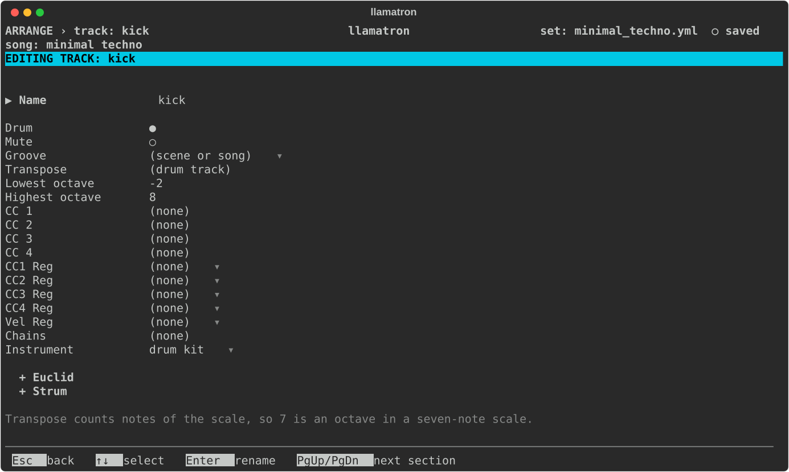
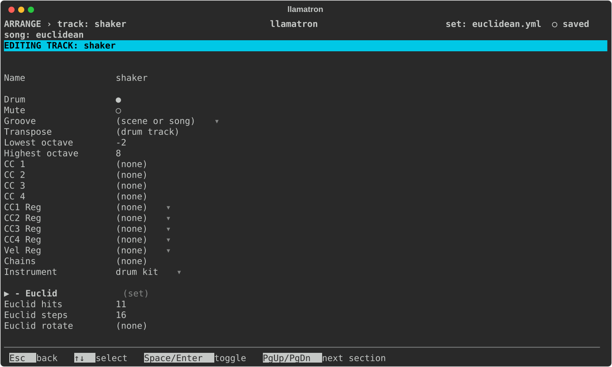

# Tracks

A track is a column of Arrange, with its own instrument, transpose, CC numbers and more. This page covers the track editor, whose settings apply to every clip on the track.

## Track Settings

On Arrange, `Enter` on a track's name opens the track editor. Tracks become tracks in Live in the order Arrange shows them.

| Setting | What it does |
| --- | --- |
| Name | `Enter` renames the track, updating every scene and every clip that grabs from the track. |
| Drum | Marks a drum track, shown with `●`, which is never transposed. `Space` or `Enter` toggles it. |
| Mute | Starts the track switched off in Live, shown with `●`, so the track is silent until switched on. A muted track's clips are still written, so the track can be switched on to hear them, and other tracks can still grab notes from it. Mute is meant for tracks that only feed grabs or a hocket. `Space` or `Enter` toggles it. |
| Groove | A groove for the track's clips in place of the scene's or the song's, or `off` to play them straight whatever the scene and song choose, which keeps a kick straight in a swung song. `[` and `]` step through the choices, `Enter` picks from a list, and `Bksp` goes back to the scene's or the song's. See [Grooves](GROOVES.md). |
| Transpose | Moves every note on the track along the scale, from -24 to 24, without changing its patterns; in a seven-note scale, 7 is an octave. Drum patterns are never transposed, on any track. |
| Lowest octave, Highest octave | The octaves the track's instrument plays, in the Set File page's octave labels, the whole MIDI range at first. The piano roll marks the rows outside them when this track alone plays a pattern. `[` and `]` move an end, which can't cross the other, `Enter` types one, and `Bksp` puts it back at the end of the range. |
| Chains | The chains every clip on the track runs, after the clip's own and the scene's, edited as a clip's are. Track chains give a whole part the same treatment, such as a strum or a slight drift; a chain named both here and on a clip runs twice. See [Chains](CHAINS.md). |
| Instrument | The instrument the track plays through in real time, chosen from the Instruments page, or `(none)` to leave the track out of real-time playback. `Enter` chooses and `Bksp` sets none. See [Instruments](INSTRUMENTS.md). |
| + Euclid | A section, closed until opened, holding a Euclidean rhythm that masks every clip on the track: Euclid hits, Euclid steps, Euclid rotate and Euclid step, as [Euclid](generators/EUCLID.md) describes. `H` on Euclid hits picks a named rhythm. |
| + Strum | A section, closed until opened, that strums every chord the track plays: Strum direction, `(none)` for no strum, and the other settings [Strum](generators/STRUM.md) describes. A clip's own strum wins over the track's. |
| CC 1 to CC 4 | The CC number each of a pattern's CC rows sends on this track, from 0 to 127. `Bksp` sets none, so that the row sends nothing on this track. CC 1 is usually the mod wheel, and CC 74 the filter cutoff. |
| CC1 Reg to CC4 Reg | A register, AX to DX, bound to that CC lane, or `(none)`. A bound lane sends the register's value, held between 0 and 127, on the lane's CC number when the track's clip starts and whenever the register changes while the clip plays, so a step on any track can move this track's filter. A step's own value on the CC row wins at that step's moment. `[` and `]` step through the registers, `Enter` picks one, and `Bksp` unbinds. See [Registers](REGISTERS.md). |
| Vel Reg | A register bound to the velocity, or `(none)`. A note whose Velocity is blank plays at the register's value, held between 1 and 127, and `+Vel` still adds to that value. The keys are the same as for the CC lanes. |

## Euclidean Mask

A track's `+ Euclid` section keeps only the notes that land on a Euclidean rhythm, in every clip the track plays. In `examples/other/euclidean.yml`, the shaker plays 11 hits over 16 steps:

