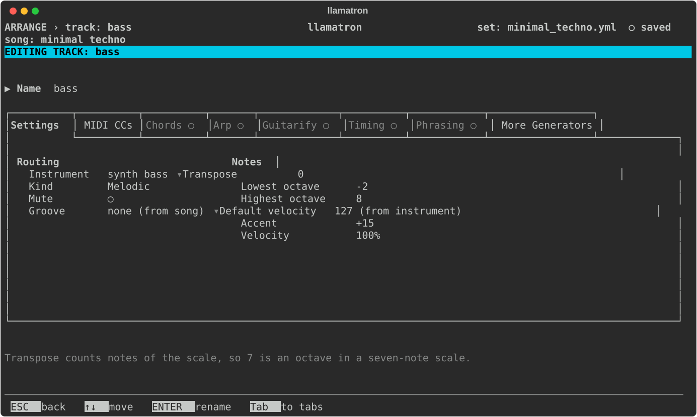

# Tracks

A track is a column of Arrange, with its own instrument, transpose, CC numbers and more. This page covers the track editor, whose settings apply to every clip on the track.

## Track Settings

On Arrange, `ENTER` on a track's name opens the track editor. Tracks become tracks in Live in the order Arrange shows them.

Under the Name, a box of tabs holds the rest, as on the clip page (see [Clips](CLIPS.md#clip-settings) for the keys): Settings, with General (Instrument, Drum, Mute, Groove) and Notes (Transpose, the octaves, Default velocity, Accent); Chords, Arp and Guitarify, the track's built-in generators that run before its list; Generators, the Generators field; Timing and Phrasing, the built-ins after the list; MIDI CCs; Bypass When and Skip When. A track's built-in generator plays on every clip of the track whose own of the same kind is off; its tab names the clips whose own stands in for it, such as `chords overridden in 1 clip: verse (lead)`.

| Setting | What it does |
| --- | --- |
| Name | `ENTER` renames the track, updating every scene and every clip that grabs from the track. |
| Drum | Marks a drum track, shown with `●`, which is never transposed. `Space` or `ENTER` toggles it. |
| Mute | Starts the track switched off in Live, shown with `●`, so the track is silent until switched on. A muted track's clips are still written, so the track can be switched on to hear them, and other tracks can still grab notes from it. Mute is meant for tracks that only feed grabs or a hocket. `Space` or `ENTER` toggles it. |
| Groove | A groove for the track's clips in place of the scene's or the song's, or `off` to play them straight whatever the scene and song choose, which keeps a kick straight in a swung song. `[` and `]` step through the choices, `ENTER` picks from a list, and `Bksp` goes back to the scene's or the song's. See [Grooves](GROOVES.md). |
| Transpose | Moves every note on the track along the scale, from -24 to 24, without changing its patterns; in a seven-note scale, 7 is an octave. Drum patterns are never transposed, on any track. |
| Lowest octave, Highest octave | The octaves the track's instrument plays, in the File/Global page's octave labels, the whole MIDI range at first. The piano roll marks the rows outside them when this track alone plays a pattern. `[` and `]` move an end, which can't cross the other, `ENTER` types one, and `Bksp` puts it back at the end of the range. |
| Default velocity | The velocity a step with none typed plays at on the track, 1 to 127. Until set, the field shows the value of the track's instrument, such as `80 (from instrument)`, and a track with no instrument plays at 127. `Bksp` gives the field back to the instrument. |
| Accent | What a step with its Accent on adds to its velocity on the track, 0 to 127, `+15` unless set, on top of the Accent of the track's instrument. A drummer's accents and a singer's stressed notes are entered as switches on the pattern's Accent row, which is quicker than typing velocities, and the same pattern is accented more or less on another track. |
| Generators | On the Generators tab: the generators every clip on the track runs, after the clip's own and the scene's, edited as a clip's are. A track's generators give a whole part the same treatment, such as a strum or a slight drift; a generator named both here and on a clip runs twice. See [Generators](GENERATORS.md). |
| Instrument | The instrument the track plays through in real time, chosen from the Instruments page, or `(none)` to leave the track out of real-time playback. `ENTER` chooses and `Bksp` sets none. See [Instruments](INSTRUMENTS.md). |
| Bypass When, Skip When | Tabs of statements about the registers, read each time a pattern starts over on the track: the first lets a pass go by the generators of the track's clips untouched, and the second makes the track's clip sit a pass out. See [Conditional Execution](REGISTERS.md#conditional-execution). |
| CC 1 to CC 4 | The CC number each of a pattern's CC rows sends on this track, from 0 to 127. `Bksp` sets none, so that the row sends nothing on this track. CC 1 is usually the mod wheel, and CC 74 the filter cutoff. |
