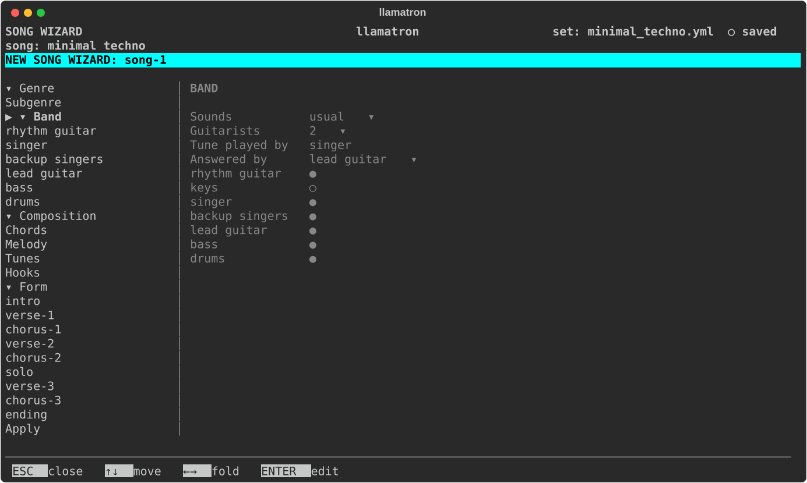
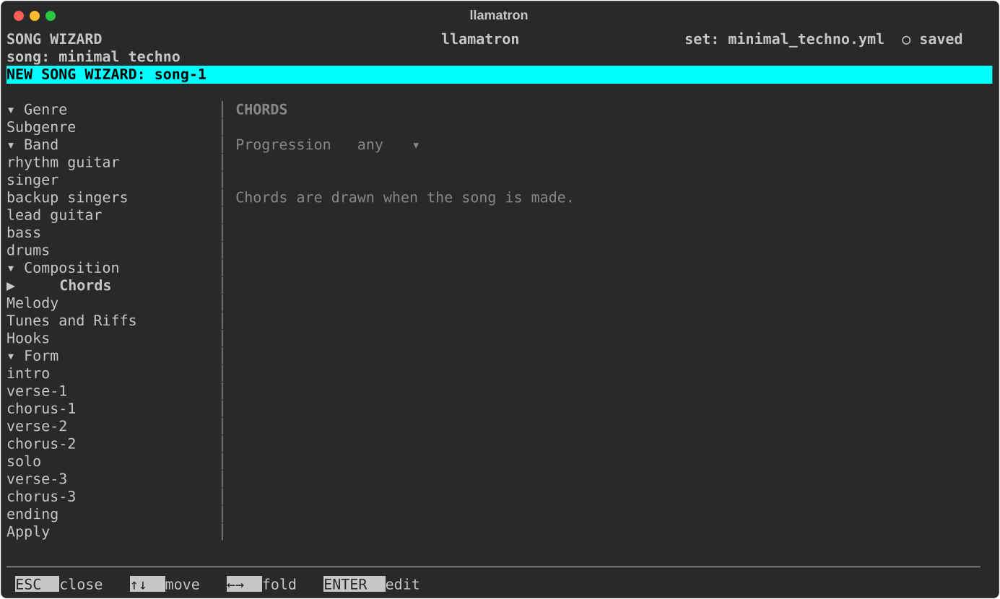
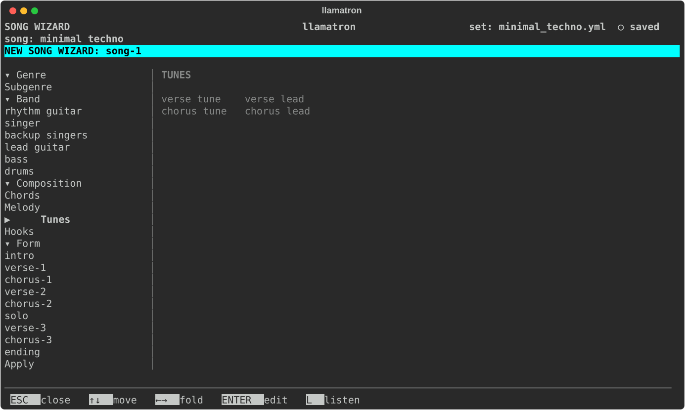
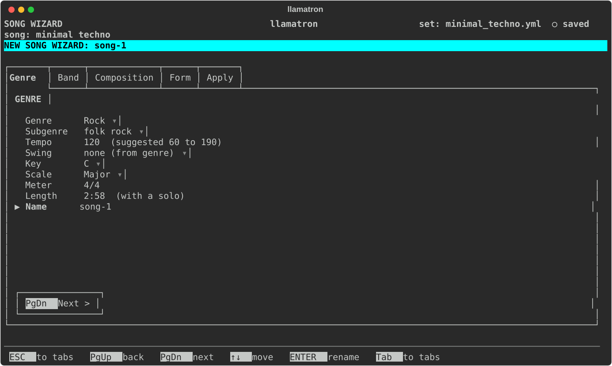

# Song Wizard

The song wizard makes a whole song from a few choices: a genre, a band, chords, tunes and a form. A songwriter starts the same way, deciding what kind of song it is, who plays, what the chords are and which section follows which, before anyone plays a note. The wizard asks for those decisions and writes the patterns, tracks, scenes and clips that a band of that genre would play, and the result is an ordinary song of the set, every note of which can be edited afterwards on Arrange and in the pattern editor.

`F5` opens the wizard from any page. Nothing in the set changes until Apply, and undo then takes the whole song away again. Each run makes a different song from the same choices.

The wizard is in progress: its panels change from one version to the next, and this page shows what each panel holds now. How to work through a song with the wizard will get a page of its own.

## Wizard Layout

The tree at the left lists the wizard's panels, and the settings of the panel under the cursor show at the right. Up and Down move through the tree, Left and Right close and open a panel that has panels under it, `ENTER` or Tab moves into the settings, and `ESC` or Tab moves back to the tree. `L` (listen) plays what the panel under the cursor would make, a tune, a hook, a player or a section, through FluidSynth. `ESC` in the tree closes the wizard, and asks first.

## Genre

The Genre panel comes first, since every other panel starts from what the genre usually does. Choosing a genre and then, on the Subgenre panel under Genre in the tree's list, a subgenre fills in the key, the scale, the tempo, the meter, the band and the form with what that kind of song usually has. Each can then be changed, and the panel shows how long the song will play.

Another genre brings another band and another form, so choosing one after settings were changed by hand first asks, in a Change Genre question that counts what would be lost, such as band settings and new takes of tunes, and what is kept: a tune whose notes were edited stays as written through any change of genre.

## Band

The Band panel chooses who is in the band. Each player is switched in or out, Sounds chooses the band's set of instrument sounds, Guitarists chooses one guitar or two, Tune played by names the player who carries the tune, and Answered by names the player who answers the tune in the gaps between its lines.

## Players

Each player in the band has a panel under Band in the tree. Plays chooses the kind of part the player plays, such as a chiming arpeggio or strummed chords, and Sound the instrument. Comes in and Lays out say when the player joins the song and when the player rests, as a real player waits for the second verse or drops out before a chorus. Reacts and Dynamics set how much the player follows the rest of the band and the song's louds and softs, and the gauges below them set how busy and how varied the part is.

Edit Player opens the player's [Musician](generators/MUSICIAN.md), the generator that plays the player's part as a player of that instrument would in a band: softer under the tune, an organ holding each chord, and differently in each kind of section. What is changed on the Musician's page is kept for the player when the page closes, the button then reads "Edit Player (your own)", and `Bksp` on the button gives the player back the Musician the genre gives. Songs of the Electronic and Experimental genres have no Musicians.

## Composition

Composition holds the panels of what the song is made of: its chords, its melody style, its tunes and its hook.

### Chords

The Chords panel chooses the chord progression: one of the genre's progressions by name, or any, which leaves the choice to the wizard when the song is made.

### Melody

The Melody panel chooses the style the tunes are written in, such as a walk by steps or a tune of leaps, and how the tune is delivered. A singer or a horn player delivers a tune in lines, with a breath after each and a rise toward the line's main note, and the Phrasing switch has the tune's player do the same, through a [Phrasing](generators/PHRASING.md) generator that every clip of the tune runs. Edit Phrasing opens that generator's page, where the line's length, the breath, the rise and fall and how the notes are joined are chosen; `ESC` there comes back to the wizard. With the switch off the tune is played as written.

### Tunes and Riffs

The Tunes and Riffs panel has a heading for each kind of section of the form. A kind of section that has a tune holds that tune, one for the verses and one for the choruses, so that every verse plays the same tune as verses do. `Space` or `ENTER` on a heading opens the heading, which holds the Tune of that kind of section and its Played by field. Tune played by chooses the player who carries the tune through the song, a singer, a lead guitar or any player of the band but the bass and the drums, and the Played by field of a kind of section goes by the song until another player is chosen there, or nobody, for a section with no tune. The player given the tune plays it in place of that player's usual part. Hook line, under Tune played by, names the line of the tune that is the song's hook, the line a listener goes away humming, such as "chorus, line 1"; "(none)" makes a song with no hook. `ENTER` (edit notes) on a tune opens the tune in the pattern editor, where the notes are edited as any pattern's are, and `ESC` there comes back to the wizard. A tune that was edited is marked `(edited)`, belongs to the person from then on, and is never written over by another choice; `Bksp` gives the tune back to the wizard. When a later choice changes the chords under an edited tune, the wizard asks whether to fit the tune: yes moves each long note that clashes with its new chord to the nearest note of that chord and leaves the short passing notes, and no keeps the tune as written. `T` (new take) writes another tune for that kind of section alone, leaving the rest of the song as it was, and the row then says which take it shows.

A riff is a short figure a player repeats in place of that player's usual part, as a guitar and a bass play one under a verse. Add Riff under a heading adds a riff to that kind of section: a new riff the wizard writes, a blank riff to write by hand, or a riff already in the song, which the same players then play with the same notes in that kind of section too. A new or a blank riff asks who plays the riff, one player or two together. Only players with their hands free are offered: a player has one riff in a section, and the player of the section's tune has none. Each riff has a row with its name and its players, where `ENTER` (edit notes) opens the riff in the pattern editor as a tune opens, `T` (new take) writes other notes for the riff and `Bksp` takes the riff out of that kind of section. A riff that was edited is marked `(edited)` and is kept through a change of genre, as an edited tune is; where two players share the riff, the second plays the edited notes in that player's own octave. The riff the genre itself brings, where the genre has one, is still chosen on the Hooks panel. When a player who has a riff is switched out of the band on the Band panel, the wizard asks who takes the riff over, offering each player free to play it, or whether the riff is removed; `ESC` keeps the player in the band.

### Hooks

The Hooks panel switches the song's hook on, the short phrase a listener goes away humming, and shows the hook's notes. Its sections choose the hook's kind, where in the song the hook is said, and the riff, a short figure a player repeats under the song. New hook draws another.

## Form

The Form panel chooses the sections the song plays and in what order. Starts with and Ends with come first, since a band settles how to get into a song and out of it before arranging the middle: a song can start with the full band, the drums or one player alone, or in layers, a player joining with each section, and can end on a held chord, slow down, strip down a player at a time or repeat and fade. Choosing another form keeps how the song starts and ends. Song plan gives every section a place in a rise and fall across the whole song, and Contrast sets how far the loud sections stand from the quiet ones. The list at the bottom says what the plan gives each section.

## Sections

Each section has a panel under Form in the tree. On a section, `I` (insert) adds a section before it, `A` (add) adds one at the end, `C` (copy) copies it, `Bksp` (delete) removes it and `M` (move) carries it to another place. The section's settings choose its kind, how many bars it lasts and its energy, and its headings open the section's tune, harmony, shape, the way it joins the section after it, and who plays in it.

## Apply

The Apply panel sums the song up, its genre, key, tempo, form and length, and `ENTER` on the Apply button makes the song and shows it on [Arrange](ARRANGE.md).

