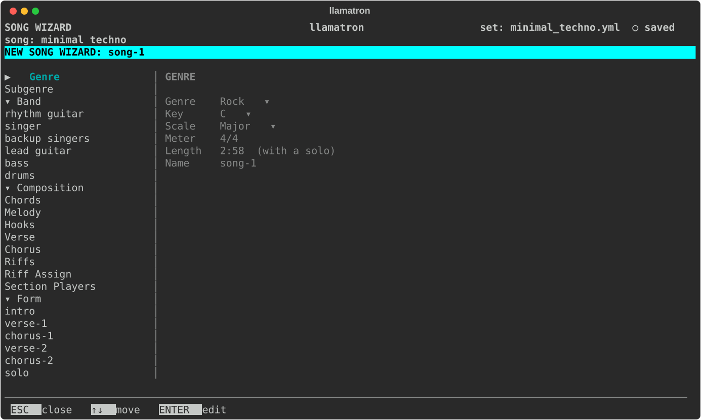
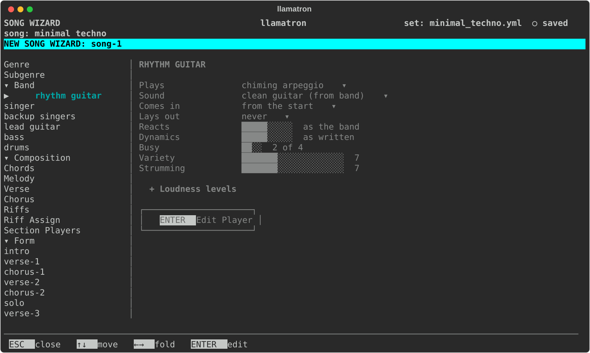
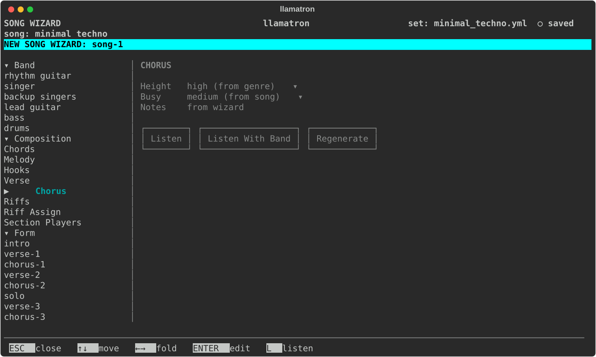
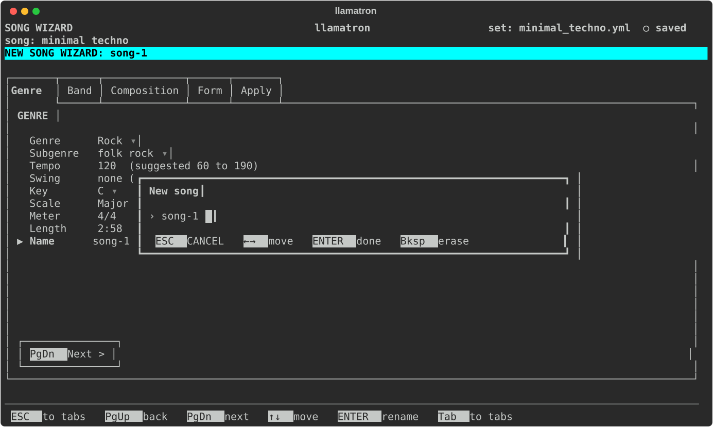
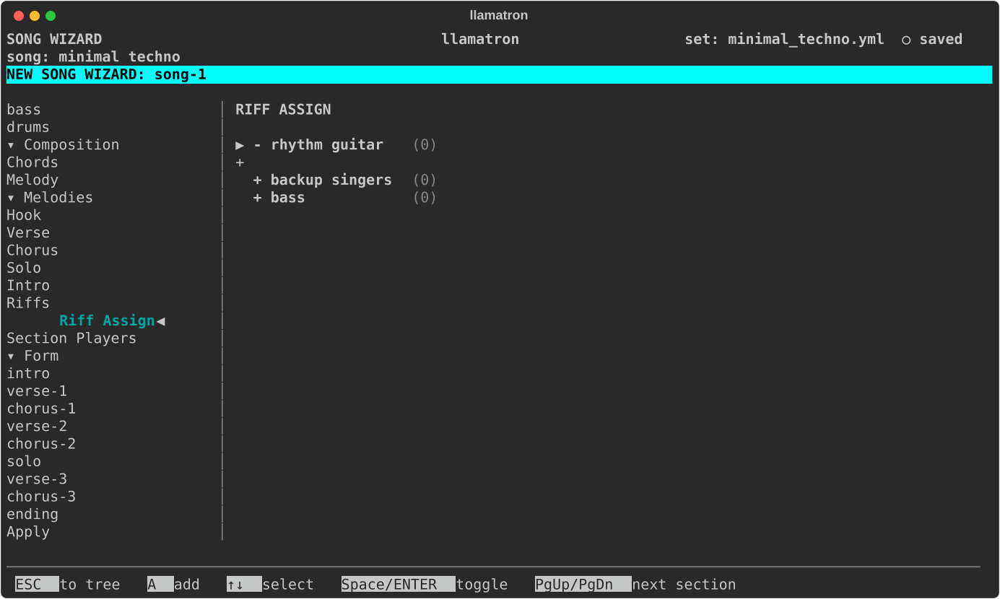
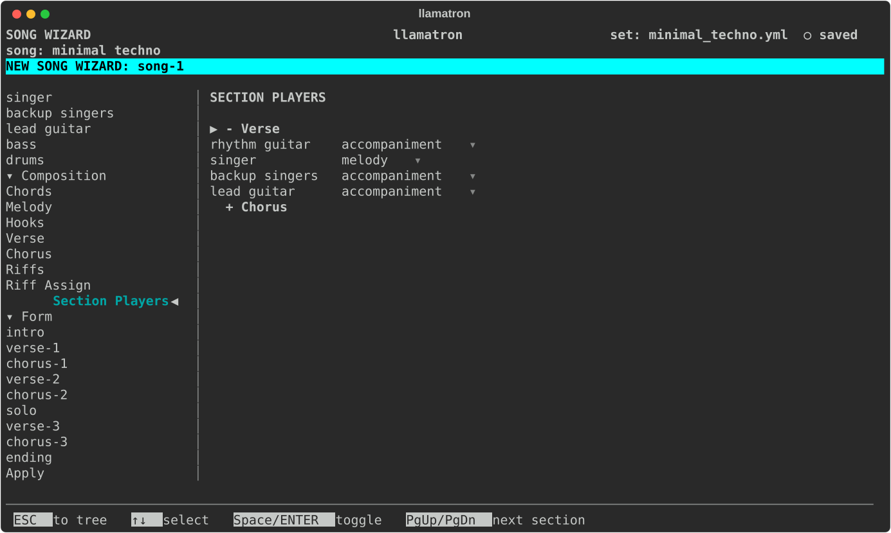
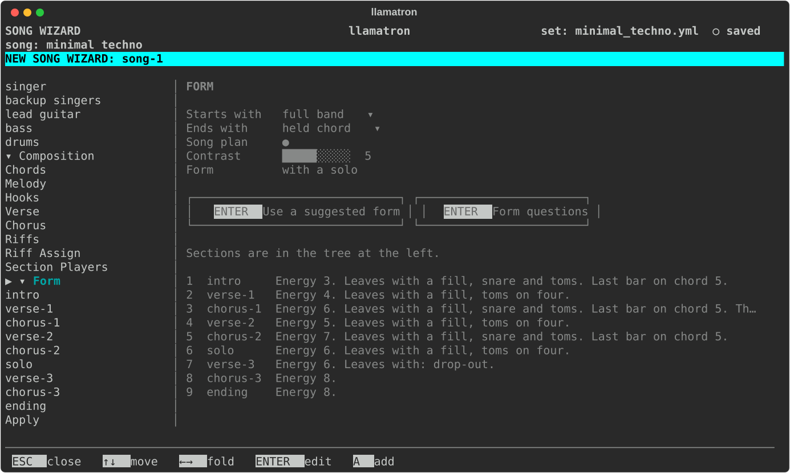
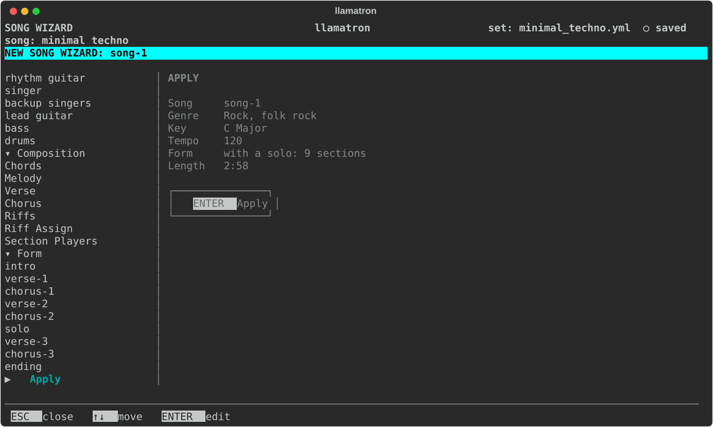

# Song Wizard

The song wizard makes a whole song from a few choices: a genre, a band, chords, tunes and a form. A songwriter starts the same way, deciding what kind of song it is, who plays, what the chords are and which section follows which, before anyone plays a note. The wizard asks for those decisions and writes the patterns, tracks, scenes and clips that a band of that genre would play, and the result is an ordinary song of the set, every note of which can be edited afterwards on Arrange and in the pattern editor.

`F5` opens the wizard from any page. Nothing in the set changes until Apply, and undo then takes the whole song away again. Each run makes a different song from the same choices.

The wizard is in progress: its panels change from one version to the next, and this page shows what each panel holds now. How to work through a song with the wizard will get a page of its own.

## Wizard Layout

The tree at the left lists the wizard's panels, and the settings of the panel under the cursor show at the right. Up and Down move through the tree, Left and Right close and open a panel that has panels under it, `ENTER` or Tab moves into the settings, and `ESC` or Tab moves back to the tree. `L` (listen) plays what the panel under the cursor would make, a tune, a hook, a player or a section, through FluidSynth. `ESC` in the tree closes the wizard, and asks first.

## Genre

The Genre panel comes first, since every other panel starts from what the genre usually does. Choosing a genre and then, on the Subgenre panel under Genre in the tree's list, a subgenre fills in the key, the scale, the tempo, the meter, the band and the form with what that kind of song usually has. Each can then be changed, and the panel shows how long the song will play.

Another genre brings another band and another form, so choosing one after settings were changed by hand first asks, in a Change Genre question that counts what would be lost, such as band settings and new takes of tunes, and what is kept: a tune whose notes were edited stays as written through any change of genre.

## Band

The Band panel chooses who is in the band. Each player is switched in or out, Sounds chooses the band's set of instrument sounds, Guitarists chooses one guitar or two, Melody played by names the player who carries the melody, and Answered by names the player who answers the tune in the gaps between its lines.

## Players

Each player in the band has a panel under Band in the tree. Plays chooses the kind of part the player plays, such as a chiming arpeggio or strummed chords, and Sound the instrument. Comes in and Lays out say when the player joins the song and when the player rests, as a real player waits for the second verse or drops out before a chorus. Reacts and Dynamics set how much the player follows the rest of the band and the song's louds and softs, and the gauges below them set how busy and how varied the part is.

Edit Player opens the player's [Musician](generators/MUSICIAN.md), the generator that plays the player's part as a player of that instrument would in a band: softer under the tune, an organ holding each chord, and differently in each kind of section. What is changed on the Musician's page is kept for the player when the page closes, the button then reads "Edit Player (your own)", and `Bksp` on the button gives the player back the Musician the genre gives. Songs of the Electronic and Experimental genres have no Musicians.

## Composition

Composition holds the panels of what the song is made of: its chords, its melodies, its hooks, its riffs and what each player plays in each kind of section.

### Chords

The Chords panel chooses the chord progression: one of the genre's progressions by name, or any, which leaves the choice to the wizard when the song is made.

### Melody

A song has more than one melody: the verses share one, the choruses another, and a bridge has its own. The Melody panel holds what those melodies have in common. Melody played by chooses the player who carries them. Busy chooses how many notes a line holds, Range how far a melody travels from its lowest note to its highest, and Repeats how much the lines of a section repeat one another. Character chooses how a melody moves: by steps, in the notes of the blues, by leaps, or as the genre writes it. Each field starts at what the genre does, and its list marks the genre's own value. A singer or a horn player delivers a melody in lines, with a breath after each and a rise toward the line's main note, and the Phrasing switch has the melody's player do the same, through a [Phrasing](generators/PHRASING.md) generator that every clip of the melody runs.

### Melodies

Melodies, under Composition, is a group that opens and closes with `←` and `→`. The group holds the Hook panel first and then a panel for each kind of section that has a melody.

### Hook

A hook is the few notes a listener goes away humming. The main hook is the line of the chorus that returns, and its top note is the highest note of the song: every other melody stays under it, so that the chorus arrives as the song's high point. The wizard writes a hook of two bars, a figure and an answer to the figure, and the Hook panel holds the song's hooks under two headings.

Under Main Hook, Sung in names the kind of section that carries the hook, and Intro hook chooses a player to play the hook in the intro before anybody sings it. Behavior chooses what kind of figure the hook is: "chant" stays on one note and lives by its rhythm, "arch" rises to its top and comes back, "leap and fall" jumps up and walks down, "call" says a short cell, waits and says the cell again, and "ladder" climbs to its top. Under Behavior are the gauges of that behavior, each from 0 to 9 and each the genre's until moved, where `Bksp` gives a moved gauge back to the genre:

| Gauge | At 0 | At 9 |
| --- | --- | --- |
| Catchiness | The answer is a plainer line of its own | The answer is the figure again, a note lower |
| Simplicity | Many short notes | Few long notes |
| Leap | The jump is a step | The jump is wide |
| Height | The hook sits low, close over the other melodies | The hook sits at the top of the singer's range |
| Hold | The last note is short | The last note is held |
| Bounce | Every note on the beat | Notes off the beat |

A behavior shows only the gauges that change its hook: a chant has no Leap, and a ladder's Leap is the size of each rung.

Under Second Hook, the Second hook switch gives the song a short tag: one bar of a few short notes, written unlike the main hook and under its top, said the same every time. Tag sung in chooses the kind of section that sings the tag: the last line of the pre-chorus, a post-chorus or the outro, as the song's form has them.

Listen plays the hook under the cursor's heading. Regenerate writes another hook with the behavior and the gauges as they stand, after asking, and New Second Hook draws another tag. The picture under the fields is the main hook's notes.

### Section Melodies

Each kind of section that has a melody has a panel of its own under Hook, named for the kind, such as Verse or Chorus. Height sets the melody high, in the middle or low against the song's other melodies, since a chorus usually sits above its verse. Busy gives the kind of section its own answer in place of the song's. Each list marks the value the genre or the song already gives, and choosing that value gives the field back. Notes opens the melody in the pattern editor, where the notes are edited by hand, and `Bksp` on Notes gives edited notes back to the wizard. Listen plays the melody alone, as `L` (listen) does, Listen With Band plays the first section of the kind with everybody in it, and Regenerate writes another melody for that kind of section after asking, keeping nothing of the old one.

The kind of section that carries the hook, the chorus in most genres, is written around the hook, and its panel holds other fields in place of Height and Busy. Placement chooses where the hook sits among the four lines: "first lines" says the hook three times and closes, "last line" leads to the hook with three plainer lines, and "first and last" opens and closes the chorus with the hook. The gauges under Placement shape the lines that are not the hook, each from 0 to 9 and each the genre's until moved:

| Gauge | At 0 | At 9 |
| --- | --- | --- |
| Sameness | The lines have a plainer rhythm of their own | The lines take the hook's rhythm |
| Space | A line runs to its end | A line ends in a long silence |
| Lift | The lines sit well under the hook | The lines sit just under the hook |
| Resolve | A line ends off the chord, left open | A line ends on a note of the chord |
| Call and answer | A line that returns is written anew | A line that returns keeps its notes and settles its ending |

A line that leads into the hook always ends open, and the last line of the section always ends on a note of the home chord, so Resolve shows only where another line's ending is free, and Call and answer only where a line returns.

### Riffs

A riff is a short figure of 1 or 2 bars that a player repeats in place of the accompaniment, as a guitar and a bass play one under a verse. The Riffs panel lists the song's riffs under a heading for each player a riff can be written for, with how many bars each lasts and the kinds of section that use it. `A` (add) on a heading, or `ENTER` on its `+` row, opens the New Riff dialog, which asks how many bars the riff lasts, whether it is made of notes or of notes and chords, whether it follows the chords, and what fills the gaps between the accents, and then writes the riff. On a riff, `ENTER` opens its notes in the pattern editor, `N` (rename) names it, `C` (copy) copies it for a player, in that player's octave, `R` (regenerate) writes other notes for it after asking, `L` (listen) plays it alone, and `Bksp` (delete) deletes it after saying where it is used. A riff exists from the moment it is written, whether or not anybody plays it yet, and a genre built on a riff arrives with that riff written.

### Riff Assign

The Riff Assign panel chooses the riffs each player knows. A player knows the riffs written for that player, and `A` (add) on the player's heading gives the player a riff written for another, which the player then plays in the player's own octave. `Bksp` (delete) on a riff takes it from the player and leaves the riff in the song.

### Section Players

The Section Players panel chooses what each player plays in each kind of section. Under the heading of a kind of section, each player with a choice there has a field: accompaniment, the part the genre writes for the player; melody, for a player who can carry it; or a riff the player knows. A player given the melody takes it from the player who had it in that kind of section.

## Form

The Form panel chooses the sections the song plays and in what order. Starts with and Ends with come first, since a band settles how to get into a song and out of it before arranging the middle: a song can start with the full band, the drums or one player alone, or in layers, a player joining with each section, and can end on a held chord, slow down, strip down a player at a time or repeat and fade. Choosing another form keeps how the song starts and ends. Song plan gives every section a place in a rise and fall across the whole song, and Contrast sets how far the loud sections stand from the quiet ones. The list at the bottom says what the plan gives each section.

## Sections

Each section has a panel under Form in the tree. On a section, `I` (insert) adds a section before it, `A` (add) adds one at the end, `C` (copy) copies it, `Bksp` (delete) removes it and `M` (move) carries it to another place. The section's settings choose its kind, how many bars it lasts and its energy, and its headings open the section's tune, harmony, shape, the way it joins the section after it, and who plays in it.

A section with more energy is lifted in several ways at once: more players come in, parts grow fuller and the drummer plays harder. So that the section does not arrive too loud, a player whose part grows much denser plays each note a little softer, as a guitarist strumming full chords does not hit each string as hard. A player who comes in, and whoever carries the melody, are left as they are. A section that builds, such as a pre-chorus, ends its climb at the loudness of the section it leads to.

## Apply

The Apply panel sums the song up, its genre, key, tempo, form and length, and `ENTER` on the Apply button makes the song and shows it on [Arrange](ARRANGE.md).

