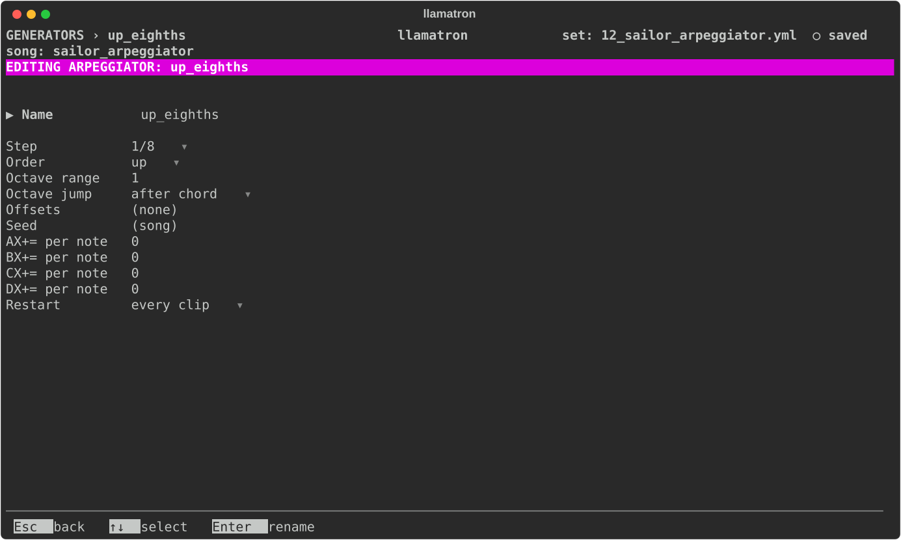
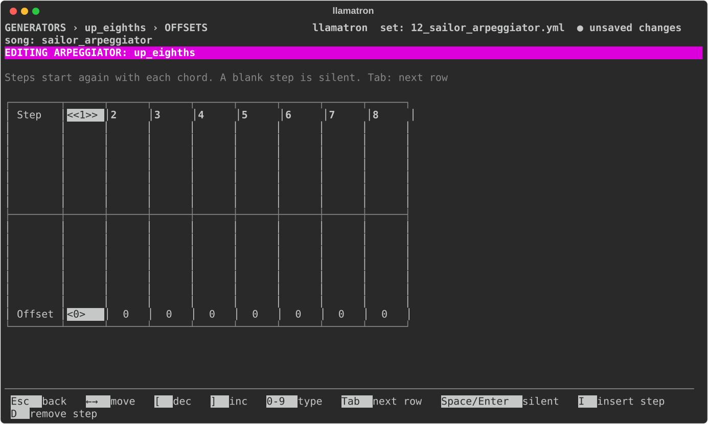

# Arpeggiator

An arpeggiator plays each chord one note at a time, and keeps going for as long as the chord lasts. Rests pass through unchanged. Single notes do too, unless the arpeggiator has offsets or an octave range, which let one note make a melody. Like every generator, it is put to work through a chain, as [Generators](../GENERATORS.md) describes.

## Settings

| Setting | What it does |
| --- | --- |
| Name | `Enter` renames the arpeggiator, and every chain using it follows. |
| Step | How long each note of the chord plays: `(pattern)`, the step size of the pattern each clip plays, which a new arpeggiator starts with, or a time from the list every time setting shares. `Bksp` goes back to `(pattern)`. |
| Order | `up` or `down` by pitch, `up_down`, `down_up`, or `random`. |
| Octave range | Plays the chord again in up to 4 octaves, from 1, which is the chord alone. |
| Octave jump | `after chord` plays the whole chord before moving up an octave, so C E G becomes C E G C E G; `after each note` plays each note in every octave first, so it becomes C C E E G G. |
| Offsets | The arpeggiator's own steps, as on the Elektron Monomachine. `Enter` edits them, and `Bksp` removes them. |
| Seed | The seed for `random`. `Bksp` goes back to the song's seed. |
| AX+= per note to DX+= per note | How much every note the arpeggiator plays adds to that register, or takes from it, within the register's Allowed Inc Max. `Bksp` sets none. See [Registers](../REGISTERS.md). |
| Restart | When it starts over, as [Generators](../GENERATORS.md#restart) describes. |

## Offsets

Offsets are a row of 1 to 16 steps, and the first edit starts them with 8 steps of 0. Each step plays the next note of the chord, moved that many notes along the scale, or by half steps when there is no scale. A blank step is silent, and the next step plays the note it would have played. The steps start again with each chord, so a row whose length doesn't fit the chord makes a new rhythm against it.

The offsets editor draws each step's offset as a bar from a zero line, up for a positive offset and down for a negative one, with the number under each bar. An offset the gauge is too short to reach fills its column and is marked, such as `+7▲` or `-9▼`. The cursor's column is marked at both ends, `<<4>>` around the step number and `<+7▲>` around the offset, and a row wider than the screen scrolls sideways, with `steps 1-9 ›` saying which steps are shown.

| Key | What it does |
| --- | --- |
| Left, Right | Move along the steps. |
| Digits | Type an offset. |
| `[`, `]` or Up, Down | Change the offset. |
| `Space` | Makes a step silent, or plays it again. |
| `I`, `D` | Insert a step, or remove one. |
| `Tab` | Moves to a row for each register, AX+= to DX+=, and back: what each step adds to that register when the arpeggiator reaches it, a silent step too. A register's row shows once any step adds to it, or while the cursor is on it. |

## Applying the Generator

Add the arpeggiator to a chain, as `arp: name`, and give clips that chain. `examples/learning/12_sailor_arpeggiator.yml` plays one chord through it, in every order and octave setting.
