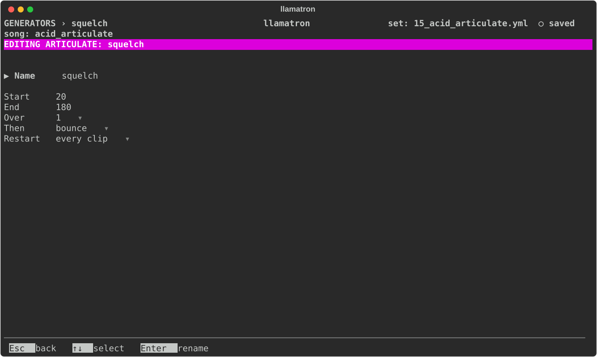

# Articulate

Articulate scales how long each note sounds, compared with what the pattern writes. Shorter leaves a gap before the next note; longer holds a note over a rest after it, but never past where the next note starts or past the clip's end. Articulate is one of the three shapes, each a percentage that ramps from a start to an end, which [Generators](../GENERATORS.md#shapes) describes: where each is set, which wins, and the settings they share. The Articulate percentage runs from 10% to 200%.

## Settings

The settings are those every shape shares, which [Generators](../GENERATORS.md#shapes) describes.

## Applying the Generator

Set Articulate in the `+ Articulate` section of a Scene page or a clip page, or make a Articulate generator and add it to a chain, as `articulate: name`, to paint one shape on many clips and change it in one place. `examples/learning/15_acid_articulate.yml` takes an acid house line from blips to slurs.
