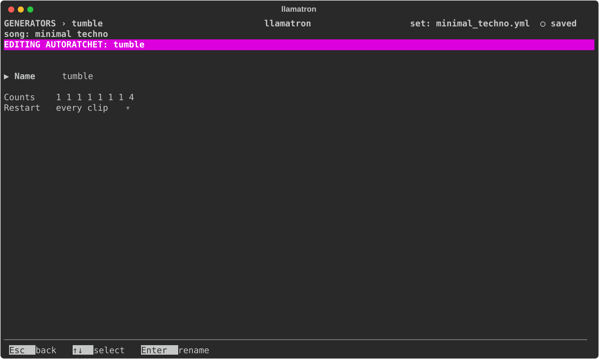

# AutoRatchet

An AutoRatchet chops each note or chord into quick, equal repeats in the same time. An AutoRatchet works through a repeating list of counts, so `1 1 4` leaves two notes alone and then chops the third into four. Rests don't use up a count.

## Settings

| Setting | What it does |
| --- | --- |
| Name | `Enter` renames it, and every chain using it follows. |
| Counts | Whole numbers of 1 or more, separated by spaces, typed after `Enter`. A new AutoRatchet starts with `2`. |
| Restart | When it starts over, as [Generators](../GENERATORS.md#restart) describes; with "on new scene" or "whole song" it goes on through its counts from clip to clip. |

## Applying the Generator

Add the AutoRatchet generator to a chain, as `auto_ratchet: name`, and give clips that chain. `examples/learning/11_ode_to_joy_ratchet.yml` plays long notes through it.
