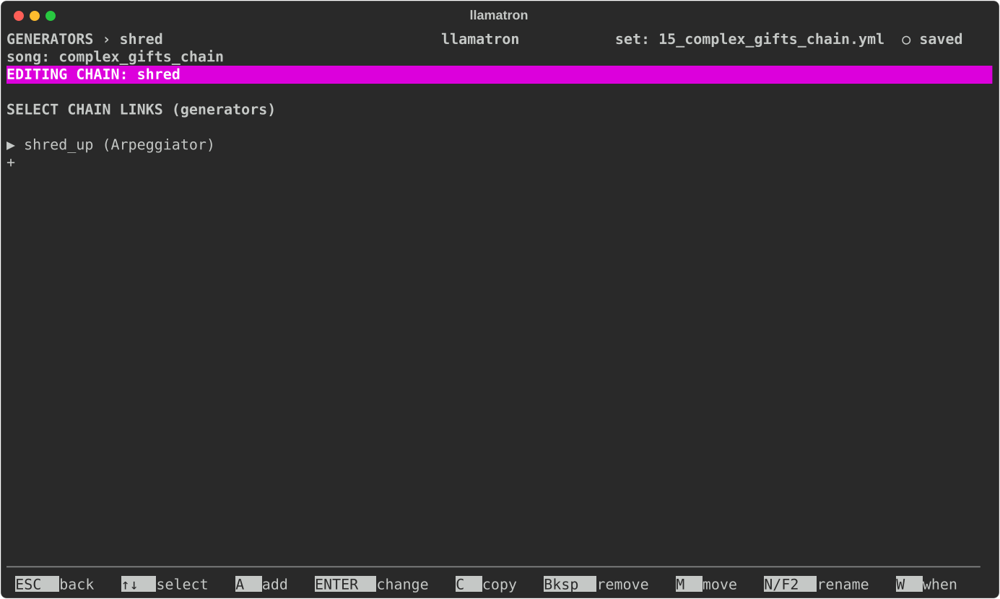

# Chain

A Chain is a generator that runs other generators, one after another, as a list. A clip, a scene or a track can list generators of its own, so a Chain is for a list that several of them share: a pedalboard of effects that a guitarist carries from song to song, set up once and switched on wherever it is wanted. Change the Chain, and every clip that runs it hears the change.

## How a Chain Runs

A Chain runs its generators from top to bottom, each working on what the generator before it made. An arpeggiator followed by a second arpeggiator arpeggiates first and then turns each arpeggiated note into a figure of its own, while a Chords generator followed by an arpeggiator moves the chords first and then arpeggiates them.

Listed on a clip, a scene or a track, a Chain runs its generators in its own place in that list. A clip whose Generators field holds a Guitarify, then a Chain of an arpeggiator and a Timing generator, then a Shapes generator, plays as if its list were the Guitarify, the arpeggiator, the Timing generator and the Shapes generator. A Chain's own steps are plain generators, never another Chain.

## Placement

A clip runs its own generators first, then its scene's, then its track's, and a generator, a Chain among them, listed twice runs twice. The clip page, the Scene page and the track editor each have a Generators field that opens the list, where a Chain sits beside any other generator.

## Chain Editor

Make a Chain on the Generators page with `A`, choosing Chain under the Chains heading; `ENTER` on it opens the chain editor.

| Key | What it does |
| --- | --- |
| `A` | Add a step: any generator but a Chain, made first on the Generators page |
| `ENTER` | Change the step to another generator |
| `C` | Copy the step |
| `W` | Open the Chain's Bypass Generators When statements, which say when a pass goes by the whole Chain. See [Conditional Execution](../REGISTERS.md#conditional-execution) |
| `M` | Pick it up: `↑↓` carry it, and `ENTER` drops it |
| `Bksp` | Remove it |
| `N` | Rename the Chain, which updates every list that runs it |

## Applying the Generator

`examples/learning/17_complex_gifts_chain.yml` runs Chains of arpeggiators on Simple Gifts.
