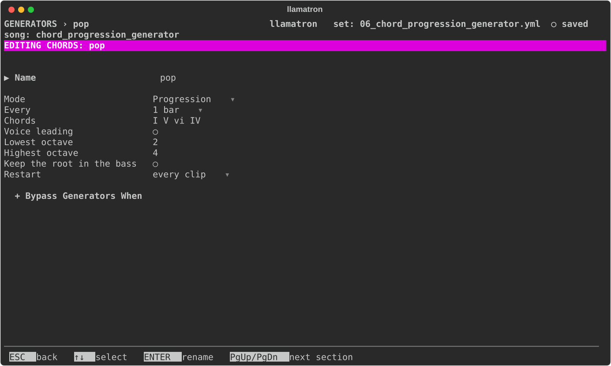

# Chords

A Chords generator moves a part's notes to chords and voices them. Write a
short figure over chord I, a riff, an arpeggio, a bass line or a chord, and
its Mode decides where the chords come from:

- **Voicing**, the default, leaves the notes where they are and only voices
  the chords, as Voice leading below describes.
- **Progression** moves the clip's notes to each chord of a progression in
  turn, so that one bar becomes a whole section, and changing the progression
  rewrites the section without touching the pattern.
- **Follow Progression** moves the clip's notes to the chords another track
  plays, so that a song's chords are written once, in one place, and
  everything else follows them.

Every mode then voices the chords if Voice leading is on: on by default in
Voicing mode, off in the others until switched on. A drum pattern is left
alone.

## Settings

| Setting | What it does |
| --- | --- |
| Name | `ENTER` renames it, and every chain using it follows. |
| Mode | Voicing, Progression or Follow Progression. The columns below it change with the mode. |
| Every | Progression mode: how long each chord lasts, `1 bar` by default. |
| Chords | Progression mode: the chords as Roman numerals in the song's scale. `ENTER` opens the chord editor. |
| Chords from | Follow Progression mode: the track whose chords are followed, a track of the current song. Renaming the track renames this too, and a track the song doesn't have moves nothing. |
| Voice leading | Every mode: on, each chord after the first takes the inversion and octave whose notes move least from the chord before. On by default in Voicing mode alone. |
| Lowest octave, Highest octave | The chords stay within these octaves, shown in the set's octave labels, so that they don't drift up or down over a long piece. A chord no voicing fits plays as written. |
| Keep the root in the bass | Off by default. On, each chord's lowest written note stays where it is and only the notes above it are voiced, always above it, as a keyboard player plays beside a bass player. `Space` or `ENTER` toggles it. |
| Restart | When it starts over, as [Generators](../GENERATORS.md#restart) describes; with "whole song" a progression runs on across scenes, and with "on new scene" or "whole song" a scene's first chord is voiced near the last chord before. |

## Progression

### Chord Movement

The chords are degrees of the scale. A plain degree moves every note that many
steps up the scale, less one, so the scale decides whether the chord is major
or minor: in C major, a C major chord moved to 6 plays A minor, and in C minor
the same progression is minor. A degree with a sharp or a flat moves the notes
by exact half steps instead, keeping the figure's own sound, which is how
borrowed chords such as the rock ♭VII (B♭ major in C major) come out right. A
note the pattern writes outside the scale keeps its distance from the scale
note below it, so a figure written as a `dom7` chord stays a dominant seventh
on every chord. The rhythm, velocity and everything else stay as written, and
a drum pattern is left alone. Each chord lasts Every, a bar by default,
counted from the clip's start, the progression looping for as long as the clip
plays.

### Chord Editor

The chord editor draws each chord as a column: a bar rising to its degree,
then its Roman numeral (upper case for major, lower case for minor, ° for
diminished) and its name in the song's scale, such as `Am`, then a `#/b` row,
the Quality, Tens. and Scale rows, and an `Inv.` row. The status line names
the chord under the cursor and its notes. A new progression has one chord, I,
which changes nothing until edited.

| Key | What it does |
| --- | --- |
| Arrows | Left and Right move along the chords, Up and Down between the rows, stopping at the edges. |
| `[`, `]` | On the Chord row, step the degree from 1 to 7; on the `#/b` and `Inv.` rows, step through the choices, as `Space` and `ENTER` do; on the Quality, Tens. and Scale rows, step through the choices and stop at the first and the last. |
| `ENTER` | On the Quality, Tens. and Scale rows, opens the [Chord Selector](../PATTERNS.md#chord-selector), the one the pattern editor opens, on that row's list; `Space` steps to the next choice and `Bksp` clears. |
| Digits | Type a degree, or an inversion. |
| `I`, `D` | Insert a chord I before the cursor's, or remove the cursor's, keeping 1 to 32 chords. |
| `H` | Opens a picker of 24 named progressions, from Pop to Andalusian, and fills the chords with the one chosen, matched to the song's scale. |

An inversion of 1 moves each chord's lowest note up an octave, and 2 its
lowest two.

### Chords Outside the Scale

Three rows let a chord leave the song's scale. Each chord is worked out in one
order: the Scale row picks the scale, the Chord and `#/b` rows pick the root
in that scale, the Quality row names the chord if set, and the Tens. row adds
notes on top.

| Row | What it does |
| --- | --- |
| Scale | A scale type on the song's root that this chord borrows, blank for the song's own. In C major, chord 6 with the Scale "Minor" is A flat major, and the notes of the pattern between the chord's notes come from C minor too while the chord plays. Because the root is always the song's, a change of root carries every borrowed chord with it. |
| Quality | A named chord in place of the one the scale builds, blank for the scale's own. In C major, chord 3 is E minor, and with the Quality `M` it is E major: the pattern's notes that are the chord's third, fifth and seventh are moved to match. |
| Tens. | Tensions: `b9`, `9`, `#9`, `11`, `#11`, `b13` and `13`. Each sets the pattern's note that lies between the chord's notes, and is added on top of a chord the pattern plays. |

## Follow Progression

### Chords Track

Put the song's chords on a track of their own, called Chords here, and turn
that track's Mute on in the track editor so that the chords are a guide and
make no sound. In each scene, the Chords track's clip says what the chords
are, in either of two ways. The chords can be written by hand, a step a chord,
with the step's Degree as the chord's root and its Chord row as the chord. Or
the pattern can hold one chord and a Chords generator in Progression mode, on
that clip's Chords tab or in its chain, can make the progression from it.
FollowChords reads the chords as they come out of the Chords track, after that
track's own generators, so the two ways are followed alike.

### Following

Write a figure over chord I, a bar of bass, an arpeggio or a held chord, and
switch on its clip's Chords tab in Follow Progression mode, or add a Chords
generator in that mode to a chain on the clip. As each note starts, it finds
the chord most lately started on the track followed, in the same scene, and
moves the note up the clip's scale by as many notes as that chord's root is
above the scale's root. The scale decides whether a chord is major or minor,
as in Progression mode: a figure written on A in A minor plays F, A and C over
a chord on F. Where the track followed plays a chord from outside the scale,
such as E major in A minor, a note of the figure that is a third, a fifth or a
seventh above the figure's root takes the chord's own note, so the figure
plays G sharp. Rests, rhythm, velocity and gates stay as written.

A chord goes on through the rests after it, until the next chord starts.
Before the first chord of a scene, with no track chosen, or in a scene where
the track followed has no clip, nothing moves. A drum pattern is left alone.
Tracks cannot follow each other in a circle.

Change a chord on the Chords track and every clip that follows it changes with
it.

## Voice Leading

Chords played in root position jump around: C, then G, then Am, each built up
from its root, moves every note a long way. A pianist plays G with its B at
the bottom and F with its C at the bottom, so that the notes barely move.
Voice leading does that for you: the first chord of a clip plays as written,
and each chord after takes the inversion and the octave whose notes move least
from the chord before. Single notes, such as a bass line's, are left alone.

## Applying the Generator

Switch on the Chords tab of a clip or a track, or add the Chords generator to
a chain, as `chords: name`, and give clips that chain;
[Concepts](../CONCEPTS.md#chord-progressions) walks through it.

- `examples/learning/06_chord_progression_generator.yml` plays three one-bar
  patterns through five progressions, and
  `examples/learning/07_blues_chords.yml` is a twelve-bar blues.
- `examples/learning/05_voice_leading.yml` plays three progressions in root
  position, inverted by hand with the chord editor's Inv. row, and voice-led;
  the last scene of `examples/learning/06_chord_progression_generator.yml`
  voice-leads its pad.
- `examples/learning/22_follow_chords.yml` plays a band stuck on one chord and
  then following one muted track, SILENT Chords, one player at a time, with
  the chords written by hand and then made by a progression.
