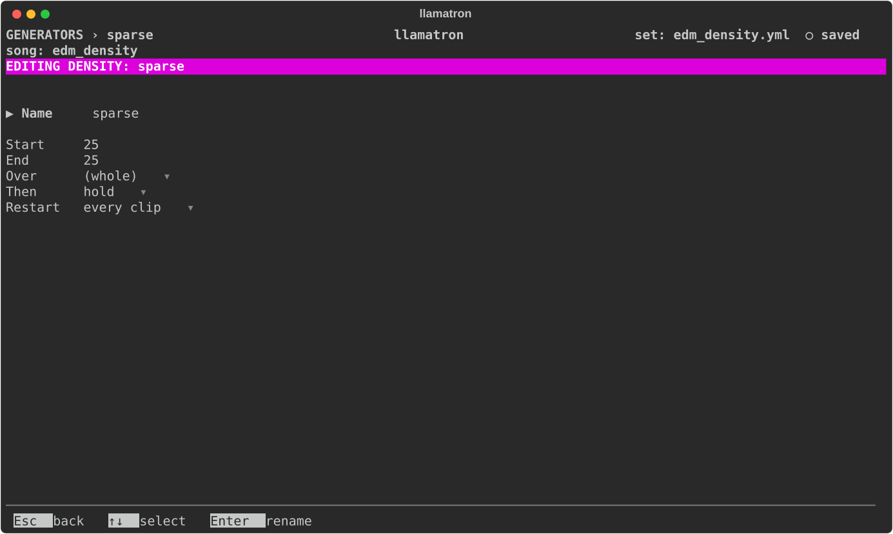

# Density

Density keeps a share of a clip's notes, the strongest places in the bar first: the bar's start, then its middle, the other beats, the eighths and last the sixteenths. At 100% every note plays, at 50% the sixteenths between the eighths drop out, at 25% only the beats are left, and at 0% nothing. A chord is kept or dropped whole, and drums are thinned too, so one full pattern gives a build, a breakdown or a fill. Density is one of the three shapes, each a percentage that ramps from a start to an end, which [Generators](../GENERATORS.md#shapes) describes: where each is set, which wins, and the settings they share. The Density percentage runs from 0% to 100%.

## Settings

The settings are those every shape shares, which [Generators](../GENERATORS.md#shapes) describes.

## Applying the Generator

Set Density in the `+ Density` section of a Scene page or a clip page, or make a Density generator and add it to a chain, as `density: name`, to paint one shape on many clips and change it in one place. `examples/by_genre/electronic/edm_density.yml` builds and breaks down an EDM track by Density alone.
