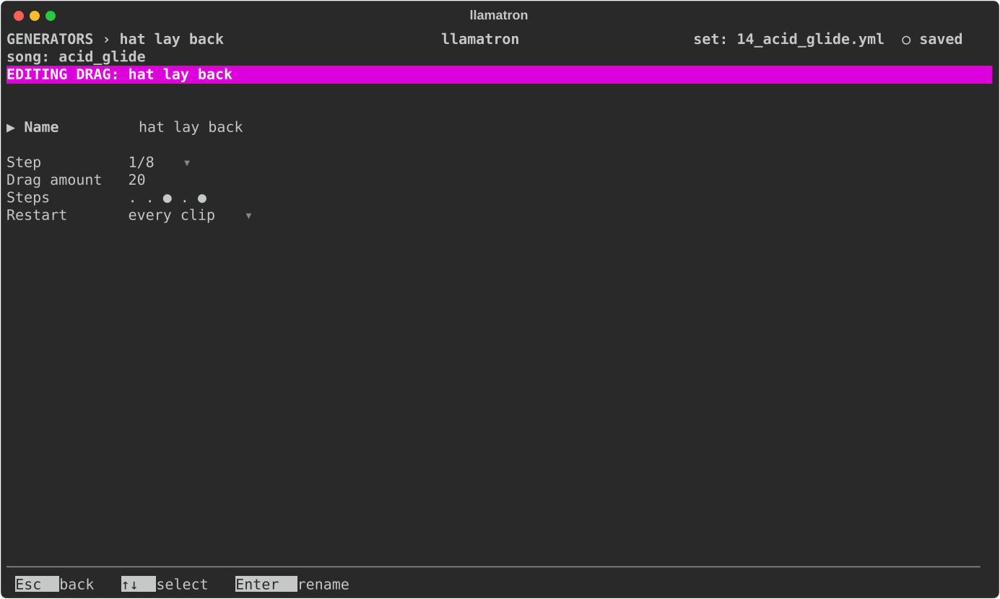

# Drag

A Drag is a row of steps, each on or off, as [Generators](../GENERATORS.md#rows-of-steps) describes. A note starting on a step that is on plays the note a little late, behind the beat, on top of the groove. A Rush and a Drag can be painted on one clip; a step that is on in both moves by the difference.

## Settings

| Setting | What it does |
| --- | --- |
| Name | `Enter` renames it, and every chain using it follows. |
| Step | How long each step of the row lasts: `(pattern)`, the clip's pattern's step size, or a time from the list every time setting shares. |
| Amount | The Drag amount, 20% of a step by default, up to half a step. |
| Steps | The row, from 1 to 16 steps. `Enter` opens it. |
| Restart | When it starts over, as [Generators](../GENERATORS.md#restart) describes. |

## Applying the Generator

Add the Drag generator to a chain, as `drag: name`, and give clips that chain. The drop of `examples/learning/14_acid_glide.yml` loosens its drums with a Rush and Drags.
