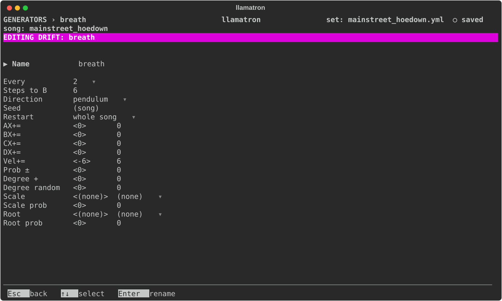

# Drift

A drift slowly changes the clips that name it in their chains, over the whole song: their loudness, how often their notes play, the notes themselves, and their scale and root. A drift is one process for the whole song, so every clip that names the drift hears the same drift at the same moment, and the drift keeps changing through scenes where no clip hears it. A little drift keeps a gentle piece from sounding mechanical over its repeats; a lot makes a strange one wander.

A drift triggers every so often and picks new amounts, holding them until the next trigger. A drift has two versions of every setting, A and B, starts at A, and moves one step toward B at each trigger. A drift was built to be used mostly with its Restart at "whole song", so that it runs from the top of the song through every scene.

## Settings

| Setting | What it does |
| --- | --- |
| Name | `Enter` renames the drift, and every chain using it follows. |
| Every | How often it triggers: `1 bar` of the song, the default, or another time from the list every time setting shares. |
| Steps to B | How many triggers it takes to get from A to B, 16 unless set. |
| Direction | `forward` goes from A to B and stays there, `loop` starts again at A, `pendulum` goes from A to B and back forever, and `brownian` wanders a step either way at each trigger. |
| Seed | The seed for its random choices. `Bksp` goes back to the song's seed. |
| Restart | When it starts over, as [Generators](../GENERATORS.md#restart) describes. |

## Versions A and B

Below the settings, each row has a value for A and for B side by side, the one Left and Right picked marked `< >`. `[` and `]` change the one picked, `Enter` types it or picks from a list, and `Bksp` clears it. Numbers are blended between A and B by how far the drift has moved, and a scale or a root is B's with a chance of how far it has moved.

| Row | What it does at each trigger |
| --- | --- |
| AX+= to DX+= | Adds to the register, so that `+Note`, `+Vel`, the conditions and register binding all follow the drift. |
| Vel+= | Added to every note's velocity, kept between 1 and 127. |
| Prob ± | Added to every step's probability, from -100 to 100; a blank Probability counts as 100, so a negative amount brings in dropouts. |
| Degree + | Moves every note along the scale, from -7 to 7. |
| Degree random | Moves every note a random number of scale steps, up to this many either way, picked at each trigger and held until the next. |
| Scale, Scale prob | A scale of the song's that takes over the clips' scale, with this chance at each trigger. |
| Root, Root prob | A root that takes over the scale's root, with this chance. |

## Applying the Generator

Add the drift to a chain, as `drift: name`, and give clips that chain. The drift's place in the chain doesn't matter, and an arpeggiator after the drift arpeggiates the drifted notes. `examples/by_genre/electronic/mainstreet_hoedown.yml` uses a very slight one on its loudness.
