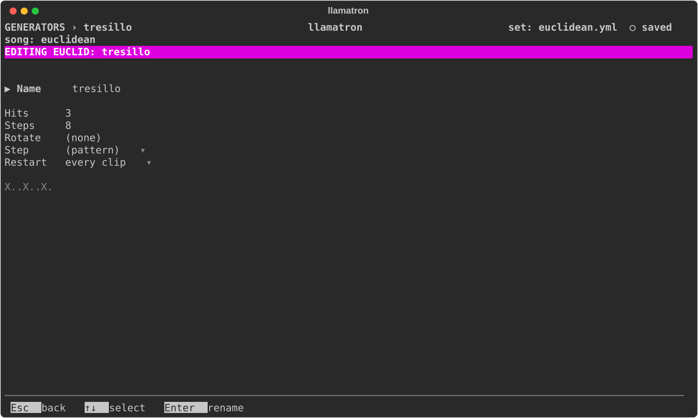

# Euclid

A Euclidean rhythm spreads a number of hits as evenly as it can over a number of steps: three over eight is X . . X . . X ., the Cuban tresillo, and the same sum gives traditional rhythms the world over. A Euclidean mask keeps only the notes of a clip that start on a hit, the rest falling silent, so you can write a full pattern, a note on every step, and carve rhythms out of it.

A mask can be set in the track editor's `+ Euclid` section, for every clip on the track, and as a Euclid generator painted on clips through a chain. Masks stack: a note plays only where every mask has a hit.

## Settings

| Setting | What it does |
| --- | --- |
| Hits | How many hits, from 1 to 32. A mask with no hits masks nothing. `H` on Hits picks a named rhythm, filling Hits and Steps: tresillo, cinquillo, khafif-e-ramal, aksak, Venda, bembé, samba or bossa nova. |
| Steps | Over how many steps, from 1 to 32, a bar of sixteenths unless set. |
| Rotate | Moves the rhythm that many steps later. |
| Step | How long each step lasts: `(pattern)`, the clip's pattern's step size, or a time from the list every time setting shares. |
| Restart | On the generator, when it starts over, as [Generators](../GENERATORS.md#restart) describes; with "whole song" the rhythm keeps drifting against the bar. |

The rhythm repeats every Steps times Step from the clip's start, so a rhythm of twelve steps against a bar of sixteen drifts against the bar and lines up again only every three bars. The Euclid editor draws the rhythm under its fields.

## Applying the Generator

Set Euclid on a track, or add a Euclid generator to a chain, as `euclid: name`, and give clips that chain. `examples/other/euclidean.yml` is an Afro-Latin percussion piece built this way.
