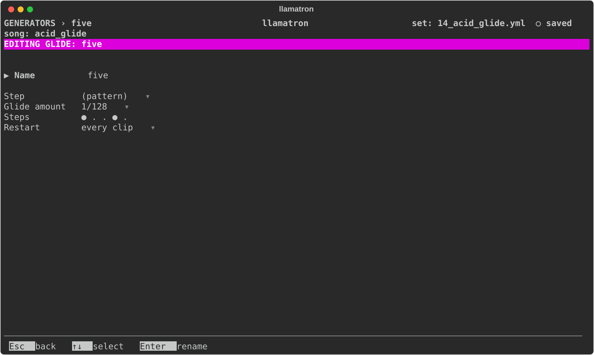

# Glide

A Glide is a row of steps, each on or off, as [Generators](../GENERATORS.md#rows-of-steps) describes. A note starting on a step that is on runs the note into the next one, as the pattern's Glide row does, so that a synth with glide turned on slides between the two. A note before a rest, or before the same pitch, has nothing to glide into.

## Settings

| Setting | What it does |
| --- | --- |
| Name | `Enter` renames it, and every chain using it follows. |
| Step | How long each step of the row lasts: `(pattern)`, the clip's pattern's step size, or a time from the list every time setting shares. |
| Amount | The Glide amount, 1/128 by default, from 1/256 to 1/16. |
| Steps | The row, from 1 to 16 steps. `Enter` opens it. |
| Restart | When it starts over, as [Generators](../GENERATORS.md#restart) describes. |

## Applying the Generator

Add the Glide generator to a chain, as `glide: name`, and give clips that chain. `examples/learning/14_acid_glide.yml` moves an acid line's slides with rows of 5, 7 and 3 steps.
