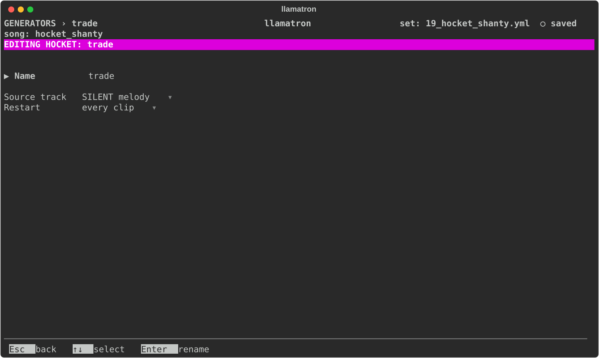

# Hocket

A Hocket shares one track's notes out among other tracks, one note each, as a hocket in early music passes a melody between singers. Its Source Track names the track whose notes it shares.

## Turn Order

Add the Hocket to a chain on the clips that should take turns. In each scene, the tracks whose clips run it take turns at the source's notes, left to right in the song's track order, and round again: with one such track it plays every note, with four each plays every fourth. A rest passes no turn, and a chord passes whole to one track. The notes handed out are the source's notes as they come out of the source clip's chain. Each keeps the source's pitch, timing, length and velocity, and then moves with the hocketing track's groove, Rush and Drag as the track's own notes do, but not with the track's Transpose or the generators after the Hocket in its chain, so that the melody stays whole.

The source track plays its own pattern as ever, with nothing of the Hocket applied to it, so turn its Mute on in the track editor to hear only the hocket; a muted source still hands out its notes. A hocketing track also plays its own pattern's notes, besides those it is handed, so a pattern of rests plays only the hocket. The usual use is four tracks on four patches of one synth, or four instances of a monosynth with slightly different settings in the DAW, trading a lead line so that no one sound plays every note.

## Settings

| Setting | What it does |
| --- | --- |
| Name | `Enter` renames it, and every chain using it follows. |
| Source track | The track whose notes it shares, a track of the current song. Renaming the track renames this too, and a track the song doesn't have hands out nothing. |
| Restart | "every clip", the default, starts the turns again with the first track at each clip the source plays; "on new scene" and "whole song" carry them on. |

## Applying the Generator

[Concepts](../CONCEPTS.md#hocketing) walks through it. `examples/learning/19_hocket_shanty.yml` shows it on The Wellerman, with four voices.
