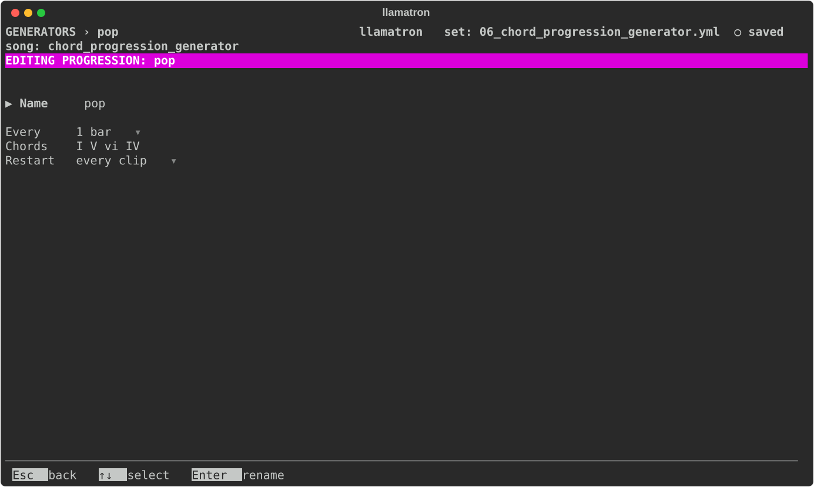
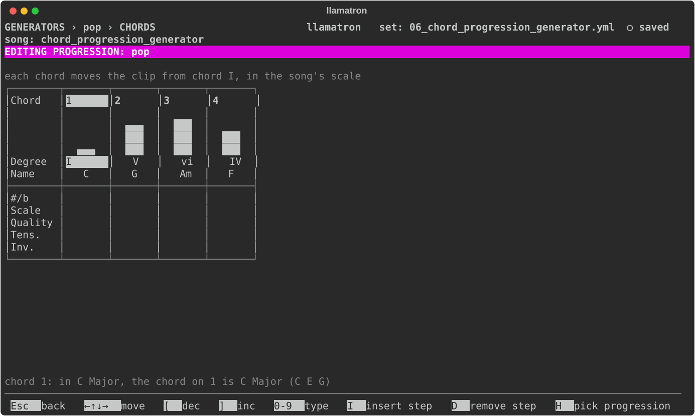

# Progression

A progression plays a clip through a chord progression. Write a short figure over chord I, a riff, an arpeggio, a bass line or a chord, and the progression moves the clip's notes to each of its chords in turn, so that one bar becomes a whole section, and changing the progression rewrites the section without touching the pattern.

## Chord Movement

The chords are degrees of the scale. A plain degree moves every note that many steps up the scale, less one, so the scale decides whether the chord is major or minor: in C major, a C major chord moved to 6 plays A minor, and in C minor the same progression is minor. A degree with a sharp or a flat moves the notes by exact half steps instead, keeping the figure's own sound, which is how borrowed chords such as the rock ♭VII (B♭ major in C major) come out right. A note the pattern writes outside the scale keeps its distance from the scale note below it, so a figure written as a `dom7` chord stays a dominant seventh on every chord. The rhythm, velocity and everything else stay as written, and a drum pattern is left alone. Each chord lasts Every, a bar by default, counted from the clip's start, the progression looping for as long as the clip plays.

## Settings

| Setting | What it does |
| --- | --- |
| Name | `Enter` renames it, and every chain using it follows. |
| Every | How long each chord lasts, `1 bar` by default. |
| Chords | The chords as Roman numerals in the song's scale. `Enter` opens the chord editor. |
| Restart | When it starts over, as [Generators](../GENERATORS.md#restart) describes; with "whole song" a progression runs on across scenes. |

## Chord Editor

The chord editor draws each chord as a column: a bar rising to its degree, then its Roman numeral (upper case for major, lower case for minor, ° for diminished) and its name in the song's scale, such as `Am`, then a `#/b` row, the Quality, Tens. and Scale rows, and an `Inv.` row. The status line names the chord under the cursor and its notes. A new progression has one chord, I, which changes nothing until edited.

| Key | What it does |
| --- | --- |
| Arrows | Left and Right move along the chords, Up and Down between the rows, stopping at the edges. |
| `[`, `]` | On the Chord row, step the degree from 1 to 7; on the `#/b` and `Inv.` rows, step through the choices, as `Space` and `Enter` do. |
| `Enter` | On the Quality, Tens. and Scale rows, opens the [Chord Selector](../PATTERNS.md#chord-selector), the one the pattern editor opens, on that row's list; `Space` steps to the next choice and `Bksp` clears. |
| Digits | Type a degree, or an inversion. |
| `I`, `D` | Insert a chord I before the cursor's, or remove the cursor's, keeping 1 to 16 chords. |
| `H` | Opens a picker of 24 named progressions, from Pop to Andalusian, and fills the chords with the one chosen, matched to the song's scale. |

An inversion of 1 moves each chord's lowest note up an octave, and 2 its lowest two.

## Chords Outside the Scale

Three rows let a chord leave the song's scale. Each chord is worked out in one order: the Scale row picks the scale, the Chord and `#/b` rows pick the root in that scale, the Quality row names the chord if set, and the Tens. row adds notes on top.

| Row | What it does |
| --- | --- |
| Scale | A scale type on the song's root that this chord borrows, blank for the song's own. In C major, chord 6 with the Scale "Minor" is A flat major, and the notes of the pattern between the chord's notes come from C minor too while the chord plays. Because the root is always the song's, a change of root carries every borrowed chord with it. |
| Quality | A named chord in place of the one the scale builds, blank for the scale's own. In C major, chord 3 is E minor, and with the Quality `M` it is E major: the pattern's notes that are the chord's third, fifth and seventh are moved to match. |
| Tens. | Tensions: `b9`, `9`, `#9`, `11`, `#11`, `b13` and `13`. Each sets the pattern's note that lies between the chord's notes, and is added on top of a chord the pattern plays. |

## Applying the Generator

Add the progression to a chain, as `progression: name`, and give clips that chain; [Concepts](../CONCEPTS.md#chord-progressions) walks through it. `examples/learning/06_chord_progression_generator.yml` plays three one-bar patterns through five progressions, and `examples/learning/07_blues_chords.yml` is a twelve-bar blues.
