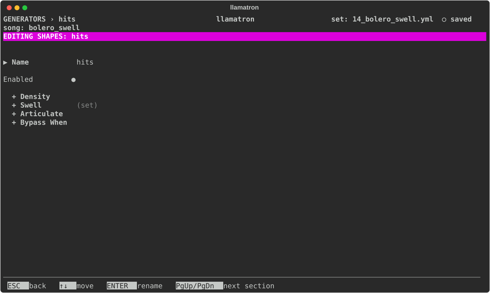

# Shapes

A Shapes generator shapes a section over time in three ways at once, each a percentage that ramps from a start to an end, which [Generators](../GENERATORS.md#shapes) describes: where each is set, which wins, and the settings they share.

- **Density** keeps a share of a clip's notes, the strongest places in the bar first: the bar's start, then its middle, the other beats, the eighths and last the sixteenths. At 100% every note plays, at 50% the sixteenths between the eighths drop out, at 25% only the beats are left, and at 0% nothing. A chord is kept or dropped whole, and drums are thinned too, so one full pattern gives a build, a breakdown or a fill. It runs from 0% to 100%.
- **Swell** scales each note's velocity, held from 1 to 127, for crescendos and fades, from 0% to 200%. Its Swell accent makes the beats louder still, up to 50%.
- **Articulate** scales how long each note sounds, compared with what the pattern writes, from 10% to 200%. Shorter leaves a gap before the next note; longer holds a note over a rest after it, but never past where the next note starts or past the clip's end.

A shape whose Start and End are both blank does nothing, so a Shapes generator that sets only its Density leaves a clip's own Articulate in force.

## Settings

Each shape is a section, `+ Density`, `+ Swell` and `+ Articulate`, closed until opened and saying `(set)` when anything inside holds a value, with the Start, End, Over and Then every shape shares. Swell accent follows the Swell, and Restart, when the ramps start over, ends the page.

## Applying the Generator

Make a Shapes generator and add it to a chain, as `shapes: name`, to paint the same shapes on many clips and change them in one place. Density and Articulate can also be set in the `+ Density` and `+ Articulate` sections of a Scene page or a clip page. A Swell scales the notes on top of the Velocity and the velocity ramps of the scene and the clip, which are the plain way to make one scene louder or to fade one in and out: see [Velocity and Velocity Ramps](../SCENES.md#velocity-and-velocity-ramps).

`examples/by_genre/electronic/edm_density.yml` builds and breaks down an EDM track by Density alone. In `examples/learning/14_bolero_swell.yml`, the scenes' velocity ramps make one long crescendo and a Shapes generator's Swell accent makes the timpani's downbeats land harder. `examples/learning/13_acid_articulate.yml` takes an acid house line from blips to slurs with Articulate.
