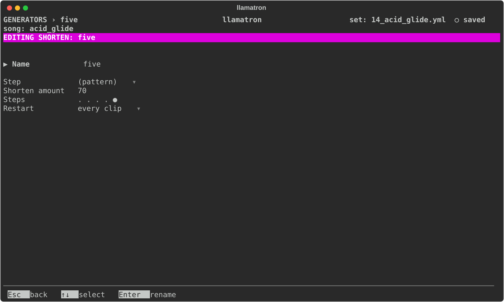

# Shorten

A Shorten is a row of steps, each on or off, as [Generators](../GENERATORS.md#rows-of-steps) describes. A note starting on a step that is on plays the note short, its Shorten amount of its length, the rest of its place silent.

## Settings

| Setting | What it does |
| --- | --- |
| Name | `Enter` renames it, and every chain using it follows. |
| Step | How long each step of the row lasts: `(pattern)`, the clip's pattern's step size, or a time from the list every time setting shares. |
| Amount | The Shorten amount, 70% of the note's length by default, from 10% to 95%. |
| Steps | The row, from 1 to 16 steps. `Enter` opens it. |
| Restart | When it starts over, as [Generators](../GENERATORS.md#restart) describes. |

## Applying the Generator

Add the Shorten generator to a chain, as `shorten: name`, and give clips that chain. `examples/learning/14_acid_glide.yml` moves an acid line's short notes with rows of 5, 7 and 3 steps.
