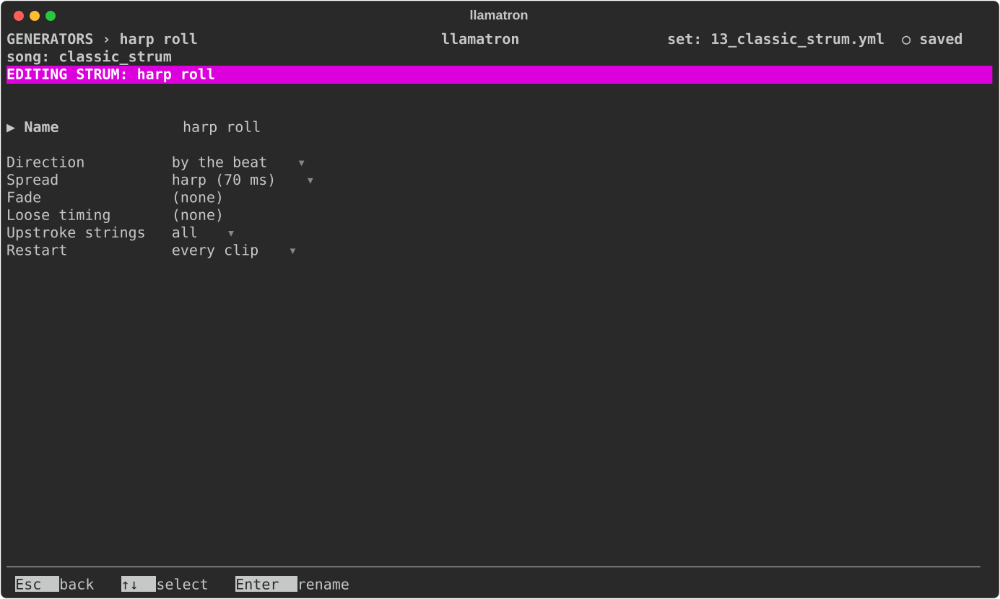

# Strum

A keyboard plays a chord's notes all at once; a guitarist's pick crosses the strings one after another, low to high on a downstroke and high to low on an upstroke. Strum plays chords that way, each note still ending where the chord ends. Strum changes only when the notes start, as a groove does, so every export and real-time playback hear it.

Strum can be set in three places: in the track editor's `+ Strum` section, for every clip on the track; in the clip page's `+ Strum` section, for one clip, which wins over the track's; and as a Strum generator in a chain, which wins over both.

## Settings

| Setting | What it does |
| --- | --- |
| Direction | "by the beat", down on the beats and up between them, as a hand that never stops moving does; "down", every chord low to high; "up", every chord high to low, the reggae skank; "down up", alternating chord by chord; or "off", for a clip that won't take its track's strum. A new Strum generator strums by the beat. |
| Spread | How far apart two strings sound, in milliseconds whatever the tempo, since a hand doesn't slow down with the song: tight (2 ms), crisp (4), normal (8, the default), loose (15), rake (30) or harp (70), where each note of a roll is heard. |
| Fade | How much quieter the last string is than the first, up to 50%. |
| Loose timing | How much each gap between strings varies, up to 50%, as a real hand does, drawn from the song's seed. |
| Upstroke strings | What an upstroke catches: all the notes, or only the top 3 or the top 4, so that up-strums sound lighter. |
| Restart | On the generator, when it starts over, as [Generators](../GENERATORS.md#restart) describes. |

## Applying the Generator

Set Strum on a track or a clip, or add a Strum generator to a chain, as `strum: name`, and give clips that chain. `examples/learning/13_classic_strum.yml` is an acoustic folk song that compares the spreads.
