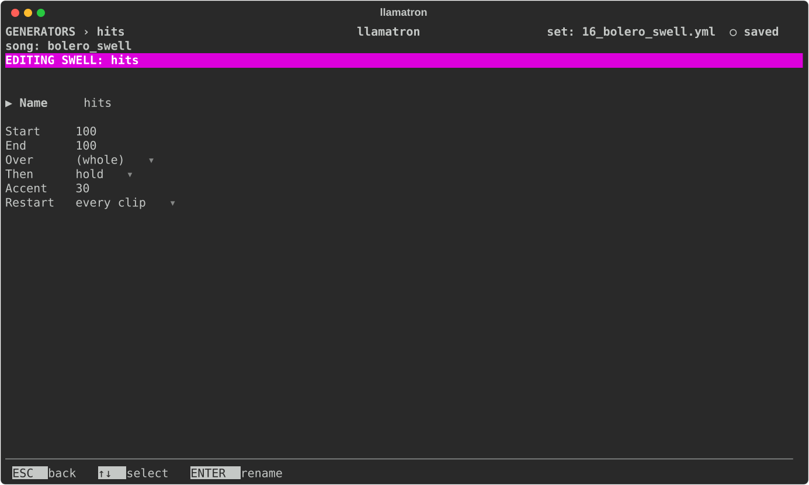

# Swell

Swell scales each note's velocity, held from 1 to 127, for crescendos and fades. A Swell generator also has an Accent, which makes the beats louder still, up to 50%. Swell is one of the three shapes, each a percentage that ramps from a start to an end, which [Generators](../GENERATORS.md#shapes) describes: where each is set, which wins, and the settings they share. The Swell percentage runs from 0% to 200%.

## Settings

The settings are those every shape shares, which [Generators](../GENERATORS.md#shapes) describes.

## Applying the Generator

Make a Swell generator and add it to a chain, as `swell: name`, to paint one shape on many clips and change it in one place. A Swell scales the notes on top of the Velocity and the velocity ramps of the scene and the clip, which are the plain way to make one scene louder or to fade one in and out: see [Velocity and Velocity Ramps](../SCENES.md#velocity-and-velocity-ramps). In `examples/learning/16_bolero_swell.yml`, the scenes' velocity ramps make one long crescendo and a Swell generator's Accent makes the timpani's downbeats land harder.
