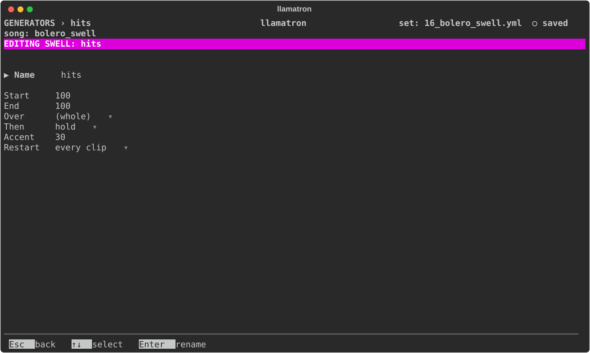

# Swell

Swell scales each note's velocity, held from 1 to 127, for crescendos and fades. A Swell generator also has an Accent, which makes the beats louder still, up to 50%. Swell is one of the three shapes, each a percentage that ramps from a start to an end, which [Generators](../GENERATORS.md#shapes) describes: where each is set, which wins, and the settings they share. The Swell percentage runs from 0% to 200%.

## Settings

The settings are those every shape shares, which [Generators](../GENERATORS.md#shapes) describes.

## Applying the Generator

Set Swell in the `+ Swell` section of a Scene page or a clip page, or make a Swell generator and add it to a chain, as `swell: name`, to paint one shape on many clips and change it in one place. `examples/learning/16_bolero_swell.yml` is one long crescendo.
