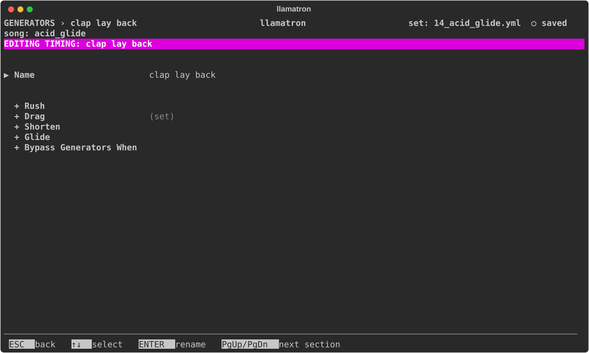

# Timing

A Timing generator holds four rows of steps, each on (`●`) or off, as [Generators](../GENERATORS.md#rows-of-steps) describes, and each changes the notes starting on its lit steps in its own way:

- **Rush** plays the note a little early, ahead of the beat, on top of the groove. The first note of a clip can't move before the clip.
- **Drag** plays the note a little late, behind the beat. A step lit in both the Rush and the Drag moves its note by the difference.
- **Shorten** plays the note short, its Shorten amount of its length, the rest of its place silent.
- **Glide** runs the note into the next one, as the pattern's Glide row does, so that a synth with glide turned on slides between the two. A note before a rest, or before the same pitch, has nothing to glide into.

The Glide runs first and then the Shorten, so a note on a step lit in both glides and isn't shortened; the Rush and the Drag move the notes after every chain has run. A part with no step lit does nothing, and a new Timing generator has none.

## Settings

Each part is a section, `+ Rush`, `+ Drag`, `+ Shorten` and `+ Glide`, closed until opened and saying `(set)` when anything inside holds a value.

| Setting | What it does |
| --- | --- |
| Name | `ENTER` renames it, and every chain using it follows. |
| Step | How long each step of the part's row lasts: `(from pattern)`, the clip's pattern's step size, or a time from the list every time setting shares. |
| Amount | Rush: 15% of a step by default, up to half a step. Drag: 20% of a step by default, up to half a step. Shorten: 70% of the note's length by default, from 10% to 95%. Glide: 1/128 by default, from 1/256 to 1/16. |
| Steps | The part's row, from 1 to 16 steps, shown as `[configure]`. `ENTER` opens it: Left and Right move, `Space` or `ENTER` turns a step on or off, `I` and `D` insert and remove steps. |
| Restart | When every row starts over, as [Generators](../GENERATORS.md#restart) describes. |

## Applying the Generator

Switch on the Timing tab of a clip or a track, or add the Timing generator to a chain, as `timing: name`, and give clips that chain. `examples/learning/12_acid_glide.yml` moves an acid line's slides and short notes with rows of 5, 7 and 3 steps, and its drop loosens the drums with a Rush and Drags.
