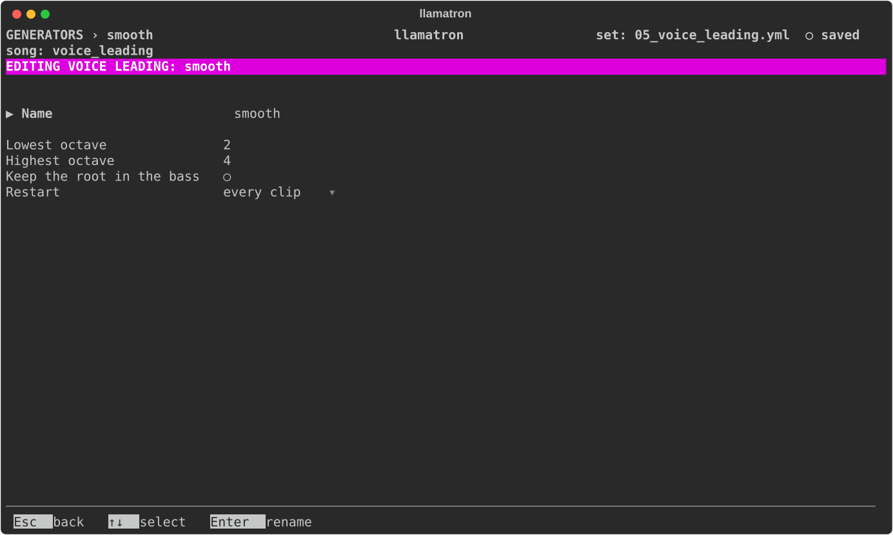

# Voice Leading

Chords played in root position jump around: C, then G, then Am, each built up from its root, moves every note a long way. A pianist plays G with its B at the bottom and F with its C at the bottom, so that the notes barely move. A voice leading does that for you: the first chord of a clip plays as written, and each chord after takes the inversion and the octave whose notes move least from the chord before. Single notes, such as a bass line's, are left alone.

## Settings

| Setting | What it does |
| --- | --- |
| Name | `Enter` renames it, and every chain using it follows. |
| Lowest octave, Highest octave | The chords stay within these octaves, shown in the set's octave labels, so that they don't drift up or down over a long piece. A chord no voicing fits plays as written. |
| Keep the root in the bass | Off by default. On, each chord's lowest written note stays where it is and only the notes above it are voiced, always above it, as a keyboard player plays beside a bass player. `Space` or `Enter` toggles it. |
| Restart | When it starts over, as [Generators](../GENERATORS.md#restart) describes; with "on new scene" or "whole song" a scene's first chord is voiced near the last chord before. |

## Applying the Generator

Add the Voice Leading generator to a chain after a progression, as `voice_leading: name`, or put it on any clip of chords. `examples/learning/05_voice_leading.yml` plays three progressions in root position, inverted by hand with the chord editor's Inv. row, and voice-led; the last scene of `examples/learning/06_chord_progression_generator.yml` voice-leads its pad.
