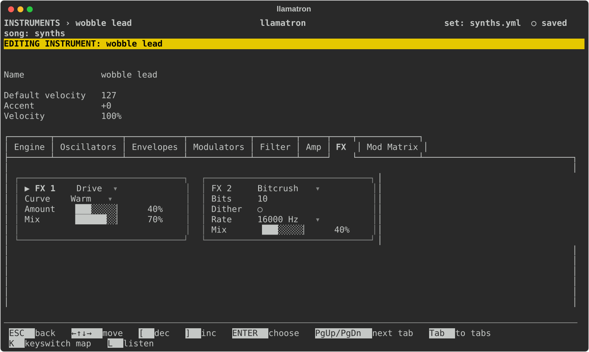

# Effects

The FX tab holds two effects, each empty until chosen, applied in order to the
whole instrument's sound after its voices are added together. Each has a Mix,
how much of the effect is heard against the sound that went into it.

## Drive

Drive shapes the sound by a curve, as an overdriven amplifier or a pedal does,
by its Amount. Soft and Warm saturate, rounding the peaks off smoothly; Warm
leans to one side first, so that the two halves of the wave are rounded
differently and even harmonics are added, as a tube's are. Leaning a sound and
then taking the lean's own level away again keeps silence silent, and the
curve is scaled so that it reaches full on one side and stays under it on the
other. Hard clips the peaks flat. Fold folds the wave back on itself past full
scale, and Wrap wraps it round to the other side, the harsh digital sounds of
cheap grooveboxes.

## Bitcrush

Bitcrush makes a sound lo-fi, as early samplers and game consoles were. Rate
holds each sample for as long as a lower sample rate would, so that high notes
alias into metallic tones. Each hold falls where the lower rate puts it, even
between samples, so that any Rate stays even and in tune, not only one that
divides the sample rate. Bits rounds each sample to fewer bits, which adds a
gritty hiss that follows the sound.

## Bax

Bax is a tone control, the two knobs, Bass and Treble, that every hi-fi
amplifier and many guitar amplifiers have, after the circuit Peter Baxandall
published in 1952. Bass lifts or cuts everything under about 100 Hz, the kick
and the bottom of a bass line, and Treble everything over about 10 kHz, the
air and sizzle of cymbals and bright synths, each from -15 dB to +15 dB, 0 dB
unless set. The shelves are gentle, 6 dB an octave, as on the circuit, so even
turned far the sound stays natural: a little Bass warms a thin lead, a cut of
Treble tames a harsh one. At 0 dB both pass the sound untouched. `Bksp` brings
a gauge back to 0 dB, and Mix blends the shaped sound with the plain one.

## MultiTap

MultiTap is a digital delay that plays the sound back at four moments, its
taps, each at its own loudness, so that one note becomes a rhythm of echoes:
with the taps on 1/8, 1/4, 1/4d and 1/2, as a new MultiTap starts, a single
stab turns into a little falling figure in time with the song.

Sync, on unless switched off, times each tap as a division of the beat that
follows the song's tempo, from 1/32 to 1/1, dotted (`d`) or triplet (`t`);
off, each tap's time is in milliseconds, from 1 to 4000. Time change says how
a tap reaches a new time, as a synced tap does when the tempo moves: Fade, as
a new MultiTap starts, crossfades from the old echo to the new one without a
click or a bend, and Glide slides the echo there, bending its pitch on the way
as a tape echo does.

Each Tap row has three cells: a switch, its time and its level. Left and Right
move between them, Space or ENTER turns the switch, which silences the tap
while keeping its level, and `[` and `]` step the time or level under the
cursor.

Feedback from chooses the tap sent back into the delay, Tap 4 as a new
MultiTap starts, and Feedback says how much, up to 90% so that it never runs
away: from the last tap the whole figure repeats, quieter each time, and from
an earlier tap the figure overlaps itself in a new rhythm. A tap switched off
sends nothing back. Tone darkens each repeat, as the echoes of a tape or an
old digital delay soften, from 500 Hz to 18 kHz, and Low cut thins each one,
from 20 Hz to 2 kHz, 80 Hz as a new MultiTap starts, so that the repeats of a
bass or a kick do not pile up into a rumble.

Mode chooses the kind of delay: Digital, clean and exact, as a new MultiTap
starts, or Analog, a model of the bucket-brigade chips of old analog echoes. In
Analog the four taps sit along one chain of stages moved by one clock, as on a
multi-tap chip, so a change of tempo slides every echo together and bends its
pitch on the way, and Time change is not shown. Choosing Analog starts the
delay on a warm dotted echo: taps on 1/8d at 80%, 1/4 switched off, 1/4d at 55%
and 1/2 at 35%, fed back from Tap 3 at 40%, Tone at 3.5 kHz and Low cut at
120 Hz. Five gauges, each from 0% to 100%, shape the device. Darkness takes
stages away, so that the clock runs slower for the same time and the echoes
grow darker and grainier, 35% as it starts. Noise is the hiss inside the
device, which rises and falls with the sound, as the device's compander makes
it breathe, 15%. Drive saturates each stage warmly, 30%. Wow is a slow drift of
the clock and Flutter a fast small wobble, each bending the echoes' pitch, 10%
and 5%; at 100% both are a seasick warble.

Mix sets how loud the echoes come in under the sound, which itself stays whole,
35% as a new MultiTap starts. The delay holds up to four seconds, a bar at 60
beats a minute.

## Planned

The agreed effects, by kind: Drive and Bitcrush for dirt, Bitcrush gaining a
gentle drive, a rate that can follow the note and its top bits as switches;
Legend and Spring for space; Chorus, Flanger, Phaser, Tremolo and Auto-pan,
and Rotary for motion; Tape, Tape Echo, Phone and Stutter for lo-fi and
glitch; and EQ and Filter for tone. The planned effects go in four FX blocks,
each with its own tab and presets.

Tape's wow is to be a moving read of a delay line: the sound is written into a
delay line as tape is written by a record head, and read back from a point
that drifts slowly back and forth, as a stretched tape's speed wavers, so that
the pitch bends a little and back. Since a delay line is read after the sound
has been written, the instrument's notes are started early by the delay's
length, so that the effect costs no lateness. Tape Echo shares the same code,
read at a fixed distance and fed back into itself for repeats.
