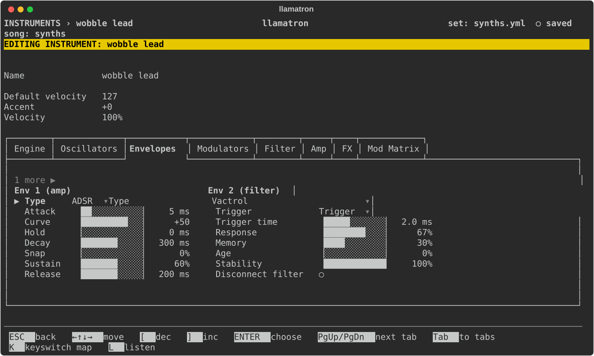
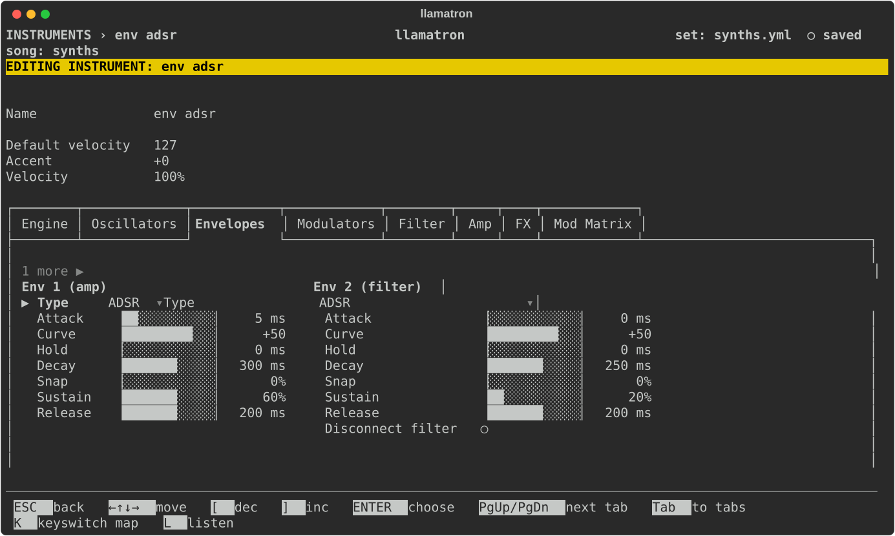
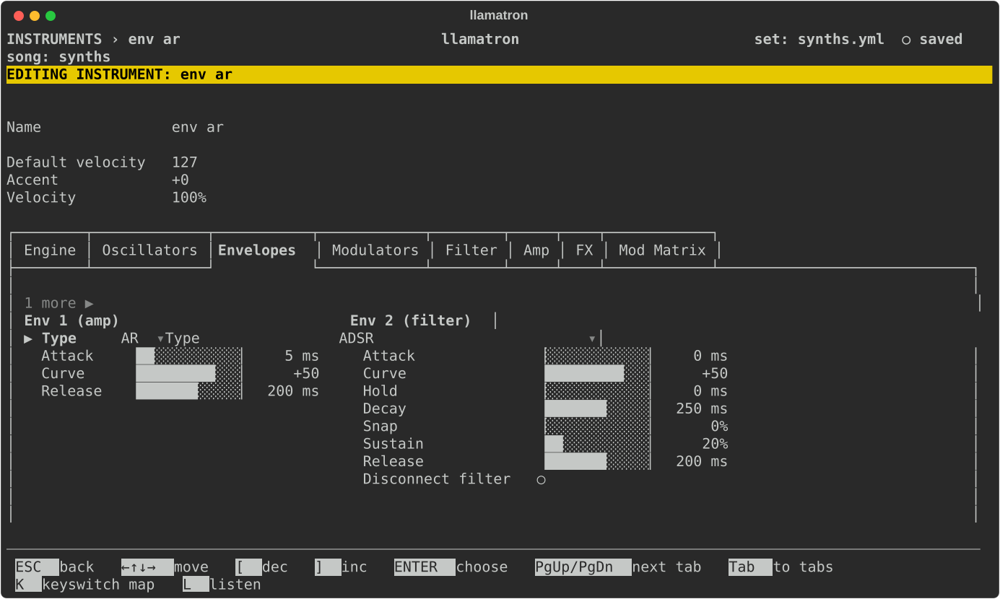
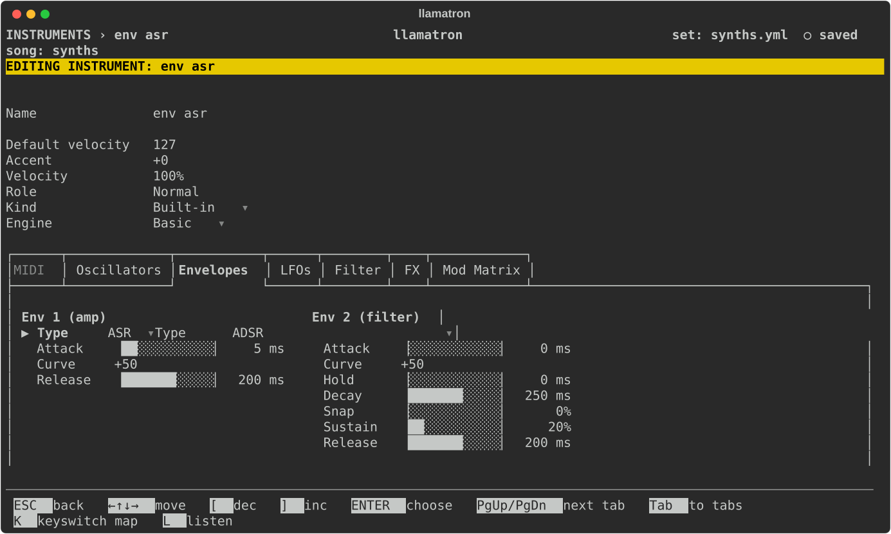
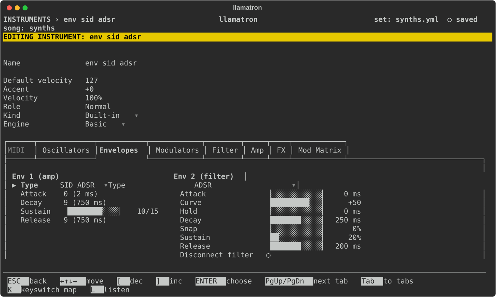
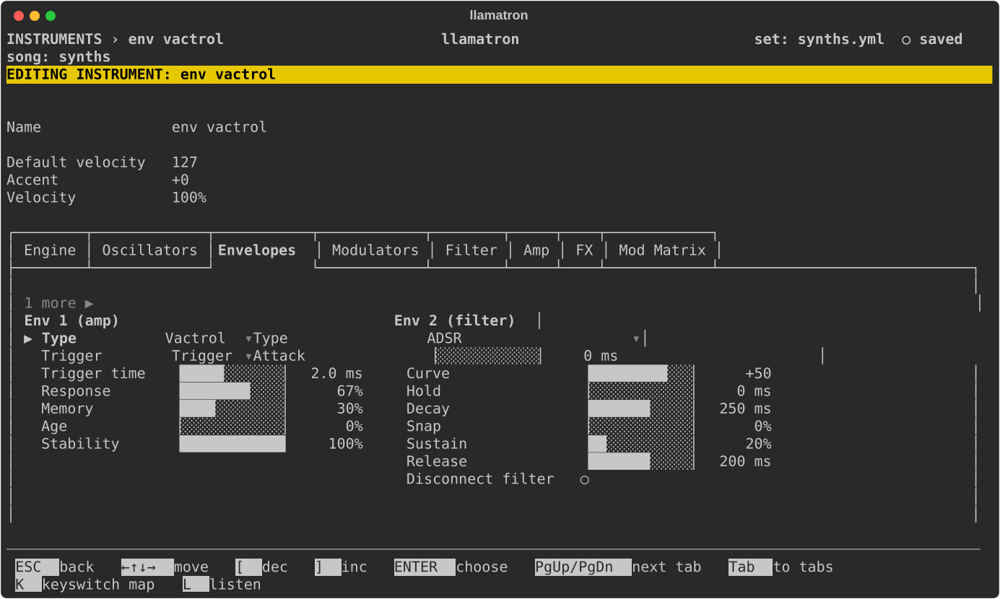
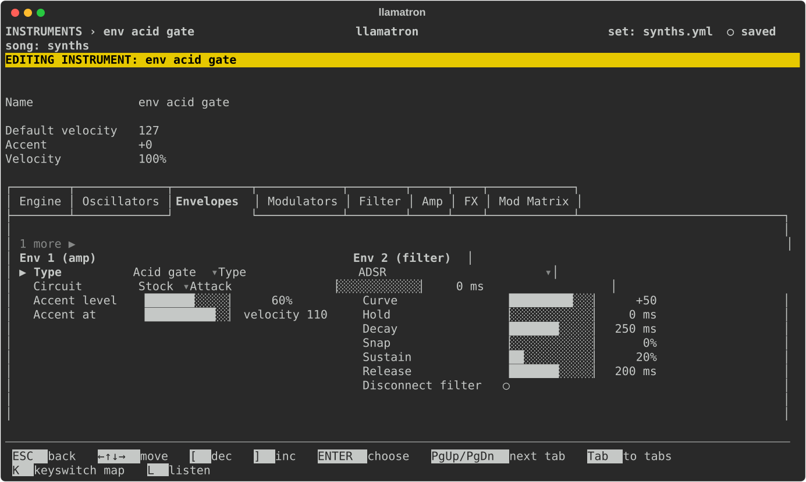
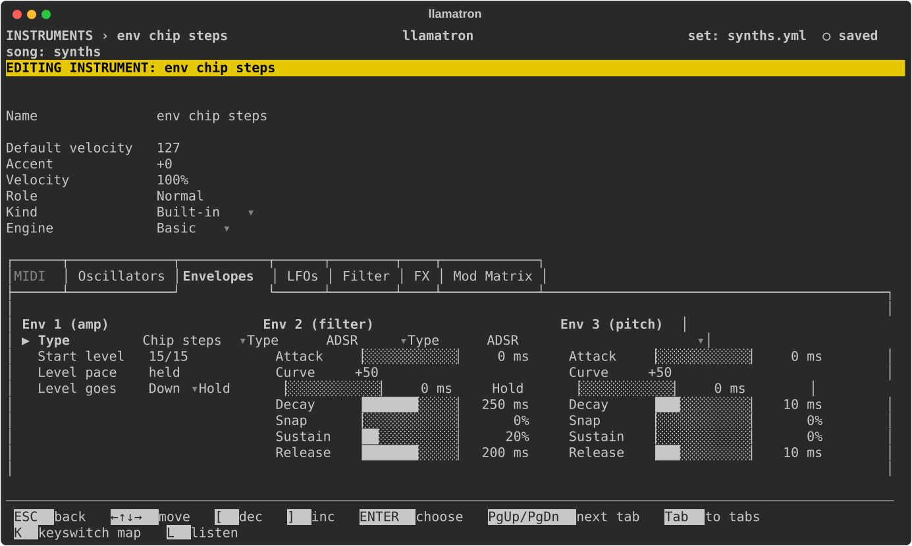

# Envelopes

An envelope is how a note rises and falls: the swell of a bowed string, the
sharp hit and quick fade of a pluck, the long glow of a pad. Every built-in
instrument has three, on the Envelopes tab, and each is wired in: Env 1 shapes
the loudness, Env 2 sweeps the filter through its Env amount, and Env 3 bends
the pitch through the oscillator's Pitch env. The [Mod Matrix](MOD_MATRIX.md)
can send any of them anywhere else too.

At the foot of Env 2's column, Disconnect filter, off unless switched on,
unhooks Env 2 from the filter: the cutoff then stays where the Filter tab sets
it, and Env 2 is free for the Mod Matrix to send elsewhere, such as to the
pulse width or to an LFO's depth through a Via.

## Swappable Envelopes

Swappable envelopes are a key part of the synths' design. Most synthesizers
have one kind of envelope and only let you change its times. Here each of the
three envelope slots holds an envelope of any type, and the types are not
variations of one design: each is its own circuit, with its own way of moving
and its own settings. A chip voice can fade in its chip's own steps or be
given a smooth ADSR; an acid bass can keep its accent gate or be struck
through a vactrol, whose light-sensitive cell falls unevenly and remembers the
last hit; a pad can swell with a slow curved attack. Changing an envelope's
type changes how an instrument feels to play as much as changing its
oscillator, and the envelopes are where many of the engines' characters live,
so mixing one engine's oscillator with another's envelope is how the synths'
strangest and most personal sounds are found.

Every envelope works its level out from the time into its note, in one
formula, rather than by stepping from one sample to the next, so that a note
sounds the same whichever chunk of sound it falls in, live and in a WAV export
alike.

Every envelope can be very snappy and tight, yet none clicks: the quickest
rise takes half a millisecond and the quickest fall two, as quick as the
snappiest analog envelopes, so that a time of 0 ms is as short as a note can
start or stop without a tick. A vactrol falls in no less than four
milliseconds, and Chip Steps ease in their first level over the same half
millisecond.

## ADSR

The envelope of most synthesizers. It rises over its Attack, stays at the top
for its Hold, falls over its Decay to its Sustain while the note is held, and
falls from wherever it is over its Release once the note ends. On an
instrument of one voice, a note struck while the last still sounds starts its
attack from where the envelope had reached, keeping the oscillators running,
so that striking again never clicks.

The Curve sets the attack's shape. Above zero it is the charge of a capacitor
in an analog envelope circuit: the level chases a target set above full, so
that it rises fast and slows as it nears the top, reaching full on time; the
higher the curve, the nearer the target and the more bowed the rise. At zero
the rise is a straight ramp. Below zero it is an exponential swell, slow at
first and rushing at the end, as a hand pushes a fader up. The decay and the
release are exponential falls, as a capacitor discharges, each set by how long
the fall takes to become inaudible. Snap mixes in a second, much faster fall
at the start of the decay, which gives a hit its click without shortening its
body.

## AR

A strike: the envelope rises over its Attack and falls over its Release at
once, however long the note is held, as a drum or a plucked string does. A
note's velocity sets how hard it is struck.

## ASR

An organ's envelope: it rises over its Attack, holds at full for as long as
the note is held, and falls over its Release once it ends.

## SID ADSR

The envelope of an 8-bit sound chip, as the chip makes it. Each of its four
settings is a step of the chip's own table rather than a time, and the field
shows the time each step stands for. The level is a counter: the attack counts
it up at a steady rate; the decay and the release count it down through an
exponential counter that is divided into segments, each slower than the last,
so that the fall is a chain of straight lines bending towards silence, the
chip's way of faking an exponential curve. The sustain is one of the chip's
sixteen levels, and the level heard is always the counter's whole steps, so a
slow fade has the chip's faint staircase.

## Vactrol

A vactrol is a light and a light-sensitive cell sealed together, used in the
low-pass gates of modular synthesizers. A strike lights the light, and the
cell's conductance rises towards it, faster the brighter it is lit; when the
light goes out, the cell falls in a hyperbolic curve, quick at first and then
lingering, to a tenth over the cell's fall time, with a slow leak under its
tail, so that a strike is a pluck with a body, as loud to the ear as a note
of any other envelope. Because the rise depends on how
brightly it is lit, a hard strike is snappy and a soft one lingers, so no two
hits sound alike.

Response is how fast the cell is, from fast at 0% to lazy at 100%. Trigger is
a short flash at each note, lasting its Trigger time, or the Gate, lit for as
long as the note is held. Memory is how much of the cell's last glow carries into the next
hit, so that hits close together build on each other, as a real cell's do. Age
dims the light and slows the cell, as an old one does. Stability is how alike
each hit is: below full, each hit draws its own small differences in rise,
fall and brightness from a seeded random source, the same at every playing,
and the room's slowly changing warmth drifts them further.

The cell also remembers its light over a longer time, as a real one does. Kept
lit, it tires within a second or so and answers each strike more slowly, up to
twice as slowly; left dark for a minute or more, it rests and is quick again.
A passage played hard softens its attacks as it goes on, and the first notes
after a rest snap. A gated note tires the cell for as long as it is held.

## Acid Gate

The envelope of an acid bass line. Each note opens quickly over its Soft
attack and decays over its Amp decay. A note at Accent at's velocity or louder
is accented: it opens at once, swells for a moment by its Accent level, and
gives the filter a short extra sweep that falls over its Accent decay. Behind
the accent is a capacitor, charged a little by each accented note, in
proportion to the filter's resonance and the Accent sweep, and draining
between notes; a run of accents close together charges it further, so the
filter climbs higher with each one, the squelch of an acid line.

Its Circuit is Stock or Modded. Stock plays the circuit's own accent decay,
accent sweep, amp decay and soft attack. Modded shows them, as the
modifications players made to the original machine let them be set.

## Chip Steps

The volume envelope of a 4-bit chip, which has no smooth curves at all. The
level starts at its Start level, one of sixteen steps, and at each tick of its
Level pace moves one step down, or up, by Level goes. Held, it stays where it
starts. A note's end fades it out very quickly, so that it doesn't click.

## Off

Env 2 and Env 3 can be set to Off, which holds them at nothing: Env 2 then
sweeps no filter and Env 3 bends no pitch, and the Mod Matrix reads nothing
from them. With Env 2 Off and the Filter set to (none), you hear the
oscillator as it is, a quick way to learn what an oscillator sounds like. Env
1 is the loudness, so it always holds an envelope.

## Planned

The agreed design adds a fourth envelope, and two inputs to the gate types: a
low-pass gate envelope, which brings its own low-pass filter and amp following
the vactrol's response, and a strike and a gate that the Mod Matrix can route
to either.
