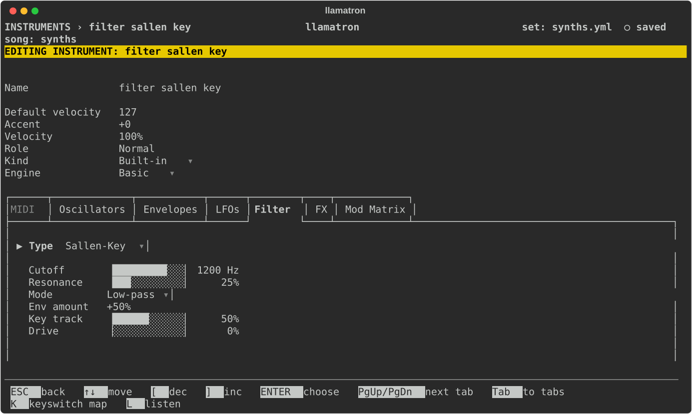
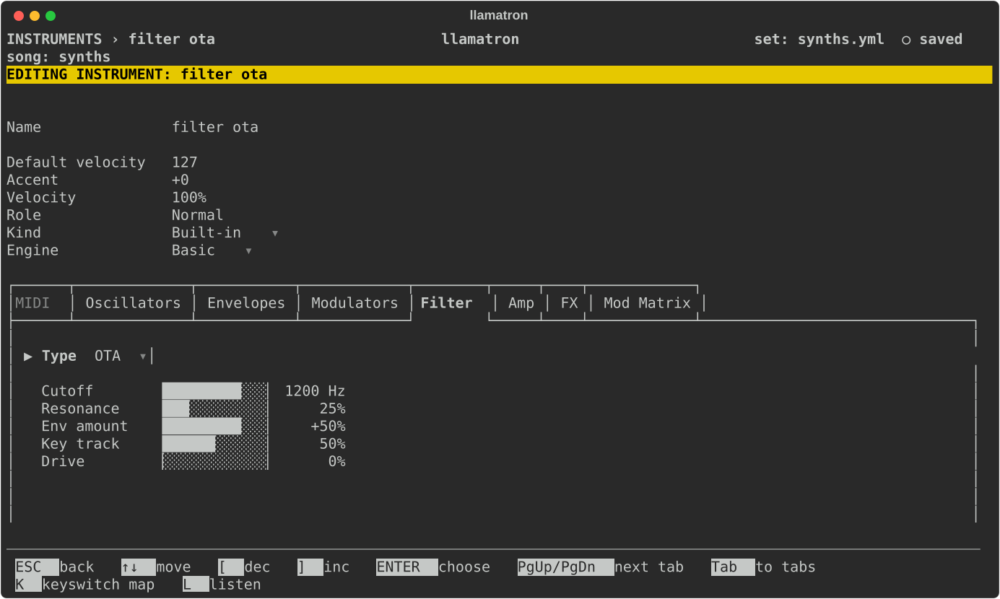

# Filters

A filter takes away part of the sound, as the knob that makes a synth darker
or brighter does. The Filter tab holds one filter, or the low-pass gate, or
none.

Cutoff is where the filter starts cutting, in hertz. Env 2 opens it on each
note by its Env amount, a share of several octaves; below zero, Env 2 closes
it instead. Key track moves the cutoff with the note, so that a high note is
as bright as a low one. Drive pushes the sound into the filter for grit. The
cutoff is moved in octaves, by all of these and the [Mod
Matrix](MOD_MATRIX.md) together, sample by sample.

## How the Filters Are Built

Every filter is a zero-delay-feedback model, made with the topology-preserving
transform. An analog filter is a loop: its output feeds back to its input with
no delay at all. A simple digital filter has to wait one sample to feed back,
which detunes it and lets it blow up when its cutoff moves fast. Here, each
sample, the loop is solved exactly, as one equation, before anything is passed
on, so that the filter behaves as its circuit does at every cutoff, and the
cutoff can sweep as fast as an envelope moves it with no stepping and no
blow-up. The filter's coefficients are worked out again every few samples, too
often for any ear to hear as steps. Each filter's state is flushed to zero
once its tail falls below what can be heard, so that a long fade never slows
into the tiny numbers a processor is slow with.

## Ladder

The warm four-pole filter of the traditional monosynths: four one-pole stages
in a row, the last one's output fed back to the input through a saturating
stage. At full Resonance the loop's gain passes the point where it rings on
its own, and the saturation holds that ringing to a clean sine, so it whistles
as the transistor ladder does, never growing without bound. As the resonance
rises the bass thins, also as the circuit's does, and the output makes some of
it up again. Slope taps an earlier stage for a gentler filter of one, two or
three poles, the feedback still taken from the last.

## Multimode

A state-variable filter: two integrators in a loop, which give a low-pass, a
band-pass and a high-pass at once, and a notch from their sum. Mode picks
which is heard, and the resonance sets its Q, how sharply it peaks at the
cutoff.

## Sallen-Key

The aggressive two-pole filter of early semi-modular monosynths, low-pass or
high-pass, modelled on its circuit. Two one-pole sections pass the sound, and
a third, a high-pass, sits in the feedback loop, so the resonance peaks hard
and thin rather than round. The loop saturates: Drive pushes the saturation
inside the loop rather than the sound going in, so a driven, resonant
Sallen-Key growls and screams rather than only getting louder. As the
resonance nears the top the loop saturates harder, so the peak turns from a
whistle into a snarl; full resonance rings long after each note but stops
just short of self-oscillating, so the filter never holds a tone of its own.

## Diode

The squelchy, liquid filter of acid bass lines, after Open303's model of the
original circuit. It is four stages in a ladder with a high-pass inside its
feedback loop: as the resonance rises, the bass thins and the peak sings
rather than booms, and it stops short of ringing on its own. It runs at four
times the sample rate, so that its peak stays clean high up, and after it an
all-pass, a high-pass and a notch shape the low end as the circuit's coupling
does. Its Env amount follows the circuit's measured mapping: the higher the
amount, the further the envelope sweeps, and the lower the sweep starts.

Its Circuit is Stock or Modded. Modded shows Filter FM, the oscillator itself
moving the cutoff, which adds growl.

## OTA

A creamier four-pole ladder, with a softer drive before it, as filters built
on transconductance amplifiers sound.

## Low-pass Gate

The filter and the amp of modular synthesizers in one: a single
light-sensitive cell, lit by Env 1, sets both how loud the note is and how
bright, so that the sound darkens as it fades, like a struck object. It is
never two envelopes; it is always each note's own, since it is that note's
amp. With a [vactrol](ENVELOPES.md#vactrol) on Env 1, it is the classic pluck
and bonk.

Mode is VCA, the loudness alone; Lowpass, the cutoff alone, through a resonant
two-pole filter, so that a falling cutoff rings a pitch that drops as the gate
closes; or Both, loudness and a one-pole filter's cutoff together. Input feeds
the gate the Oscillator, a Ping, or both: a ping is a short strike at each
note rung through the gate, which with some resonance makes a pitched bongo or
log drum with no oscillator at all. Open is the cutoff fully lit, and Key
track moves it with the note, so that a pinged gate plays in tune.

## Planned

The agreed filter types, each its own circuit with its original's controls:
Ladder, Diode, OTA, State Variable (its Mode sweeping from low-pass through
notch to high-pass), Scream, Comb, Formant, Resonator and SID. The low-pass
gate becomes an envelope type, so that the Filter slot stays free before it.
