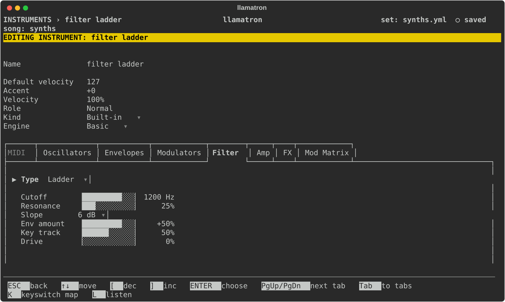
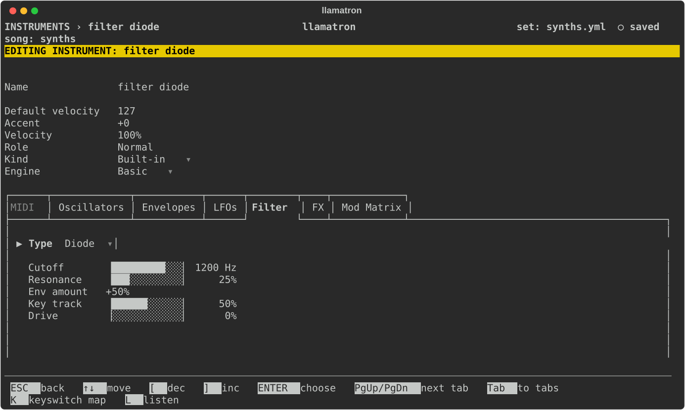
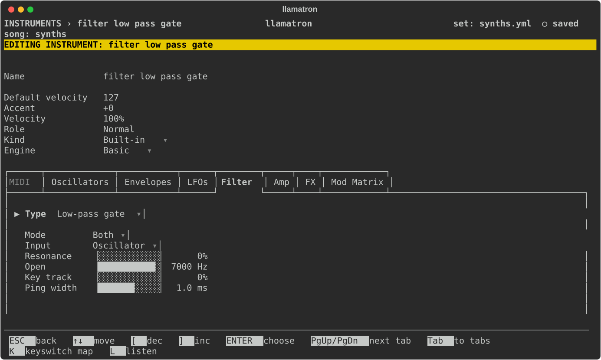

# Filters

A filter takes away part of the sound, as the knob that makes a synth darker
or brighter does. The Filter tab holds one filter, or the low-pass gate, or
none.

Cutoff is where the filter starts cutting, in hertz. Env 2 opens it on each
note by its Env amount, a share of several octaves; below zero, Env 2 closes
it instead. Key track moves the cutoff with the note, so that a high note is
as bright as a low one. Drive pushes the sound into the filter for grit; any
driven filter runs its Drive at twice the sample rate or more, smoothed so that
a high note driven hard stays clean rather than whistling. The
cutoff is moved in octaves, by all of these and the [Mod
Matrix](MOD_MATRIX.md) together, sample by sample.

## How the Filters Are Built

Every filter is a zero-delay-feedback model, made with the topology-preserving
transform. An analog filter is a loop: its output feeds back to its input with
no delay at all. A simple digital filter has to wait one sample to feed back,
which detunes it and lets it blow up when its cutoff moves fast. Here, each
sample, the loop is solved exactly, as one equation, before anything is passed
on, so that the filter behaves as its circuit does at every cutoff, and the
cutoff can sweep as fast as an envelope moves it with no stepping and no
blow-up. The filter's coefficients are worked out again every few samples, too
often for any ear to hear as steps. Each filter's state is flushed to zero
once its tail falls below what can be heard, so that a long fade never slows
into the tiny numbers a processor is slow with.

## Ladder

The warm four-pole filter of the traditional monosynths, modelled on its
circuit: four stages, each a pair of transistors charging a capacitor, the
last stage's voltage fed back to the pair at the input. Each pair bends its
curve as it is pushed, so a loud note darkens and thickens rather than only
getting louder, and a driven Ladder growls. At full Resonance the loop's gain
stops just short of the point where it would ring on its own, so the peak
rings strongly when the sound excites it and always dies away; no filter here
holds a tone of its own.

No two analog ladders sound quite alike, since their parts are never exactly
matched, and each instrument's Ladder is a unit of its own in the same way:
its capacitors are a little off their values and its transistor pairs a
little off balance, which adds the soft even harmonics a perfectly matched
filter lacks. The same instrument always sounds like the same unit, and two
instruments sound like two. The circuit's warmth also wanders very slowly, as
a real one's does with temperature, so that a held note breathes.

The Ladder runs at four times the sample rate, and at eight once Drive is
turned up, so that the harmonics its curves make above hearing are filtered
away rather than folding back down as harsh, out-of-tune whistles. As the
resonance rises the bass thins, as the circuit's does; Bass comp, at 80% unless
set, gives most of the bass back, so that a resonant bass keeps its weight;
turned down to 0% it leaves the circuit's own thinner sound. Slope taps an earlier stage for a gentler filter of one,
two or three poles, the feedback still taken from the last.

## Multimode

A state-variable filter: two integrators in a loop, which give a low-pass, a
band-pass and a high-pass at once, and a notch from their sum. Mode picks
which is heard, and the resonance sets its Q, how sharply it peaks at the
cutoff. Its band integrator saturates softly, so a loud, resonant peak is held
round rather than ringing out of bounds, while quiet sounds pass as before.

On every filter, a cutoff the Mod Matrix moves at audio rate, by an
oscillator or an LFO at Very High speed, is worked out afresh every sample, so
that filter FM is smooth rather than stepped.

## Sallen-Key

The aggressive two-pole filter of early semi-modular monosynths, low-pass or
high-pass, modelled on its circuit. Two one-pole sections pass the sound, and
a third, a high-pass, sits in the feedback loop, so the resonance peaks hard
and thin rather than round. The loop saturates: Drive pushes the saturation
inside the loop rather than the sound going in, so a driven, resonant
Sallen-Key growls and screams rather than only getting louder. As the
resonance nears the top the loop saturates harder, so the peak turns from a
whistle into a snarl; full resonance rings long after each note but stops
just short of self-oscillating, so the filter never holds a tone of its own.

## Diode

The squelchy, liquid filter of acid bass lines, after Open303's model of the
original circuit. It is four stages in a ladder with a high-pass inside its
feedback loop: as the resonance rises, the bass thins and the peak sings
rather than booms, and it stops short of ringing on its own. It runs at four
times the sample rate, so that its peak stays clean high up, and after it an
all-pass, a high-pass and a notch shape the low end as the circuit's coupling
does. Its Env amount follows the circuit's measured mapping: the higher the
amount, the further the envelope sweeps, and the lower the sweep starts.

Its Circuit is Stock or Modded. Modded shows Filter FM, the oscillator itself
moving the cutoff, which adds growl.

## OTA

A creamier four-pole ladder, with a softer drive before it, as filters built
on transconductance amplifiers sound. Driven, or set past half its Resonance,
it runs at twice the sample rate, so that its saturation's harmonics are
filtered away rather than folding back down, as the Sallen-Key does.

## Low-pass Gate

The filter and the amp of modular synthesizers in one: a single
light-sensitive cell, a vactrol, sets both how loud the note is and how
bright, so that the sound darkens as it fades, like a struck object. On the
Filter tab it is each note's own, and the [Amp](AMP.md) still follows it, so
that the gate can shape the tone while another envelope shapes the loudness.
The same gate can stand in the Amp's place instead, as the note's last stage
([Amp](AMP.md#low-pass-gate)).

Trigger chooses what lights the cell: Trigger, a short flash at each note
lasting its Trigger time; Gate, lit for as long as the note is held; or the
level of Env 1, Env 2 or Env 3, smoothed by the cell as it follows, as on the
hardware, where an envelope only lights the lamp. Mode is Lowpass, the cutoff
alone, through a resonant two-pole filter, so that a falling cutoff rings a
pitch that drops as the gate closes; or Both, loudness and a one-pole
filter's cutoff together. Signal feeds the gate the Oscillator, a Ping, or
both: a ping is a short pulse at each note, lasting its Ping time, rung
through the gate, which with some resonance makes a pitched bongo or log drum
with no oscillator at all. Open is the cutoff fully lit, and Key track moves
it with the note, so that a pinged gate plays in tune. Response, Memory, Age
and Stability are the cell's own, the same as the
[vactrol envelope's](ENVELOPES.md#vactrol).

## Planned

The agreed filter types, each its own circuit with its original's controls:
Ladder, Diode, OTA, State Variable (its Mode sweeping from low-pass through
notch to high-pass), Scream, Comb, Formant, Resonator and SID. The low-pass
gate becomes an envelope type, so that the Filter slot stays free before it.
